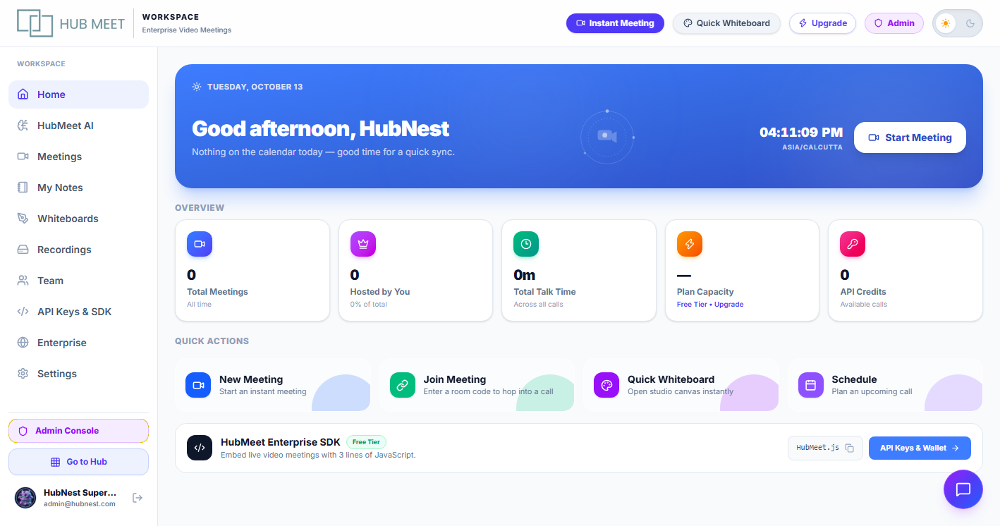
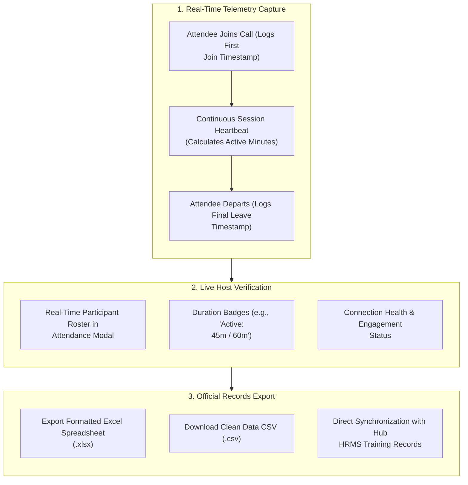

# 09. Live Attendance Tracking & Records Export

For company training sessions, all-hands meetings, compliance seminars, and university lectures, manually tracking who attended and how long they stayed is tedious and prone to errors. HubMeet includes an automated **Live Attendance Tracker** (`AttendanceModal`) that logs attendee participation in real time and offers one-click exports to Excel and CSV.

---

## 🏛️ Live Interface Overview

Below is the layout of the **HubMeet Live Attendance Management Modal**:

---

## 🧭 Live Attendance Capture Architecture

The flowchart below demonstrates how attendance data is automatically tracked during calls and exported for company records:

---

## 📋 What is Recorded in the Attendance Log

The attendance system maintains an accurate audit record for every attendee who joins the call:

| Data Field | Description | Compliance Value |
| :--- | :--- | :--- |
| **Participant Name** | Full display name of the attendee. | Confirms attendee identity. |
| **Official Email** | Registered corporate account or guest email address. | Ensures verified corporate recordkeeping. |
| **Join Timestamp** | Exact date and time the user entered the room (e.g., `10:02:15 AM`). | Identifies punctuality and on-time arrival. |
| **Leave Timestamp** | Exact moment the attendee exited the call (e.g., `11:00:04 AM`). | Detects early departures. |
| **Total Duration** | Cumulative time spent in the meeting room in minutes. | Verifies whether training hour quotas were fulfilled. |
| **Status Badge** | `ACTIVE NOW 🟢` or `DEPARTED ⚪`. | Real-time presence indicator. |

---

## ⚙️ How to View and Export Attendance Records

### Step 1: Open the Attendance Modal During a Call
1. As the host or co-host, click the **Attendance** icon on the bottom control bar or in the Participants drawer.
2. The live modal opens, displaying all attendees currently in the room as well as anyone who already departed.

### Step 2: Search and Inspect Attendees
* Type in the search box to find a specific attendee by name or email.
* Review total attendee count and average session duration at the top of the modal.

### Step 3: Export the Attendance Sheet
1. Click the **Export** button in the modal header.
2. Choose your preferred format:
   - **Excel (.xlsx)**: Pre-formatted spreadsheet with color-coded headers and summary formulas, ready for HR submission.
   - **CSV (.csv)**: Clean tabular data ready for automated payroll or learning management system (LMS) ingestion.
3. The report downloads immediately to your computer.

---

## 🔗 Syncing Attendance with Hub HRMS

For companies using both **HubMeet** and **Hub HRMS**:
* Attendance from company training sessions can be linked directly to employee **Learning Management (LMS)** completion records.
* Managers can confirm attendance for mandatory compliance webinars without collecting paper sign-in sheets.

---

## 💡 Best Practices

> [!TIP]
> **Export Immediately After Call Concludes:** While attendance logs remain saved in your post-meeting dashboard, exporting the Excel file immediately after ending the call ensures you have an instant offline copy for your team records.
