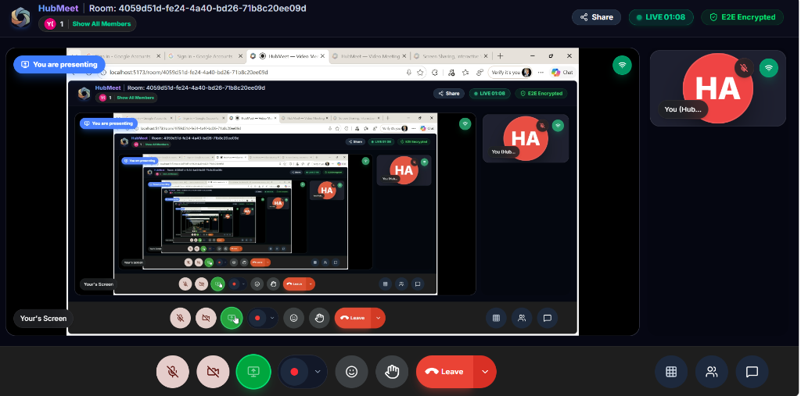
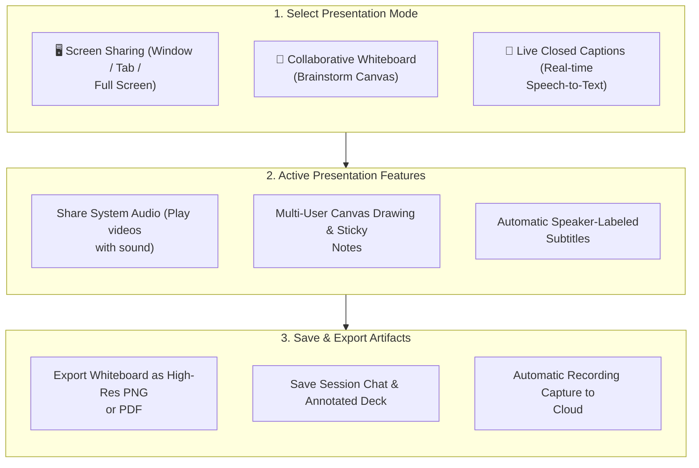

# 04. Screen Sharing & Whiteboard Collaboration

Collaboration lies at the heart of productive meetings. HubMeet provides powerful interactive tools that turn passive calls into hands-on working sessions, including high-definition screen sharing with system audio, a real-time collaborative whiteboard, and live closed captions.

---

## 🏛️ Live Interface Overview

Below is the live console layout of **HubMeet High-Definition Screen Sharing in Action**:

---

## 🧭 Collaboration & Presentation Architecture

The flowchart below demonstrates how presenters share content and interact with attendees in real time:

---

## 🖥️ Screen Sharing Walkthrough

Whether walking through slide decks, reviewing software designs, or conducting product demos, HubMeet ensures smooth, low-latency screen delivery.

### How to Start Screen Sharing
1. Click the **Share Screen** (`🖥️`) button on the bottom control bar.
2. Select your presentation source:
   - **Entire Screen**: Ideal when switching between multiple desktop applications, code editors, and spreadsheets.
   - **Application Window**: Shares only a single program (e.g., Microsoft PowerPoint or Figma). Your personal notifications and other windows remain completely private.
   - **Browser Tab**: Perfect for web demos and online video playback. Offers the smoothest frame rate.
3. **Sharing Audio**: Check the **Share System Audio** checkbox if your presentation contains video clips or sound.
4. Click **Share**. A blue indicator banner confirms that your screen is broadcasting.

### How to Stop Screen Sharing
* Click the red **Stop Sharing** button at the top of your screen or re-click the screen icon on the bottom navigation bar.

---

## 🎨 Interactive Whiteboard (`WhiteboardEditor`)

The built-in digital whiteboard allows distributed teams to brainstorm ideas, sketch system diagrams, and map user journeys simultaneously on an infinite shared canvas.

### Core Whiteboard Drawing & Upload Capabilities
* **Full Toolset**: Features selection pointer (`V`), precision vector pen (`P`), geometric shapes (`S`), rich typography text blocks (`T`), and vector eraser (`E`).
* **Sticky Notes**: Add colorful movable cards (`N`) for agile sprint retrospectives and idea grouping.
* **Universal File & Media Ingestion**: Click the **Upload icon (`🖼️`)** or drag-and-drop **Images (.PNG, .JPG, .SVG), PDF Documents (.PDF), and Excel Spreadsheets (.XLSX, .CSV)** directly onto the canvas to markup contracts, financial figures, or UI mockups collaboratively.
* **1-Click High-Res Download (`📥`)**: Export all canvas drawings and markup as a **High-Resolution PNG Image**, **Lossless SVG**, or **Printable Multi-Page PDF Document**.
* **Multi-Sheet Workbooks (`+ New Sheet`)**: Add unlimited presentation sheets to your board without crowding a single view.

*(For the complete exhaustive tool-by-tool breakdown and workflow guide, see [06. Interactive Collaborative Whiteboard](whiteboard.md)).*

---

## 📝 Real-Time Live Closed Captions

For noisy environments, hearing-impaired team members, or multilingual calls, HubMeet offers live automated subtitles:

1. Click the **More Options** (`...`) button on the control bar.
2. Select **Turn On Live Captions**.
3. Live subtitles appear cleanly at the bottom of the video grid with real-time speaker identification tags (e.g., *[Rahul]: "Let's review the quarterly targets"*).
4. Each attendee controls their own caption display without affecting what other attendees see.

---

## 💡 Best Practices

> [!TIP]
> **Use Browser Tab Sharing for Video:** When presenting YouTube videos or product animations, share the specific browser tab rather than your entire desktop to ensure maximum video smoothness and synchronized audio.
