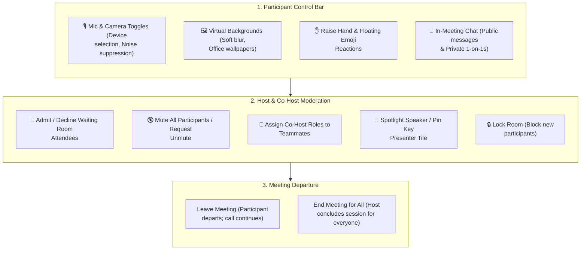

# 03. In-Call Controls & Host Tools

Once inside an active HubMeet call, attendees and hosts have complete control over their audio, video, interaction, and meeting flow through an intuitive bottom navigation bar and flyout side drawers.

---

## 🏛️ Live Interface Overview

Below is the layout of the **HubMeet In-Call Controls & Participant Console**:

---

## 🧭 In-Call Interaction & Host Control Architecture

The flowchart below outlines how controls, permissions, and moderation tools interact during a live meeting:

---

## 🎛️ Bottom Control Bar Walkthrough

The bottom bar provides quick access to your most frequently used meeting actions:

| Icon / Control | Primary Function | Keyboard Shortcut |
| :--- | :--- | :--- |
| **🎙️ Microphone** | Click to mute or unmute your microphone. Click the arrow (`▴`) to select input devices or adjust noise cancellation. | `Spacebar` (Push-to-talk) / `M` |
| **📹 Camera** | Click to turn your webcam on or off. Click the arrow (`▴`) to choose virtual backgrounds. | `V` |
| **🖥️ Share Screen** | Present your entire screen, an application window, or a browser tab with audio. | `S` |
| **✋ Raise Hand** | Signals to the host that you have a question; moves your tile to the top of the queue. | `H` |
| **🎉 Reactions** | Send floating applause, thumbs up, heart, laughter, or celebration emojis. | — |
| **💬 Chat** | Opens the in-meeting chat drawer for group text or private messages. | `C` |
| **👥 Participants** | Opens the attendee roster with host management options. | `P` |
| **🛑 Leave / End** | Exit the call or conclude the session for all attendees. | — |

---

## 🛡️ Host & Co-Host Moderation Tools

Meeting creators automatically receive **Host** privileges. Hosts can designate trusted colleagues as **Co-Hosts** to assist with moderating large discussions.

### 1. Managing the Waiting Room (Lobby)
When the Waiting Room is active:
* A notification chime sounds and a banner appears whenever a guest arrives.
* Click **Admit** to welcome them into the room, or **Deny** if they are unrecognized.
* Click **Admit All** in the participant drawer to let everyone in at once.

### 2. Muting Participants
* **Mute an Individual**: Hover over any participant's video tile or find their name in the participant list, click the three dots (`...`), and select **Mute**.
* **Mute All**: Click **Mute All** at the top of the participant list. A confirmation dialog lets you choose whether attendees are allowed to unmute themselves.
* **Request Unmute**: To respect attendee privacy, hosts cannot force-unmute microphones. Clicking **Ask to Unmute** sends a polite on-screen prompt to the attendee.

### 3. Spotlighting Presenters & Pinning Tiles
* **Pin Tile**: Pins a specific speaker or presentation tile large on your personal screen without altering what other attendees see.
* **Spotlight for Everyone**: Forces the selected speaker or slide deck to appear large on every attendee's screen.

### 4. Locking the Meeting Room
Once all invited guests have arrived:
1. Open the **Participants** drawer.
2. Click **Room Settings** (`⚙️`).
3. Toggle **Lock Meeting**.
4. No new attendees can enter the call, even if they have the link and passcode.

---

## 💬 In-Meeting Chat & File Sharing (`InMeetingChatDrawer`)

The built-in chat drawer allows team members to share notes, questions, links, and documents without interrupting the active speaker:

### 1. Messaging Channels
* **Everyone Channel**: Broadcasts messages, links, and questions to all call attendees.
* **Direct 1-on-1 Messages**: Select a specific person from the recipient dropdown to send private notes visible only to you and that person.
* **Voice-to-Text Dictation**: Instead of typing on your keyboard, click the **Microphone icon (`🎙️`)** in the chat box to dictate your message aloud in your preferred language.

### 2. File Sharing & Document Attachments (`📎`)
Need to share a PDF contract, design mockup, or spreadsheet during the call? You can upload files directly into the chat:
1. Click the **Paperclip icon (`📎`)** located right next to the chat text bar.
2. Select any file from your computer (supports PDFs, Excel sheets, Word documents, images, and text files up to **21 MB**).
3. The file uploads instantly into the meeting stream with a clean card showing:
   - File icon & exact file name (e.g., `Architecture_Design_v2.pdf`).
   - Dedicated **Download button (`⬇️`)** so all participants can download the file to their device with one click.
4. **Security Protection**: All file transfers run over secure channels with verified download links.

### 3. Chat Archival
* Meeting chat history and shared document attachments are preserved and remain accessible to the host on the post-meeting review dashboard.

---

## ⌨️ Essential Keyboard Shortcuts Reference

For power users who prefer fast keyboard control without clicking around with the mouse:

| Action | Shortcut Key | What Happens |
| :--- | :---: | :--- |
| **Mute / Unmute Microphone** | `M` | Toggles your personal microphone on or off. |
| **Push-to-Talk (Temporary Unmute)** | `Hold Spacebar` | Unmutes while held; mutes immediately upon release. |
| **Turn Camera On / Off** | `V` | Toggles webcam video stream. |
| **Start / Stop Screen Share** | `S` | Opens browser window picker to share presentation. |
| **Raise / Lower Hand** | `H` | Moves your participant tile to the top of the host's queue. |
| **Toggle In-Meeting Chat** | `C` | Opens or closes the side chat drawer. |
| **Toggle Participant Roster** | `P` | Opens or closes the attendees drawer. |

---

## 🛡️ Beginner Guide: How to Moderate a Meeting as Host

If you created the meeting or were assigned as Co-Host, here is how you keep the call productive and quiet:

1. **When Background Noise Arrives**: If someone forgets to mute their mic and you hear noise, open the Participant drawer (`P`) and click **Mute All**. A prompt will appear: leave "Allow participants to unmute themselves" checked.
2. **When an Unknown Person Joins**: Look at the Waiting Room lobby. If their name or email is unknown, click **Deny**. They will be disconnected safely without disrupting your room.
3. **When a Guest Disrupts the Call**: Click the three dots (`...`) next to their name in the attendee list, and select **Remove Participant**. They will not be able to re-enter using the same link.
4. **Lock Room for Maximum Security**: Once all team members are present, open Settings (`⚙️`) and turn on **Lock Meeting**. Even if your link is leaked, no outsider can enter.

---

## 💡 Best Practices

> [!TIP]
> **Use Push-to-Talk in Busy Rooms:** When in large company calls, stay muted and hold down the `Spacebar` while speaking. When you release the key, your microphone automatically mutes again.

> [!NOTE]
> **E2EE Privacy Indicator:** The top header badge displays **🟢 E2E Encrypted** during the call. This confirms media packets are scrambled end-to-end and cannot be intercepted.
