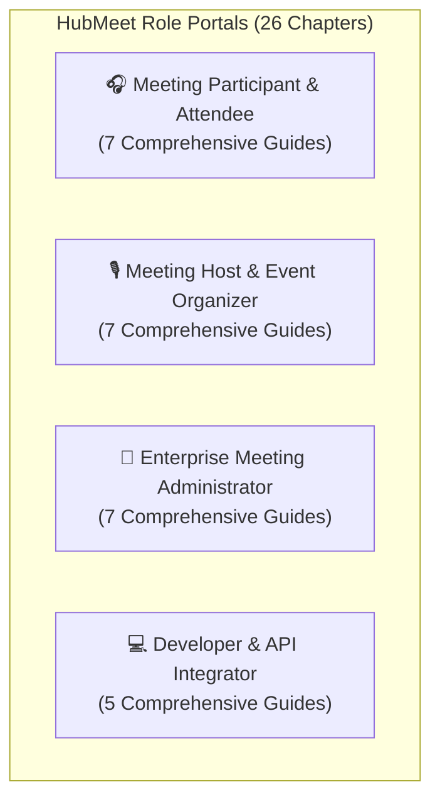
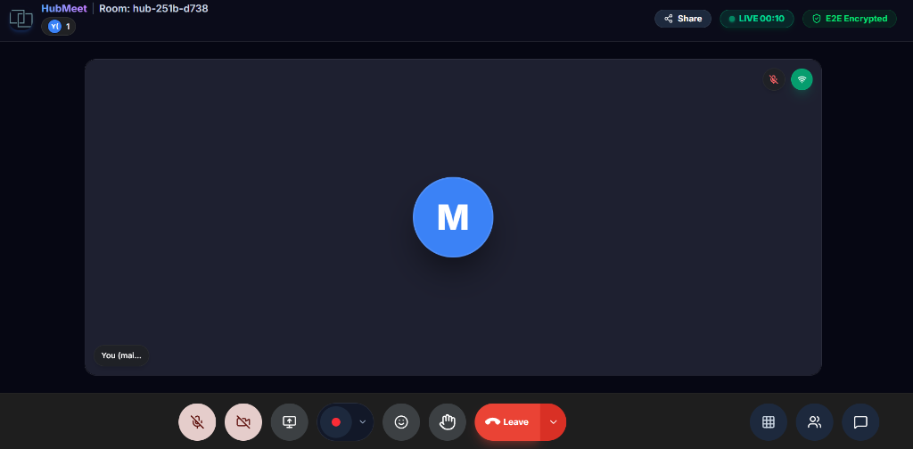
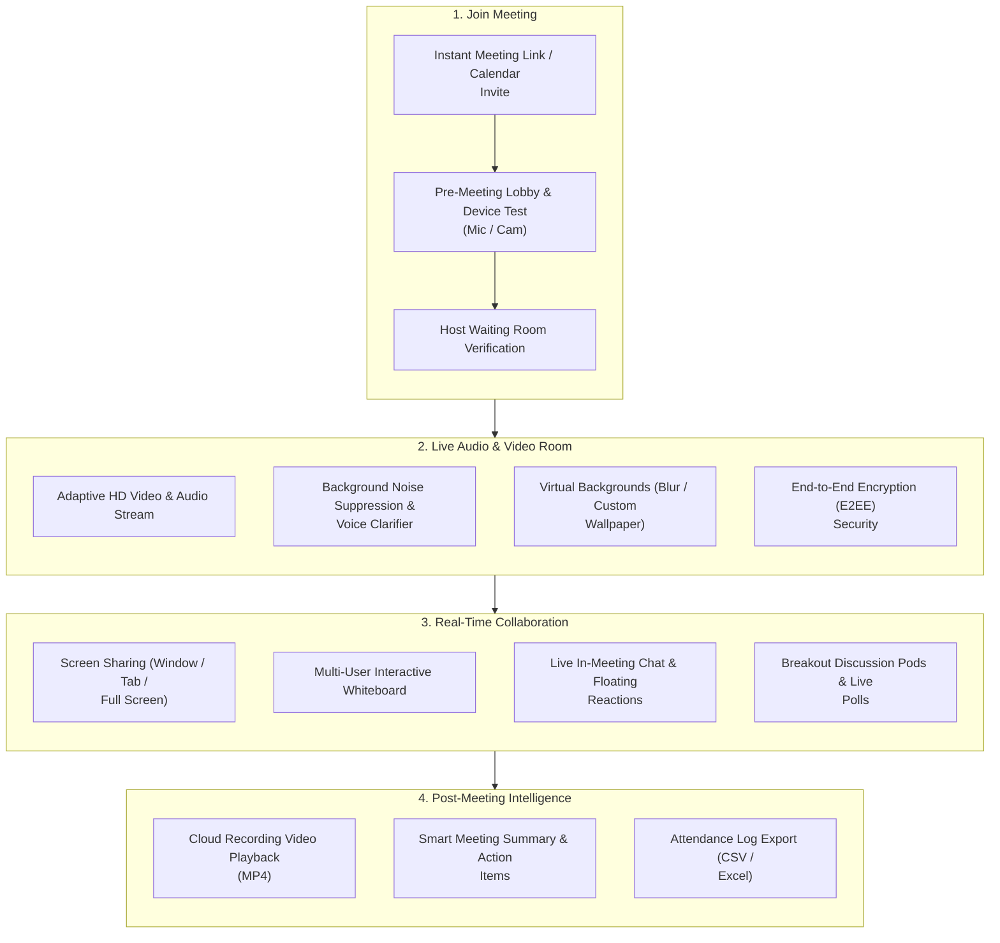

# 🎥 HubMeet Complete Overview & Setup

**HubMeet** is an enterprise-grade WebRTC video conferencing, interactive collaboration, and AI-powered meeting platform built directly into the HubNest ecosystem. Designed for seamless, crystal-clear team communication, it allows organizations to run one-on-one video catchups, multi-department all-hands meetings, interactive workshops, and client webinars with ultra-low latency.

Whether joining from a web browser, the **HubNest OS Desktop App**, or mobile devices, HubMeet delivers broadcast-quality HD video, smart background noise suppression, and real-time collaboration tools.

---

## 🧭 Direct Role-Based Portals (26 Chapters)

Choose your operational role below to access detailed, step-by-step documentation tailored to your daily meeting tasks:

-   :material-account-voice:{ .lg .middle style="color: #3b82f6;" } **[Meeting Participant & Attendee](../hubmeet-attendee/index.md)**

    ---

    Pre-flight checklist, camera/microphone setup, Spacebar push-to-talk, keyboard shortcuts, virtual background blur, AI noise cancellation, screen sharing, chat, file attachments, and live 50+ language translation.

    [:octicons-arrow-right-24: Open Participant Manual (7 Chapters)](../hubmeet-attendee/index.md)

-   :material-account-tie-voice:{ .lg .middle style="color: #6366f1;" } **[Meeting Host & Event Organizer](../hubmeet-host/index.md)**

    ---

    Instant vs. recurring meeting scheduling, calendar sync (Google/Outlook), waiting room screening, locking meetings, in-call moderation (Mute All, Co-Hosts), live polls, breakout room management, and cloud recording.

    [:octicons-arrow-right-24: Open Host Manual (7 Chapters)](../hubmeet-host/index.md)

-   :material-shield-crown:{ .lg .middle style="color: #10b981;" } **[Enterprise Meeting Administrator](../hubmeet-admin/index.md)**

    ---

    Managing employee rosters & host licenses, enforcing company-wide security policies (forced E2EE, mandatory waiting rooms), AI Copilot speech engine keys (OpenAI/Anthropic), S3 storage vaults, and WebRTC cluster telemetry.

    [:octicons-arrow-right-24: Open Admin Manual (7 Chapters)](../hubmeet-admin/index.md)

-   :material-code-braces:{ .lg .middle style="color: #8b5cf6;" } **[Developer & API Integrator](../hubmeet-developer/index.md)**

    ---

    Developer portal overview, scoped API keys, creating rooms via REST API, minting LiveKit WebRTC join tokens, listening to asynchronous webhooks, and enterprise SAML 2.0 / Keycloak SSO federation.

    [:octicons-arrow-right-24: Open Developer Manual (5 Chapters)](../hubmeet-developer/index.md)

---

## 🏛️ Live Interface Overview

Below is the live console layout of the **HubMeet Video Conference Room**:

---

## 🧭 How HubMeet Works

The diagram below illustrates how participants connect to a secure HubMeet conference room and access collaborative features:

---

## 🗂️ Quick Reference Chapters Directory

| Quick Reference Chapter | Title | Scope |
| :---: | :--- | :--- |
| **01** | [Overview & Setup](index.md) | System capabilities, audio/video settings, and security overview. |
| **02** | [Instant & Scheduled Meetings](scheduling.md) | Starting instant calls, scheduling future meetings, and calendar invites. |
| **03** | [In-Call Controls & Host Tools](in-call-controls.md) | Mic/cam toggles, host controls, participant management, and reactions. |
| **04** | [Screen Sharing & Presentation](collaboration.md) | Desktop sharing, application window sharing, and system audio. |
| **05** | [Live Video & Chat Translation](translation.md) | Real-time speech subtitles translated into 50+ languages. |
| **06** | [Interactive Collaborative Whiteboard](whiteboard.md) | Vector drawing tools, sticky notes, and canvas exports. |
| **07** | [Interactive Polls & Breakouts](polls-breakouts.md) | Running live attendee polls, breakout rooms, and session timers. |
| **08** | [Team & Workspace Management](team.md) | Managing co-hosts, user permissions, and host licenses. |
| **09** | [Live Attendance & Records Export](attendance.md) | Real-time attendee logging and CSV register exports. |
| **10** | [Cloud Recordings & Smart Summaries](recordings-ai.md) | LiveKit Egress recordings, transcripts, and AI action items. |
