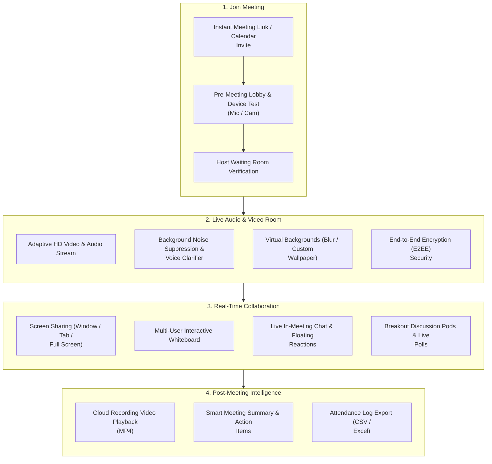

# 🎥 HubMeet Complete Overview & Setup

**HubMeet** is an enterprise-grade video conferencing and remote collaboration platform built directly into the HubNest ecosystem. Designed for seamless, crystal-clear team communication, it allows organizations to run one-on-one video catchups, multi-department all-hands meetings, interactive workshops, and client webinars with ultra-low latency.

Whether joining from a web browser, the **HubNest OS Desktop App**, or mobile devices, HubMeet delivers broadcast-quality HD video, smart background noise suppression, and real-time collaboration tools.

---

## 🏛️ Live Interface Overview

Below is the live console layout of the **HubMeet Video Conference Room**:

---

## 🧭 How HubMeet Works

The diagram below illustrates how participants connect to a secure HubMeet conference room and access collaborative features:

---

## 🌟 Key Platform Capabilities

### 1. 🎙️ Crystal-Clear Audio with Smart Noise Suppression
* **Smart Noise Cancellation**: Automatically filters out distracting background dog barks, street traffic, keyboard clicks, and cafe chatter so your voice sounds clear and natural.
* **Voice Clarity Booster**: Automatically evens out quiet and loud voices so every team member is heard clearly without manual volume tweaking.

### 2. 📹 Adaptive HD Video & Virtual Backgrounds
* **Adaptive Video Streaming**: Automatically adjusts video quality based on your current internet speed so calls never freeze, even on slow mobile connections.
* **Virtual Backgrounds**:
  * **Soft Blur**: Gently blurs your room background for instant privacy.
  * **Custom Office Wallpapers**: Choose from professional office backdrops or upload custom company-branded wallpapers.

### 3. 🔐 Enterprise Privacy & Meeting Protection
* **End-to-End Encryption (E2EE)**: Protects sensitive boardroom and executive discussions with private cryptographic keys.
* **Waiting Room (Lobby)**: Prevents uninvited guests from dropping in. Hosts review and admit participants one by one or in bulk.
* **Meeting Passcodes**: Optional 6-digit access pins for confidential client sessions.

### 4. 🔔 Seamless Hub Notification Engine Integration
HubMeet is directly plugged into the unified **HubNest Enterprise Notification Engine** (`/admin/notifications`). Teams never miss critical call events:
* **Real-Time Meeting Reminders**: 10 minutes and 2 minutes prior to scheduled calls, attendees receive desktop toast alerts and in-app bell notifications (`🔔`) with a direct **1-Click Join** button.
* **Host Waiting Room Chime & Alerts**: When external clients enter the Waiting Room lobby, the host receives instant audio chimes and high-priority banner notifications to admit them immediately.
* **Post-Meeting Intelligence Alerts**: As soon as a meeting concludes and cloud processing finishes, hosts and attendees receive an automated notification containing links to the **MP4 Recording**, **AI Smart Summary**, and **Action Items Checklist**.
* **Emergency HR & Floor Broadcasts**: Company administrators can broadcast critical operational or safety alerts that display as a non-intrusive floating banner inside ongoing video calls without disconnecting participants.

---

## 🗂️ HubMeet User Guide Directory

| Chapter | Title | Route / Scope | Core Functionality |
| :---: | :--- | :--- | :--- |
| **01** | [Overview & Setup](index.md) | HubMeet Suite | System capabilities, audio/video settings, and security overview. |
| **02** | [Instant & Scheduled Meetings](scheduling.md) | Scheduling & Invites | Starting instant calls, scheduling future meetings, and calendar invites. |
| **03** | [In-Call Controls & Host Tools](in-call-controls.md) | Active Meeting Room | Mic/cam toggles, host controls, participant management, and reactions. |
| **04** | [Screen Sharing & Whiteboard](collaboration.md) | Collaboration Tools | Desktop sharing, real-time interactive whiteboard, and live captions. |
| **05** | [Interactive Polls & Breakouts](polls-breakouts.md) | Engagement Suite | Running live attendee polls, breakout rooms, and attendance logs. |
| **06** | [Cloud Recordings & Smart Summaries](recordings-ai.md) | Post-Meeting Records | Video recordings, transcripts, smart summaries, and action checklists. |

---

## 💡 Quick Tips for the Best Meeting Experience

> [!TIP]
> **Test Hardware in the Pre-Meeting Lobby:** Always take 5 seconds in the pre-join preview screen to verify that the correct microphone, speakers, and camera are selected before clicking *Join Room*.

> [!NOTE]
> **No Downloads Needed for Guests:** External clients and guests can join HubMeet calls instantly from any modern web browser without needing to install plugins or software.
