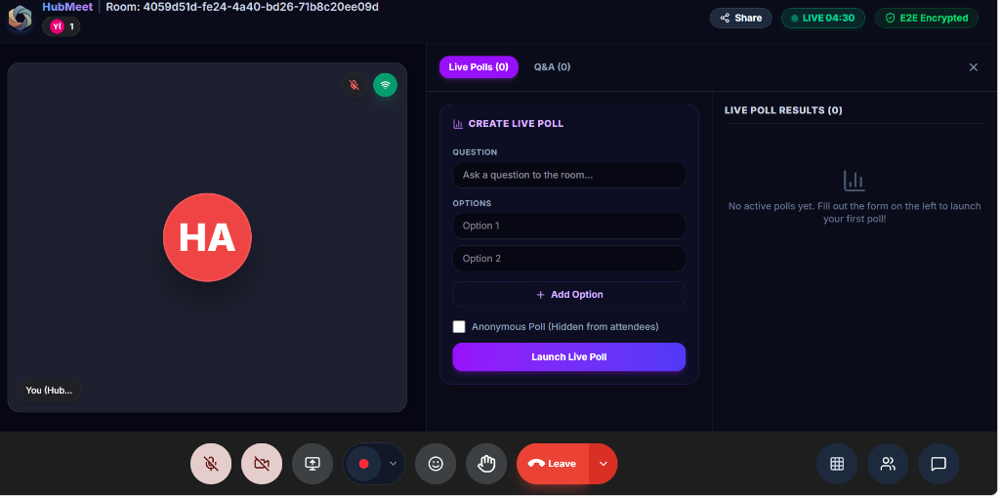
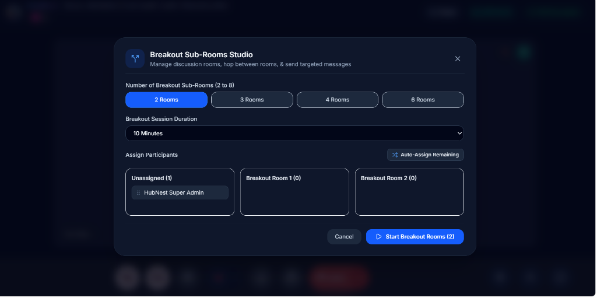
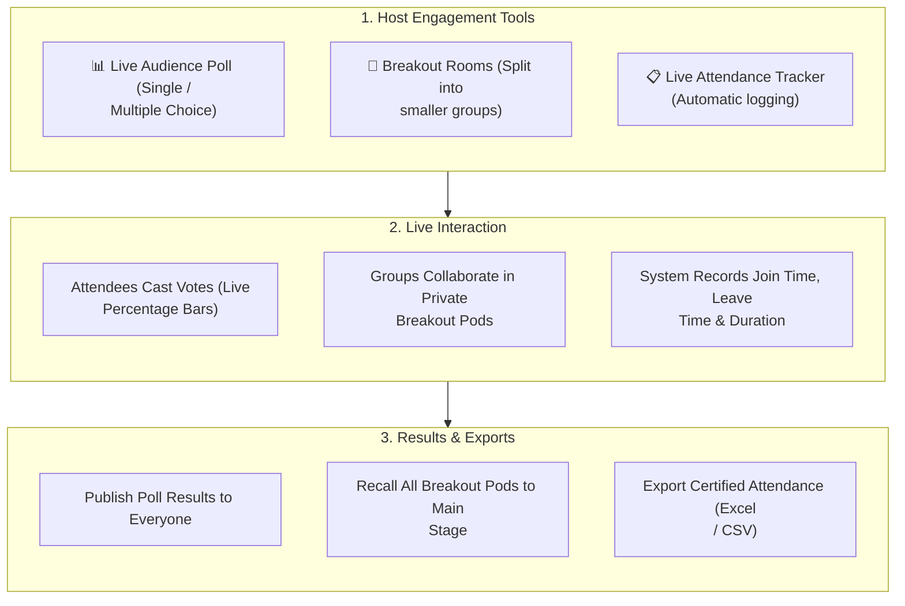

# 05. Interactive Polls, Breakout Rooms & Attendance

For training workshops, team retrospectives, webinars, and all-hands company calls, keeping attendees engaged is vital. HubMeet includes built-in interactive tools: real-time **Audience Polls**, automated **Breakout Discussion Rooms**, and a live **Attendance Tracker** with one-click export.

---

## 🏛️ Live Interface Overview

Below is the layout of the **HubMeet Polls & Breakout Rooms Console**:

  

---

## 🧭 Interactive Engagement Workflow

The flowchart below demonstrates how hosts launch polls, coordinate breakout rooms, and capture attendance logs:

---

## 📊 Live Audience Polls (`PollsDrawer`)

Hosts and co-hosts can launch instant polls to gather team feedback, vote on proposals, or test workshop comprehension without leaving the video screen.

### How to Create and Launch a Poll
1. Click the **Polls** icon on the bottom control bar to open the drawer.
2. Click **+ Create New Poll**.
3. Enter your question (e.g., *"Which sprint objective should we prioritize this quarter?"*).
4. Add answer options (up to 6 choices).
5. Configure poll options:
   - **Allow Multiple Selections**: Enables checkboxes for choosing more than one option.
   - **Anonymous Responses**: Keeps individual voter identities private.
6. Click **Launch Poll**.

### Reviewing and Sharing Results
* As attendees vote, the drawer calculates percentages and vote counts in real time.
* When voting concludes, click **End Poll**.
* Click **Share Results** to display a clean summary card directly on all attendees' screens.

---

## 🚪 Breakout Discussion Rooms (`BreakoutRoomsModal`)

Breakout rooms allow hosts to divide large meetings into smaller groups for focused brainstorming, workshop exercises, or private team discussions.

### How to Set Up Breakout Rooms
1. Click the **Breakout Rooms** icon on the control bar.
2. Choose the number of rooms needed (e.g., *3 Rooms*).
3. Select how participants will be assigned:
   - **Automatically (Random)**: HubMeet evenly distributes all attendees across the rooms.
   - **Manually**: The host drags and drops specific attendees into chosen rooms.
   - **Let Participants Choose**: Attendees select their own preferred topic room.
4. Set a timer (e.g., *15 minutes*).
5. Click **Open All Rooms**. Attendees receive a polite prompt transporting them to their breakout pod.

### Host Moderation During Breakouts
* **Join Any Room**: The host can jump into any breakout pod to check progress and offer guidance.
* **Broadcast Announcements**: Send a text message that pops up banner-style across all rooms simultaneously (e.g., *"Wrap up discussions: 2 minutes remaining"*).
* **Close Rooms**: When time expires, click **Close All Rooms**. Attendees get a 60-second warning countdown before returning automatically to the main room.

---

## 📋 Live Attendance Tracking (`AttendanceModal`)

For formal corporate training, compliance seminars, and university lectures, HubMeet automatically logs attendee participation without requiring manual roll calls.

### What is Captured in the Attendance Log:
* **Participant Full Name & Official Email**.
* **First Join Timestamp** and **Final Leave Timestamp**.
* **Total Active Time**: Exact minutes spent in the meeting room.
* **Connection Stability**: Percentage of session connected without drops.

### How to Export Attendance
1. Click the **Attendance** icon on the host control bar.
2. Review the live list of present and departed attendees.
3. Click **Export to Excel (.xlsx)** or **Download CSV**.
4. The downloaded file is pre-formatted for direct upload into the HRMS or training records system.

---

## 💡 Best Practices

> [!TIP]
> **Prepare Poll Questions Before Call:** Hosts can draft poll questions in the Polls drawer during the 5 minutes before attendees arrive so they can be launched with a single click during the presentation.
