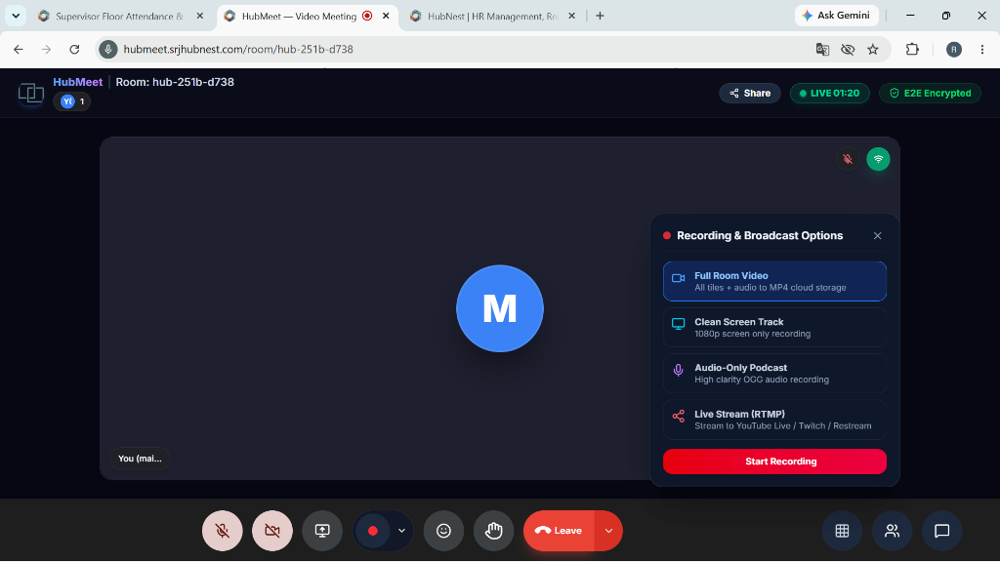
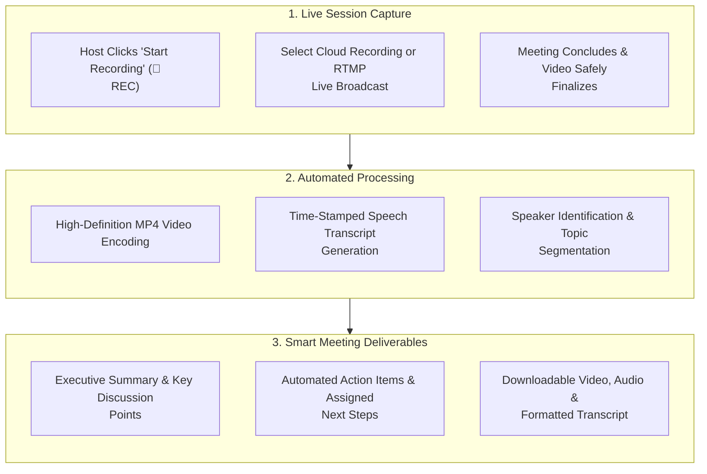
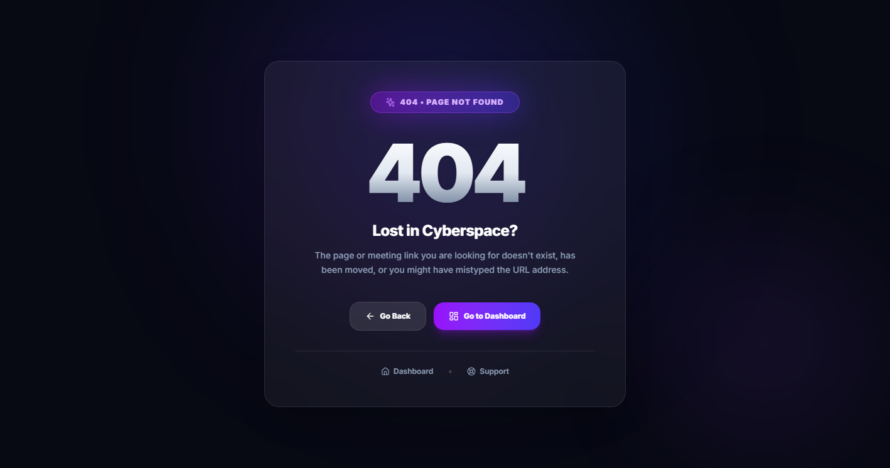

# 06. Cloud Recordings & Smart Summaries

Capturing meeting discussions and following up on decisions is just as important as the meeting itself. HubMeet includes built-in **HD Cloud Recording**, **Live RTMP Streaming**, full **Speech Transcripts**, and **Smart Meeting Summaries** that automatically distill hour-long discussions into actionable bullet points and next steps.

---

## 🏛️ Live Interface Overview

Below is the layout of the **Post-Meeting Intelligence & Recording Dashboard**:

---

## 🧭 Recording & Smart Summary Architecture

The flowchart below demonstrates the progression from live video recording to automated transcript generation and executive action checklists:

---

## 🔴 How to Record a Meeting (`EgressControlModal`)

Hosts and authorized co-hosts can record calls with a single click:

### Step 1: Start Recording
1. During an active meeting, click the **Record** button on the bottom control bar.
2. Select your preferred recording output:
   - **Cloud Recording**: Video is safely stored in your secure organizational cloud and appears on your meeting dashboard upon call completion.
   - **Local Recording**: Saves directly to your computer's local storage.
3. Choose the recording layout:
   - **Active Speaker**: Focuses dynamically on whoever is speaking.
   - **Grid View**: Captures all attendee video tiles in a balanced gallery layout.
   - **Presentation Priority**: Prioritizes shared slide decks with the speaker in a small corner tile.

### Step 2: Live Recording Indicators
* A prominent **`🔴 REC`** badge appears at the top of the screen for all participants, accompanied by an audio notification confirming that the session is being recorded.
* The host can **Pause** or **Resume** the recording at any time during confidential breaks.

### Step 3: Conclude Recording
* Click **Stop Recording**, or simply end the call. The recording processes in the background and is ready for playback within minutes.

---

## 🗄️ Cloud Recordings Vault & Management Library (`/recordings`)

Below is the centralized **Recordings Management Library** where all archived meetings and downloadable MP4 files are stored:

* **Direct Playback**: Stream recorded meetings directly in high-definition without downloading the full video file.
* **Download & Share**: One-click download of MP4 video, audio-only podcast tracks, or generate password-protected public share links for absent stakeholders.
* **Storage Quota & Retention**: Filter by date range, meeting host, or department to manage cloud storage allocations.

---

## 📡 Live RTMP Streaming

For webinars, town halls, and public broadcasts, HubMeet can stream your conference live to external video services:
1. In the recording modal, switch to the **Live Stream (RTMP)** tab.
2. Enter your streaming destination:
   - **Server / Stream URL**: (e.g., from YouTube Live, LinkedIn Live, or Facebook).
   - **Stream Key**: Paste your private stream key.
3. Click **Go Live**. HubMeet automatically broadcasts the high-definition composite stream directly to your public audience with zero lag.

---

## 📝 Time-Stamped Speech Transcripts

Never miss a crucial remark or spent hours taking manual minutes:
* **Speaker-Labeled Transcript**: The system produces a complete, word-for-word transcript with clear speaker attribution (e.g., *[00:14:22] Priya: "We need to ensure all deliverables pass QA by Thursday"*).
* **Searchable Text**: Type any keyword in the search bar to jump instantly to the exact second in the video where that topic was discussed.
* **Export Options**: Download the full transcript as a clean **Text file (.txt)** or formatted **PDF**.

---

## 💡 Smart Meeting Summaries & Action Items

Instead of re-watching a 60-minute video call, review the automated **Smart Meeting Summary** generated immediately upon call completion:

### 1. Executive Summary Paragraph
A concise 3-to-4 sentence overview explaining what the meeting was about, which problems were analyzed, and what was agreed upon.

### 2. Key Discussion Highlights
Organized by topic cards:
* **Decisions Made**: Clean bullet points listing finalized team decisions.
* **Open Questions**: Points that require further investigation before next week.
* **Important Metrics Mentioned**: Any budget numbers, timelines, or performance goals referenced during the conversation.

### 3. Action Items & Follow-Up Checklist
The system identifies commitments made during the call and formats them into an actionable to-do list:
* [x] **Frontend Team**: Update user profile settings page by Wednesday.
* [ ] **DevOps Team**: Review server load thresholds before the Friday release.
* [ ] **Sales Team**: Follow up with prospective enterprise clients regarding pricing proposals.

---

## 🔒 Sharing & Access Security

* **Access Permissions**: By default, only the host and registered attendees can access the recording and summary.
* **Shareable Guest Link**: The host can generate a temporary link with an optional password and expiration date (e.g., *Link expires in 7 days*) for sharing with teammates who could not attend live.

---

## 💡 Best Practices

> [!TIP]
> **Share Summary with One Click:** After every department call, copy the generated *Action Items Checklist* and paste it into your team chat channel so everyone has clear ownership of their deliverables.
