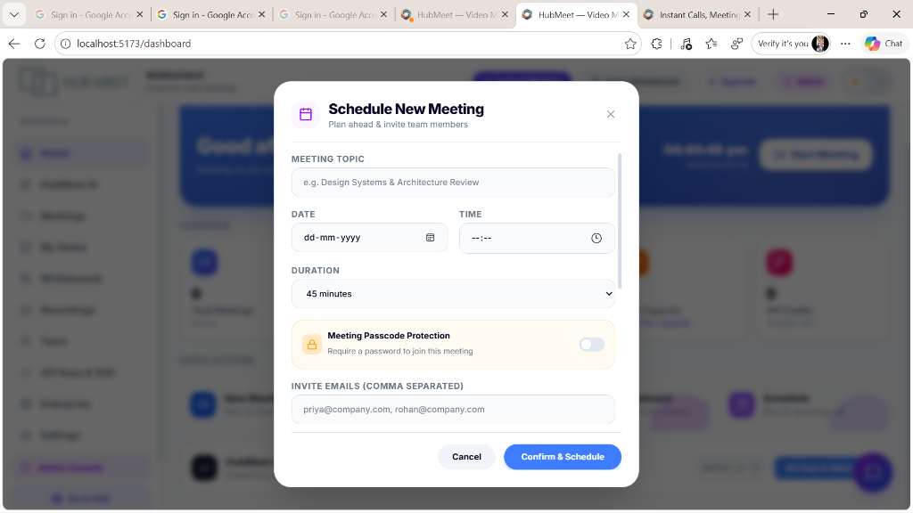
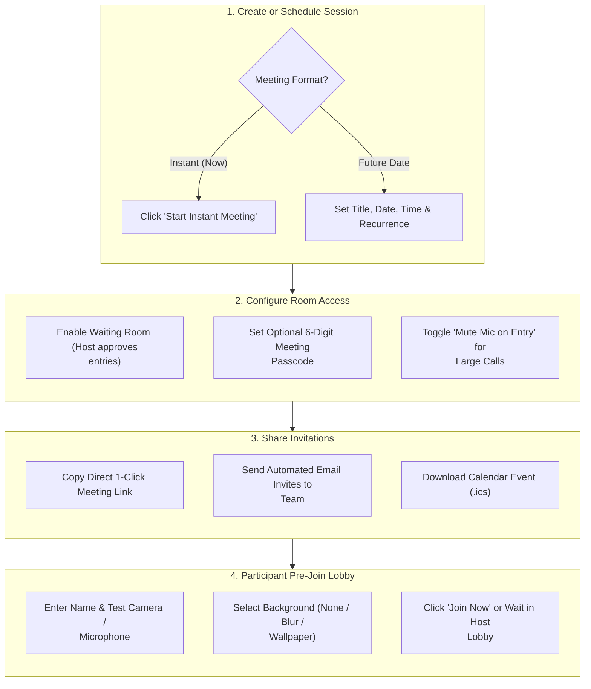

# 02. Instant & Scheduled Meetings

HubMeet offers total flexibility when connecting with teammates and clients. Whether you need an immediate 5-minute video huddle to clear a doubt or a structured, recurring weekly department standup, you can create and share meeting invitations in seconds.

---

## 🏛️ Live Interface Overview

Below is the layout of the **HubMeet Meeting Scheduler & Dashboard**:

---

## 🧭 Meeting Scheduling & Join Workflow

The diagram below illustrates the end-to-end journey from scheduling a meeting to joining the active room:

---

## 🚀 How to Start an Instant Meeting ("Meet Now")

When you need an immediate face-to-face chat with a colleague:

1. Open **HubMeet** from the sidebar menu.
2. Click the green **Start Instant Meeting** button.
3. Your camera and microphone will activate in the **Pre-Join Lobby**.
4. Click **Join Room**.
5. Once inside, click **Copy Invite Link** from the top header or share the 9-digit meeting code (e.g., `meet.hubnest.com/room/abc-defg-hij`).

---

## 📅 How to Schedule a Future Meeting

For structured team reviews, client demos, or company workshops:

### Step 1: Open Schedule Modal
1. On the HubMeet dashboard, click **+ Schedule Meeting**.

### Step 2: Set Meeting Details
* **Meeting Topic**: Type your meeting agenda (e.g., `Design Systems & Architecture Review`).
* **Date & Time Picker**: 
  - Select the meeting date from the calendar picker (`dd-mm-yyyy`).
  - Choose the exact start time using the clock picker (`--:--`).
* **Duration Selector**: Pick from common lengths (`15 minutes`, `30 minutes`, `45 minutes`, `1 hour`, `2 hours`).

### Step 3: Configure Room Security & Invite Team Members
* **Meeting Passcode Protection (Toggle Switch)**: Enable `Require a password to join this meeting` for confidential board meetings or private 1-on-1 sessions.
* **Invite Emails (Comma Separated)**: Type internal teammate emails or external client email addresses (e.g., `priya@company.com, rohan@company.com`).
* **Confirm & Schedule**: Click the blue **Confirm & Schedule** button. HubMeet creates the encrypted room and generates instant calendar invites.

---

## 🚪 How Attendees Join a HubMeet Call

Participants have three easy ways to enter a meeting:

| Join Method | Ideal Scenario | Steps to Join | What You See Next |
| :--- | :--- | :--- | :--- |
| **Direct Web Link** | Teammates & External Clients | Click the URL received in email, chat, or calendar (e.g., `https://hubmeet.srjhubnest.com/room/hub-251b-d738`). | Instant camera/mic preview test screen. |
| **Meeting Code / Room ID** | Desktop App & Mobile Users | Open HubMeet, paste the code into the **Enter Code** box on dashboard, and click **Join**. | Instant connection to host room or lobby. |
| **In-App Calendar / Bell** | Registered Company Staff | Click the **Join** button directly from your active HubNest calendar or notification notification bell (`🔔`). | Directly joins with enterprise SSO credentials. |

---

## 🎙️ Step-by-Step: Testing Camera, Mic & Audio in Pre-Meeting Lobby

Before stepping into an active conference room, every user lands on the **Pre-Meeting Lobby screen**:

1. **Verify Camera Stream**: Check your video window to make sure lighting is good and your background is presentable.
2. **Audio Input Meter**: Speak a few words (e.g., "Testing 1, 2, 3"). The audio waveform under your name will bounce in green. If the meter doesn't move:
   - Click the **Settings Gear (`⚙️`)** icon.
   - Choose your external USB headset or laptop microphone from the audio input dropdown.
3. **Select Virtual Background**: Click **Effects** to turn on soft blur or select a clean company office backdrop before connecting.
4. **Click "Join Room"**: You enter the live room immediately.

---

## 🛠️ Common Beginner Troubleshooting & FAQ

| Problem / Symptom | Likely Reason | Simple 1-Click Solution |
| :--- | :--- | :--- |
| **"Microphone Blocked" browser error** | Browser permission was denied or not prompted. | Click the **Padlock icon (`🔒`)** in your browser URL bar (left of `localhost` or `hubmeet.srjhubnest.com`), set Camera and Microphone to **Allow**, and reload page (`F5`). |
| **My video is frozen or lagging** | Slow internet or low bandwidth. | HubMeet automatically downscales video to prevent call drop. Turn off incoming HD video or switch your camera to Standard Definition (SD) via `⚙️ Settings > Video`. |
| **Other people can't hear me** | System or hardware mute active. | Check the bottom control bar: ensure the microphone icon is red-free. Also verify your physical headset inline mute switch isn't clicked. |
| **I see "Waiting for Host to admit you"** | The meeting has a secure Waiting Room lobby enabled. | Stay on the screen! A notification chime sounds on the host's screen. As soon as the host or co-host clicks **Admit**, you will enter automatically. |
| **Echo or howling noise in room** | Two laptops in the same physical room joined with mics on. | When multiple people join from the same conference room, keep only one computer's microphone and speaker active, and mute all others. |

---

## 💡 Best Practices for Smooth Video Meetings

> [!TIP]
> **Use Waiting Rooms for External Client Calls:** When hosting back-to-back client demos or vendor interviews, keep the **Waiting Room** turned on so the next client cannot accidentally enter while your current session is concluding.

> [!NOTE]
> **Headset Recommendation:** For maximum voice clarity, use a dedicated wired or wireless headset. HubMeet's AI voice suppression works best when voice input is close to the microphone.
