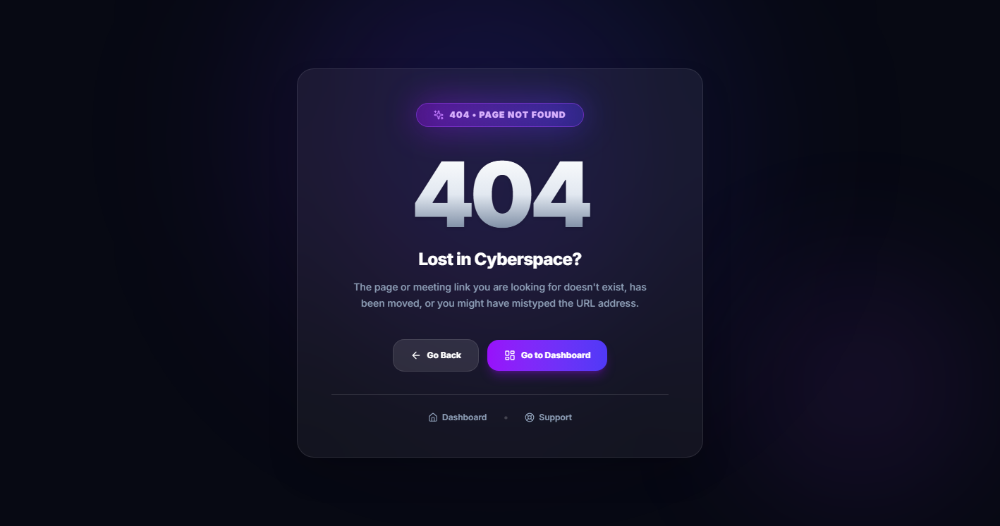
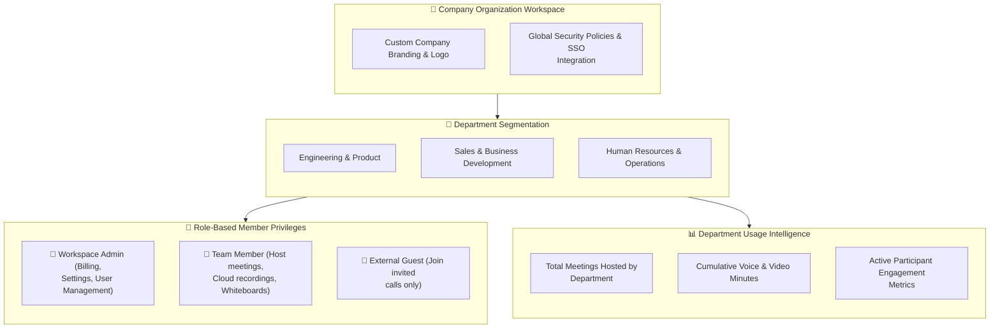

# 08. Team & Workspace Management

HubMeet is built for teams of all sizes—from fast-moving startups to multi-branch enterprises. With the dedicated **Team Panel** (`TeamPanel`), organization administrators can create company workspaces, invite colleagues, assign administrative roles, and inspect department-wide meeting usage statistics.

---

## 🏛️ Live Interface Overview

Below is the layout of the **HubMeet Team & Workspace Management Dashboard**:

---

## 🧭 Organization Workspace Hierarchy

The diagram below illustrates how workspaces, departments, and member permissions are structured in HubMeet:

---

## 👥 Managing Workspace Members (`TeamMembers`)

Administrators can easily organize their staff directory directly from the **Team** tab on the HubMeet dashboard:

### 1. Inviting New Team Members
1. Navigate to **HubMeet > Team** from the navigation bar.
2. Click the **+ Invite Member** button.
3. Enter the employee's official company email address.
4. Select their initial role:
   - **Member**: Can schedule unlimited meetings, record calls, create whiteboards, and launch live polls.
   - **Admin**: Full access including user invites, billing subscriptions, and workspace settings.
5. Click **Send Invitation**. The user receives an instant activation link via email.

### 2. Member Roster & Quick Actions
The interactive directory grid allows administrators to:
* **Search & Filter**: Search employees by name, email, or department.
* **Update Roles**: Promote active members to Admin or modify permission tiers.
* **Deactivate / Remove**: Instantly revoke workspace access when staff members transition out of the team.

---

## 📊 Department Meeting Analytics (`DepartmentStats`)

To ensure company meeting time is productive and well-balanced, the **Department Statistics** panel provides clear operational metrics across business divisions:

| Key Metric | What It Measures | How Leaders Use It |
| :--- | :--- | :--- |
| **Total Calls Hosted** | Number of video meetings run by department staff. | Identifies collaboration frequency across Engineering, Sales, etc. |
| **Total Call Minutes** | Cumulative video conferencing duration. | Helps managers spot potential "meeting fatigue" across teams. |
| **Average Meeting Duration** | Typical length of calls (e.g., *28 mins average*). | Encourages shorter, focused standups over long meetings. |
| **Attendance Participation** | Ratio of scheduled attendees who actively joined. | Measures internal team engagement and punctuality. |

---

## 🎨 Custom Workspace Branding

Administrators can personalize the HubMeet video experience with corporate branding:
* **Custom Company Logo**: Upload your official logo (`.png` or `.svg`) to display proudly in the navbar, email invitations, and pre-join lobby.
* **Custom Brand Name**: Replaces generic labels with your company name (e.g., *Acme Corp Video Meeting*).
* **Custom Email Invites**: Automatically formats all outbound meeting notifications with your company colors and logo.

---

## 💡 Best Practices

> [!TIP]
> **Review Department Minutes Monthly:** Check the *Department Statistics* tab every month. If a team exceeds 1,000 meeting hours, encourage managers to replace routine update meetings with asynchronous chat or short bulleted updates.
