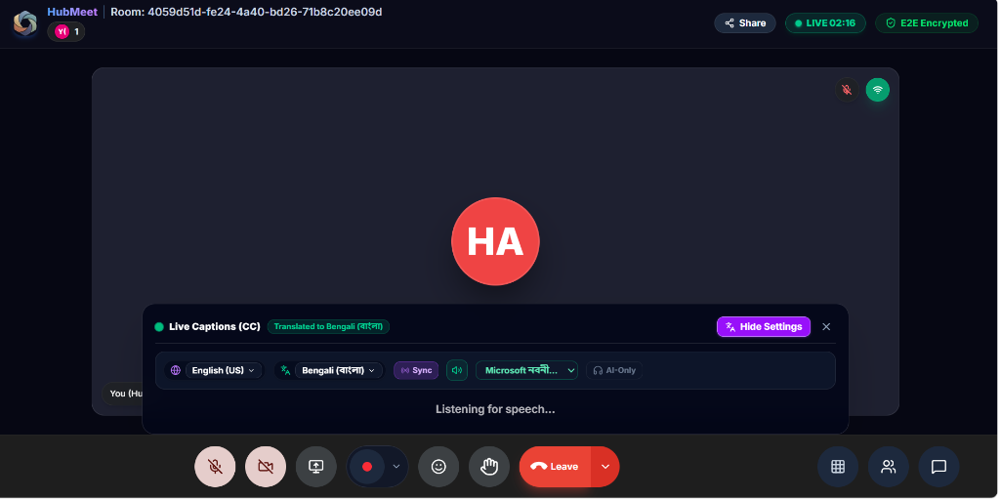
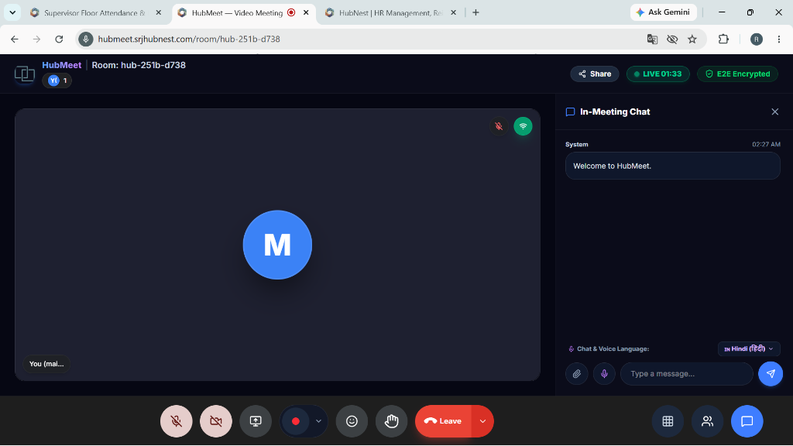
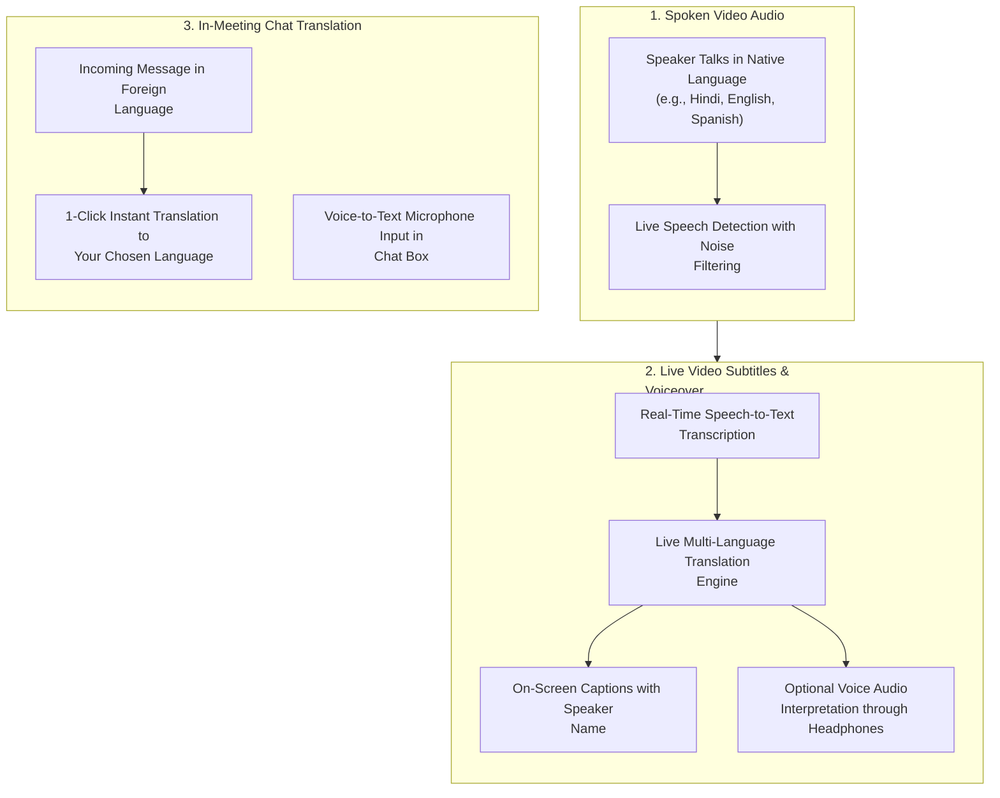

# 05. Live Video & Chat Translation

Language barriers should never slow down international collaboration. HubMeet includes two powerful, real-time translation systems: **Live Video Speech Translation** (translating spoken words into live on-screen subtitles and audio voiceover) and **In-Meeting Chat Translation** (automatically translating incoming text messages into your native language).

---

## 🏛️ Live Interface Overview

Below is the live console layout of the **HubMeet Live Captions & Real-Time Multilingual Speech Translation Overlay**:

---

### In-Meeting Chat Translation Drawer
Participants can also view real-time text translations directly in the side chat drawer:

---

## 🧭 Live Translation & Interpretation Flow

The diagram below illustrates how spoken speech and chat text are translated in real time during a call:

---

## 🎙️ 1. Live Video Speech Translation (`LiveCaptionsOverlay`)

When team members speak different languages in a meeting, each participant can customize what they see and hear without altering what others experience.

### Key Video Translation Features:
* **Automatic Language Detection**: The system recognizes the language being spoken automatically.
* **40+ Supported Languages**: Includes Hindi, English, Bengali, Tamil, Telugu, Marathi, Gujarati, Punjabi, Kannada, Malayalam, Odia, Urdu, Spanish, French, German, Japanese, Chinese, Arabic, Russian, and more.
* **Speaker Identification**: Subtitles clearly show who is speaking (e.g., *[Priya - Hindi ➔ English]: "Please review the updated product release date"*).
* **Voice Audio Interpretation (Text-to-Speech)**: If you prefer listening instead of reading subtitles, turn on the voice interpretation mode to hear the translated speech read aloud through your headphones in real time.

### How to Turn On Live Video Translation:
1. In an active meeting, click the **Captions / Translation** icon (`🌐` or `CC`) on the bottom control bar.
2. Select your **Spoken Language** (or leave as *Auto-detect*).
3. Select your **Translation Language** (e.g., *Hindi (हिंदी)* or *English (India)*).
4. *(Optional)* Toggle **Audio Voiceover** on if you want to listen to translated speech.
5. Translated subtitles immediately appear smoothly at the bottom of the video screen.

---

## 💬 2. In-Meeting Chat Live Translation (`InMeetingChatDrawer`)

The in-meeting text chat includes built-in instant translation so participants can type in their preferred language while international colleagues read in theirs.

### Key Chat Translation Capabilities:
* **Real-Time Message Translation**: Click the **Translate** icon next to any incoming chat message to instantly view it in your selected language.
* **Language Selector**: Choose from over 40 global and regional languages directly from the chat header dropdown.
* **Voice-to-Text Mic Typing**: Instead of typing on your keyboard, click the **Microphone** icon in the chat input bar to speak your message aloud; it automatically converts into written text.
* **In-Chat File Sharing (`📎`)**: Attach PDFs, Excel sheets, images, and presentation decks (up to 21MB) using the paperclip button with direct 1-click download buttons for attendees.

---

## 🌐 Supported Translation Languages Catalog

| Region | Supported Languages |
| :--- | :--- |
| **Indian Regional** | Hindi (हिंदी), Bengali (বাংলা), Marathi (मराठी), Tamil (தமிழ்), Telugu (తెలుగు), Gujarati (ગુજરાતી), Kannada (ಕನ್ನಡ), Malayalam (മലയാളം), Punjabi (ਪੰਜਾਬੀ), Odia (ଓଡ଼ିଆ), Urdu (اردو), Assamese, Nepali, Sindhi. |
| **International** | English (US/UK/India), Spanish (Español), French (Français), German (Deutsch), Japanese (日本語), Chinese (中文), Korean (한국어), Arabic (العربية), Portuguese (Português), Italian (Italiano), Russian, Dutch, Turkish. |

---

## 💡 Best Practices

> [!TIP]
> **Use Headphones for Voice Interpretation:** When listening to audio voiceover translations, wear headphones to avoid microphone feedback and ensure the cleanest listening experience.
