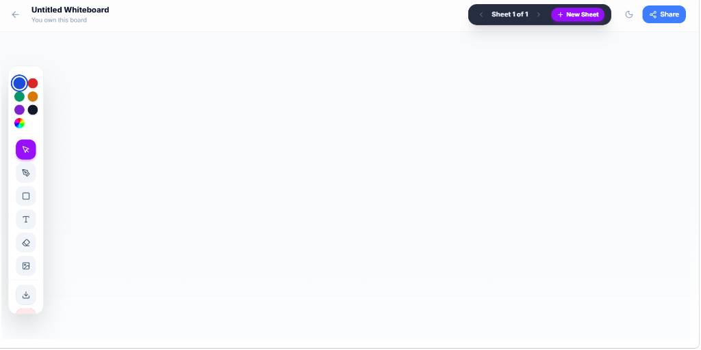
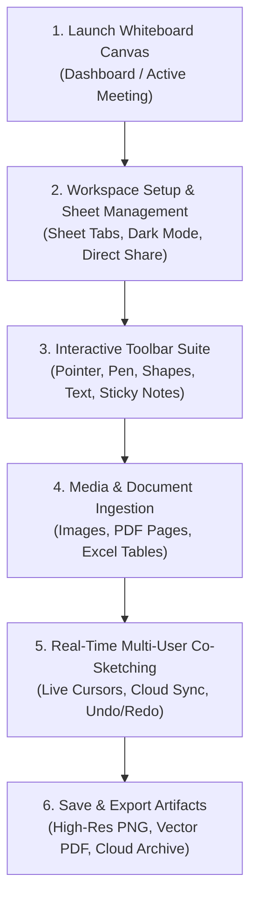
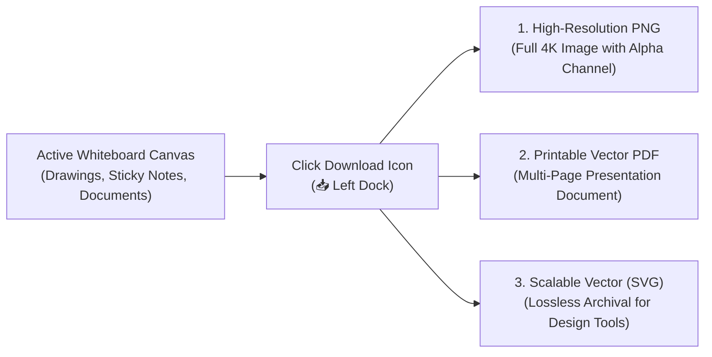

# 06. Interactive Collaborative Whiteboard

The **Collaborative Whiteboard** in HubMeet transforms remote video calls and stand-alone planning into dynamic, hands-on visual working sessions. Engineered with low-latency vector rendering, multi-sheet workbook support, and universal document ingestion, teams can brainstorm software architectures, review UI/UX mockups, annotate technical PDFs, map user journeys, and paste tabular Excel data on an infinite digital canvas.

---

## 🏛️ Live Production Interface Overview

Below is the live console layout of the **HubMeet Collaborative Whiteboard**:

---

## 🧭 Whiteboard Collaboration Workflow

The diagram below illustrates the end-to-end journey from launching a canvas to co-sketching, importing documents, and exporting final assets:

---

## 🎛️ Complete Toolbar Anatomy & Tool-by-Tool Guide

The floating vertical dock on the left provides quick access to professional creative and editing tools. Below is an exhaustive breakdown of every tool and its operational behavior:

| Tool Name | Visual Icon | Keyboard Shortcut | Functionality & Working Behavior |
| :--- | :---: | :---: | :--- |
| **Color Palette Dock** | 🔴 🔵 🟣 🟢 🌈 | — | **Dynamic Color Picker**: Top pill containing quick primary color swatches (Blue, Red, Green, Orange, Purple, Black) plus a rainbow multi-color wheel for custom HEX/RGB selections. Applies instantly to active pens, shapes, text, and highlighter strokes. |
| **Select / Transform Pointer** | ↖️ (Arrow) | `V` | **Canvas Object Selector**: Click any element (shape, drawn stroke, sticky note, or uploaded image) to select it. Drag to reposition, use corner bounding handles to resize proportionally, or press `Delete` / `Backspace` to remove. |
| **Freehand Pen & Brush** | ✏️ (Nib) | `P` | **Precision Digital Pen**: Smooth vector stroke engine with pressure smoothing. Ideal for freehand writing, circling key elements, sketching wireframes, and handwritten signatures. |
| **Geometric Shapes Engine** | ▢ (Square) | `S` | **Shape Builder**: Click and drag to create crisp geometric objects including **Rectangles, Rounded Cards, Perfect Circles, Ellipses, Connecting Arrows, and Decision Diamonds**. Automatically snaps to 90° and 45° angles. |
| **Formatted Text Tool** | T (Typography) | `T` | **Rich Text Boxes**: Click anywhere on the canvas to place an editable text block. Supports heading sizes, custom fonts, bold/italic formatting, and multi-line descriptive labels. |
| **Precision Vector Eraser** | ⌫ (Eraser) | `E` | **Object & Stroke Eraser**: Hover and click over any drawn path, shape edge, or connector line to instantly wipe it away without affecting adjacent layers. |
| **Media & Document Upload** | 🖼️ (Image / Upload) | `U` | **Universal Ingestion Gateway**: Opens the local system file picker to import **Images (.PNG, .JPG, .SVG, .WebP), PDF Documents (.PDF), and Excel Spreadsheets (.XLSX, .CSV)** directly onto the active canvas. |
| **Download & Export Canvas** | 📥 (Download) | `Ctrl + S` | **Instant File Exporter**: 1-click exporter that renders the entire board or active sheet into **High-Definition PNG Image, Scalable SVG, or Printable Vector PDF Document**. |
| **Sticky Notes / Annotations** | 🗈 (Bottom Pill) | `N` | **Virtual Sticky Notes**: Generates pastel-colored movable cards (Yellow, Cyan, Mint, Coral) designed for agile sprint retrospectives, backlog sorting, and team idea clustering. |

---

## 📑 Top Navigation Bar & Multi-Sheet Workbook Management

The top navigation header manages board ownership, multi-page presentation sheets, and enterprise access permissions:

### 1. Board Title & Ownership Details
* **Board Title**: Displays the current whiteboard name (e.g., `Untitled Whiteboard`). Click directly on the title text to rename your session (e.g., *Q4 Architecture Review - Sprint 24*).
* **Ownership Tag**: Indicates your administrative control (`You own this board`), giving you master export, permission, and deletion privileges.

### 2. Multi-Sheet Pagination (`Sheet 1 of 1` ➔ `+ New Sheet`)
Unlike standard single-page whiteboards that become cluttered, HubMeet features **Multi-Sheet Workbooks**:
* **Sheet Navigator (`< Sheet X of Y >`)**: Arrow buttons allow presenters to switch seamlessly between distinct pages without clearing the canvas.
* **`+ New Sheet` Button**: Click to instantiate a fresh, blank canvas page within the same meeting session. Ideal for multi-agenda presentations (e.g., *Sheet 1: User Personas, Sheet 2: System Architecture, Sheet 3: Sprint Action Items*).

### 3. Theme Toggle & Workspace Sharing
* **Dark / Light Canvas Mode (`🌙` / `☀️`)**: Toggles the whiteboard between high-contrast crisp white background and a sleek dark-mode canvas to reduce eye fatigue during long night sessions.
* **Blue Share Button (`🔗 Share`)**: Opens the team access modal to grant live co-editing permissions or copy secure invite links for meeting attendees.

---

## 📂 Comprehensive Document & Media Ingestion Guide

HubMeet allows presenters to import external reference materials directly into the infinite canvas for live collaborative markup:

### 1. 🖼️ Uploading Images (`.PNG`, `.JPG`, `.SVG`, `.WebP`)
* **How to Upload**: Click the **Media Upload icon (`🖼️`)** on the left dock or drag and drop any image file from your computer directly onto the browser window.
* **Canvas Interaction**:
  - Once dropped, bounding handles allow proportional scaling and 360-degree rotation.
  - Teammates can draw arrows, write notes, and highlight UI elements directly on top of the image (ideal for design feedback and bug audits).

### 2. 📄 Uploading PDF Documents (`.PDF`)
* **How to Upload**: Click the **Upload icon (`🖼️`)** and select any PDF document (e.g., contracts, product specifications, financial statements).
* **Multi-Page Page Selection**: The system parses the PDF document and allows you to place individual pages or entire page ranges as interactive vector tiles across the board.
* **Live Markup & e-Signature**: Review legal clauses, circle action items, and draw digital signatures directly across the PDF surface during active calls.

### 3. 📊 Importing Excel Sheets & Tabular Data (`.XLSX`, `.CSV`)
* **How to Upload**: Select an `.xlsx` or `.csv` spreadsheet file from your local system.
* **Visual Table Grid**: HubMeet converts spreadsheet rows into clean, readable vector table cards on the canvas.
* **Financial & Telemetry Annotation**: Present quarterly budgets, highlight specific revenue cells using the color pen, and attach sticky notes to explain forecast variations in real time.

---

## 💾 Downloading & Exporting Your Whiteboard Output

Never lose brainstorming output after a call concludes. HubMeet provides multiple export formats:

### Step-by-Step Export Instructions:
1. Click the **Download icon (`📥`)** located near the bottom of the left tool dock.
2. Choose your target format:
   - **PNG Image (.png)**: Captures the entire canvas at high resolution, perfect for embedding into user documentation, Slack/Teams chats, or slide decks.
   - **Printable PDF (.pdf)**: Compiles all workbook sheets (`Sheet 1`, `Sheet 2`, etc.) into a cohesive multi-page presentation document.
   - **Scalable Vector (.svg)**: Retains lossless paths for designers importing assets into Figma or Adobe Illustrator.
3. The browser immediately triggers the file download to your default downloads folder.

---

## 👥 Multi-User Co-Sketching & Real-Time Sync

* **Live Participant Cursors**: Every collaborator's mouse pointer is rendered with their assigned identity badge and color, showing exactly where teammates are sketching.
* **Infinite Pan & Zoom**:
  - **Mouse Wheel**: Scroll up to zoom in up to 500%; scroll down to zoom out for a high-level roadmap overview.
  - **Pan Navigation**: Hold `Spacebar` and drag with the left mouse button (or click and drag using a middle mouse click) to glide across the infinite canvas.
* **Undo & Redo Shortcuts**:
  - `Ctrl + Z`: Undo previous stroke or action.
  - `Ctrl + Y` / `Ctrl + Shift + Z`: Redo previous stroke or action.

---

## 💡 Best Practices for High-Impact Whiteboard Sessions

> [!TIP]
> **Use Multi-Sheets for Structured Workshops:** Instead of dragging items far away across one gigantic canvas, click **`+ New Sheet`** to maintain distinct agenda chapters (*Sheet 1: Brainstorming, Sheet 2: Technical Design, Sheet 3: Sprint Action Items*).

> [!IMPORTANT]
> **Host Permission Control:** If you are presenting to a large room of 20+ attendees, switch the canvas permission to **Presenter Only** in the Share settings to prevent accidental cursor clutter or unwanted line drawing.

> [!NOTE]
> **Vector Quality Preservation:** When exporting technical diagrams containing uploaded PDF pages or spreadsheet cards, prefer **Printable PDF** export to ensure text and numbers remain sharp and legible at any zoom level.
