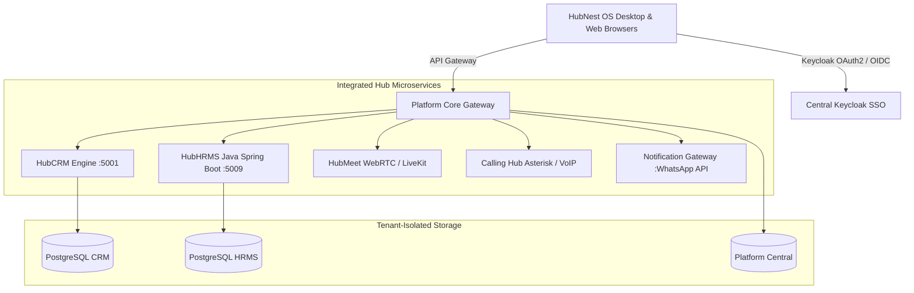

# 🌐 HubNest Unified Documentation Portal

  
  

    The Complete Knowledge Base, User Manuals & Interactive Technical Guides for SRJ HubNest Ecosystem.
  

---

## ⚡ Direct Role Portals & Fast Jump

Jump directly to your designated operational workspace:

-   :material-shield-crown:{ .lg .middle style="color: #6366f1;" } **[Company Admin HRMS](hrms/index.md)**

    ---

    Full administrative command: multi-branch controls, 22-module sidebar, enterprise payroll, and RBAC governance.

    [:octicons-arrow-right-24: Open Admin Guide (22 Chapters)](hrms/index.md)

-   :material-account-tie:{ .lg .middle style="color: #3b82f6;" } **[HR Specialist / Director](hrms-hr/index.md)**

    ---

    Daily human resources operations: AI recruitment pipelines, attendance audits, leave quotas, and 9-Box calibration.

    [:octicons-arrow-right-24: Open HR Guide (14 Chapters)](hrms-hr/index.md)

-   :material-account-supervisor:{ .lg .middle style="color: #10b981;" } **[Department Manager](hrms-manager/index.md)**

    ---

    Team leadership: roster allocation, project sprints, team attendance, and leave approval workflows.

    [:octicons-arrow-right-24: Open Manager Guide (10 Chapters)](hrms-manager/index.md)

-   :material-account-circle:{ .lg .middle style="color: #f59e0b;" } **[Employee Self-Service (ESS)](hrms-employee/index.md)**

    ---

    Staff portal: geo-fenced daily check-ins, encrypted PDF payslips, leave applications, and task boards.

    [:octicons-arrow-right-24: Open Employee Guide (13 Chapters)](hrms-employee/index.md)

-   :material-video:{ .lg .middle style="color: #ec4899;" } **[HubMeet (Video Calls)](hubmeet/index.md)**

    ---

    Ultra-HD WebRTC conferencing, AI noise cancellation, instant meeting links, screen sharing, and cloud recordings.

    [:octicons-arrow-right-24: Open HubMeet Guide](hubmeet/index.md)

-   :material-chart-timeline-variant:{ .lg .middle style="color: #8b5cf6;" } **[HubCRM (Sales & Deals)](hubcrm/index.md)**

    ---

    Sales pipelines, client accounts, deal forecasting, quotations, and automated customer communication.

    [:octicons-arrow-right-24: Open HubCRM Guide](hubcrm/index.md)

---

## 🗺️ Master Documentation Directory (Complete Sitemap)

Click on **any topic or chapter** below to open its dedicated guide directly:

=== "🏢 HubHRMS (All 4 User Roles)"

    

    -   **🏢 1. Company Admin (`/admin`)**

        ---

        * 🚀 **[01. Overview & Architecture](hrms/index.md)**
        * 📊 **[02. Company Dashboard](hrms/dashboard.md)**
        * 👥 **[03. Manage Employees](hrms/employees.md)**
        * 📑 **[04. Digital Onboarding](hrms/onboarding.md)**
        * 📍 **[05. Manage Branches](hrms/branches.md)**
        * 🏛️ **[06. Departments](hrms/departments.md)**
        * 🏷️ **[07. Designations](hrms/designations.md)**
        * 📖 **[08. Employee Directory](hrms/directory.md)**
        * ⏰ **[09. Attendance Management](hrms/attendance.md)**
        * 🏖️ **[10. Leave Management](hrms/leaves.md)**
        * 💰 **[11. Payroll Processing](hrms/payroll.md)**
        * 📋 **[12. Tasks & Projects](hrms/tasks.md)**
        * 🎯 **[13. Performance Reviews](hrms/performance.md)**
        * 🎓 **[14. Learning (LMS)](hrms/lms.md)**
        * 💻 **[15. Asset Tracking](hrms/assets.md)**
        * 📁 **[16. Document Vault](hrms/documents.md)**
        * 📈 **[17. Company Reports](hrms/reports.md)**
        * 🔔 **[18. Notifications & Logs](hrms/notifications.md)**
        * 💬 **[19. Messages & Calls](hrms/messages.md)**
        * 🎧 **[20. Help & Support](hrms/support.md)**
        * ⚙️ **[21. Company Settings](hrms/settings.md)**
        * 👤 **[22. Admin Profile](hrms/profile.md)**

    -   **👩‍💼 2. HR Specialist / Director (`/hr`)**

        ---

        * 🌟 **[01. Operations Overview](hrms-hr/index.md)**
        * 📊 **[02. HR Dashboard](hrms-hr/dashboard.md)**
        * 📢 **[03. Talent Acquisition & Recruitment](hrms-hr/recruitment.md)**
        * 👥 **[04. Employee Management](hrms-hr/employees.md)**
        * ⏰ **[05. Attendance Tracking](hrms-hr/attendance.md)**
        * 🏖️ **[06. Leave Administration](hrms-hr/leaves.md)**
        * 💰 **[07. Payroll & Deductions](hrms-hr/payroll.md)**
        * 📋 **[08. Tasks & Milestones](hrms-hr/tasks.md)**
        * 🎯 **[09. Performance & 9-Box Matrix](hrms-hr/performance.md)**
        * 📈 **[10. HR Reports & Analytics](hrms-hr/reports.md)**
        * 📜 **[11. Company Documentation & Policies](hrms-hr/documentation.md)**
        * 🤖 **[12. AI HR Talent Assistant](hrms-hr/ai.md)**
        * 💬 **[13. Internal Messages](hrms-hr/messages.md)**
        * 👤 **[14. HR Profile & Security](hrms-hr/profile.md)**

    -   **👔 3. Department Manager (`/manager`)**

        ---

        * 🧭 **[01. Team Oversight Overview](hrms-manager/index.md)**
        * 📊 **[02. Manager Dashboard](hrms-manager/dashboard.md)**
        * 👥 **[03. Department Team Roster](hrms-manager/team.md)**
        * 📋 **[04. Task & Project Allocation](hrms-manager/tasks.md)**
        * ⏰ **[05. Team Daily Attendance](hrms-manager/attendance.md)**
        * 🏖️ **[06. Team Leave Approvals](hrms-manager/leaves.md)**
        * 📈 **[07. Team Performance & Reports](hrms-manager/reports.md)**
        * 💬 **[08. Team Communication](hrms-manager/messages.md)**
        * 🎧 **[09. Support & Grievances](hrms-manager/support.md)**
        * 👤 **[10. Manager Profile](hrms-manager/profile.md)**

    -   **🧑‍💻 4. Employee Self-Service (`/employee`)**

        ---

        * 🧭 **[01. Portal Guide Overview](hrms-employee/index.md)**
        * 📊 **[02. Employee Dashboard](hrms-employee/dashboard.md)**
        * ⏰ **[03. Daily Check-In & Attendance](hrms-employee/attendance.md)**
        * 📋 **[04. My Assigned Tasks](hrms-employee/tasks.md)**
        * 🏖️ **[05. Apply Leaves & Quotas](hrms-employee/leaves.md)**
        * 💰 **[06. Payslips & Salary Structure](hrms-employee/salary.md)**
        * 🎯 **[07. Goals & Performance Appraisals](hrms-employee/performance.md)**
        * 📑 **[08. Digital Onboarding Checklist](hrms-employee/onboarding.md)**
        * 📁 **[09. Document Vault & Letters](hrms-employee/documents.md)**
        * 📈 **[10. My Attendance & Task Reports](hrms-employee/reports.md)**
        * 💬 **[11. Team Chat & Messages](hrms-employee/messages.md)**
        * 🎧 **[12. Helpdesk & Grievance Tickets](hrms-employee/support.md)**
        * 👤 **[13. My Profile & Security Settings](hrms-employee/profile.md)**

    

=== "🚀 Getting Started & Desktop App"

    

    -   **🚀 Getting Started Manual**

        ---

        * 🏁 **[01. Quick Start Guide](getting-started/index.md)**
        * 💻 **[02. Installing Windows Desktop App](getting-started/installing-desktop-app.md)**
        * 🏢 **[03. Account Setup & Company Profile](getting-started/account-setup.md)**
        * 🔐 **[04. Login & Account Security (SSO / MFA)](getting-started/login-security.md)**
        * 🛡️ **[05. Roles & Permissions (RBAC Matrix)](getting-started/roles-permissions.md)**
        * 🧭 **[06. Complete Dashboard Tour](getting-started/dashboard-tour.md)**
        * 🔌 **[07. Integrations & Configuration](getting-started/integrations.md)**
        * ✅ **[08. First Day Task Checklist](getting-started/first-tasks.md)**
        * ⚠️ **[09. Common Setup Problems & Fixes](getting-started/common-problems.md)**

    -   **💻 HubNest OS (Desktop Client)**

        ---

        * 🖥️ **[Workspace Architecture & WebView2](desktop/workspace.md)**
        * 🗂️ **[Multi-Hub Switching & Navigation](desktop/navigation.md)**
        * ⚙️ **[Preferences, Performance & Auto-Update](desktop/preferences.md)**

    

=== "🎥 HubMeet & 📊 HubCRM"

    

    -   **🎥 HubMeet (Video Conferencing)**

        ---

        * 🌐 **[HubMeet Overview & Architecture](hubmeet/index.md)**
        * 📅 **[Instant & Scheduled Meetings](hubmeet/scheduling.md)**
        * 🎛️ **[In-Call Controls, Mic & Camera Settings](hubmeet/in-call-controls.md)**
        * 🖥️ **[Screen Sharing & Collaborative Whiteboard](hubmeet/collaboration.md)**
        * 🤖 **[Cloud Recording & AI Transcription Summaries](hubmeet/recordings-ai.md)**

    -   **📊 HubCRM (Customer Relationship Management)**

        ---

        * 📈 **[HubCRM Overview & Architecture](hubcrm/index.md)**
        * 🎯 **[Leads Pipeline & Kanban Stages](hubcrm/leads-pipeline.md)**
        * 👥 **[Contacts & Organization Accounts](hubcrm/contacts.md)**
        * 💼 **[Deals, Quotations & Proposals](hubcrm/deals.md)**
        * 📊 **[Sales Reports & Performance Dashboards](hubcrm/reports.md)**

    

=== "📞 VoIP, 🔔 Notifications & 💳 Billing"

    

    -   **📞 Calling Hub (VoIP Cloud Telephony)**

        ---

        * 📞 **[Calling Hub Overview](calling/index.md)**
        * 🔢 **[Softphone Web Dialpad & DTMF](calling/dialer.md)**
        * 🎙️ **[Call Logs, Recordings & CDR Analytics](calling/logs.md)**

    -   **🔔 HubNotification (WhatsApp & Alerts)**

        ---

        * 📣 **[Notification Gateway Overview](notification/index.md)**
        * 💬 **[WhatsApp Meta Campaigns & Webhook Templates](notification/campaigns.md)**

    -   **💳 Billing, Invoices & Administration**

        ---

        * 🧾 **[Subscription Plans & GST Tax Invoices](billing/plans-invoices.md)**
        * 👥 **[Team Seat Management & License Assignments](billing/team-management.md)**

    -   **🛠️ Help, FAQs & Support**

        ---

        * 🔧 **[System Troubleshooting & Error Codes](help/troubleshooting.md)**
        * 💬 **[Contacting Official Technical Support](help/support.md)**

    

---

## 🏛️ System Architecture Overview

HubNest connects your teams through a federated Single Sign-On (SSO) identity bus and multi-tenant database microservices:

---

## 🌐 Live Production Server Credentials & Access

| Resource | Live Production URL | Default Access Port |
| :--- | :--- | :--- |
| **🏢 HRMS Portal** | [https://hrms.srjhubnest.com](https://hrms.srjhubnest.com) | Port 443 (HTTPS) |
| **🔐 Admin Dashboard** | [https://hrms.srjhubnest.com/admin/dashboard](https://hrms.srjhubnest.com/admin/dashboard) | Protected Admin Route |
| **👩‍💼 HR Portal** | [https://hrms.srjhubnest.com/hr/dashboard](https://hrms.srjhubnest.com/hr/dashboard) | Protected HR Route |
| **👔 Manager Portal** | [https://hrms.srjhubnest.com/manager/dashboard](https://hrms.srjhubnest.com/manager/dashboard) | Protected Manager Route |
| **🧑‍💻 Employee Portal** | [https://hrms.srjhubnest.com/employee/dashboard](https://hrms.srjhubnest.com/employee/dashboard) | Protected Staff Route |
| **🎥 HubMeet** | [https://meet.srjhubnest.com](https://meet.srjhubnest.com) | WebRTC RTC Signaling |
| **📊 HubCRM** | [https://crm.srjhubnest.com](https://crm.srjhubnest.com) | Client Sales Suite |

---

## 📞 Enterprise Helpdesk & Assistance

* 📧 **Official Support Email**: `support@srjhubnest.com`
* 📞 **Helpline**: `+918031830008`
* ⏰ **Operating Hours**: Monday to Saturday, 10:00 AM – 7:00 PM IST
* 🏢 **SRJ HubNest Enterprise Solutions Pvt. Ltd.**
