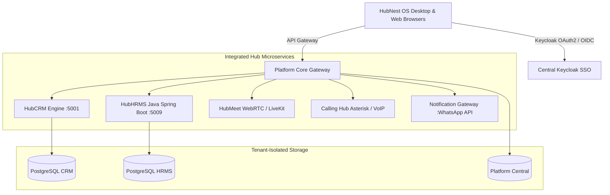

# 🌐 HubNest Unified Documentation Portal

  
  

    The Complete Knowledge Base, User Manuals & Interactive Technical Guides for SRJ HubNest Ecosystem.
  

---

## ⚡ Direct Role Portals & Fast Jump

Jump directly to your designated operational workspace:

-   :material-shield-crown:{ .lg .middle style="color: #6366f1;" } **[Company Admin HRMS](hrms/index.md)**

    ---

    Full administrative command: multi-branch controls, 22-module sidebar, enterprise payroll, and RBAC governance.

    [:octicons-arrow-right-24: Open Admin Guide (22 Chapters)](hrms/index.md)

-   :material-account-tie:{ .lg .middle style="color: #3b82f6;" } **[HR Specialist / Director](hrms-hr/index.md)**

    ---

    Daily human resources operations: AI recruitment pipelines, attendance audits, leave quotas, and 9-Box calibration.

    [:octicons-arrow-right-24: Open HR Guide (14 Chapters)](hrms-hr/index.md)

-   :material-account-supervisor:{ .lg .middle style="color: #10b981;" } **[Department Manager](hrms-manager/index.md)**

    ---

    Team leadership: roster allocation, project sprints, team attendance, and leave approval workflows.

    [:octicons-arrow-right-24: Open Manager Guide (10 Chapters)](hrms-manager/index.md)

-   :material-account-circle:{ .lg .middle style="color: #f59e0b;" } **[Employee Self-Service (ESS)](hrms-employee/index.md)**

    ---

    Staff portal: geo-fenced daily check-ins, encrypted PDF payslips, leave applications, and task boards.

    [:octicons-arrow-right-24: Open Employee Guide (13 Chapters)](hrms-employee/index.md)

-   :material-video:{ .lg .middle style="color: #ec4899;" } **[HubMeet (4 Roles)](hubmeet-attendee/index.md)**

    ---

    Ultra-HD WebRTC conferencing, AI noise cancellation, waiting rooms, interactive whiteboards, live polls, and E2EE encryption.

    [:octicons-arrow-right-24: Open HubMeet Guide (26 Chapters)](hubmeet-attendee/index.md)

-   :material-chart-timeline-variant:{ .lg .middle style="color: #8b5cf6;" } **[HubCRM (Sales & 7 Roles)](crm-sales/index.md)**

    ---

    Role-based manuals for Sales Reps, Managers, Marketing, Finance, Support, and Administrators.

    [:octicons-arrow-right-24: Open HubCRM Sales Guide (61 Chapters)](crm-sales/index.md)

-   :material-bell-ring:{ .lg .middle style="color: #10b981;" } **[HubNotification (6 Roles)](notification-agent/index.md)**

    ---

    Omnichannel Live Inbox, WhatsApp Cloud API, AI Chatbots, Multi-Channel Broadcasts, and E-Commerce Sync.

    [:octicons-arrow-right-24: Open HubNotification Guide (45 Chapters)](notification-agent/index.md)

-   :material-phone-in-talk:{ .lg .middle style="color: #06b6d4;" } **[Calling Hub (4 Roles)](calling-agent/index.md)**

    ---

    Cloud VoIP Softphone, Visual IVR Trees, Conversational AI Voice Bots, Bulk Dialer, Virtual DIDs & SIP Trunks.

    [:octicons-arrow-right-24: Open Calling Hub Guide (24 Chapters)](calling-agent/index.md)

-   :material-laptop:{ .lg .middle style="color: #0284c7;" } **[HubNest OS (Desktop User)](desktop-user/index.md)**

    ---

    Native Windows workstation: multi-hub instant switching, Command Palette (Ctrl+K), tray alerts, and offline sync.

    [:octicons-arrow-right-24: Open Desktop User Guide (6 Chapters)](desktop-user/index.md)

-   :material-server-security:{ .lg .middle style="color: #475569;" } **[HubNest OS (IT Admin)](desktop-admin/index.md)**

    ---

    Enterprise endpoint control: silent MSI Intune deployment, Edge WebView2 evergreen runtime, and deep links.

    [:octicons-arrow-right-24: Open IT Admin Guide (5 Chapters)](desktop-admin/index.md)

-   :material-crown:{ .lg .middle style="color: #e11d48;" } **[Platform Super Admin](platform-super-admin/index.md)**

    ---

    SaaS monorepo command center: global tenant provisioning, one-click impersonation, and master audit trails.

    [:octicons-arrow-right-24: Open Super Admin Guide (6 Chapters)](platform-super-admin/index.md)

-   :material-cash-register:{ .lg .middle style="color: #059669;" } **[Billing & Finance Controller](platform-billing/index.md)**

    ---

    Commercial monetization: multi-hub plan tiers, payment gateways (PhonePe, Razorpay), and wire transfer approvals.

    [:octicons-arrow-right-24: Open Billing & Finance Guide (6 Chapters)](platform-billing/index.md)

-   :material-shield-key:{ .lg .middle style="color: #d97706;" } **[Security & IAM Officer](platform-security/index.md)**

    ---

    Identity & zero-trust control: cross-tenant user registry, remote session termination, and master RBAC matrix.

    [:octicons-arrow-right-24: Open Security & IAM Guide (5 Chapters)](platform-security/index.md)

---

## 🗺️ Master Documentation Directory (Complete Sitemap)

Click on **any topic or chapter** below to open its dedicated guide directly:

=== "🏢 HubHRMS (All 4 User Roles)"

    

    -   **🏢 1. Company Admin (`/admin`)**

        ---

        * 🚀 **[01. Overview & Architecture](hrms/index.md)**
        * 📊 **[02. Company Dashboard](hrms/dashboard.md)**
        * 👥 **[03. Manage Employees](hrms/employees.md)**
        * 📑 **[04. Digital Onboarding](hrms/onboarding.md)**
        * 📍 **[05. Manage Branches](hrms/branches.md)**
        * 🏛️ **[06. Departments](hrms/departments.md)**
        * 🏷️ **[07. Designations](hrms/designations.md)**
        * 📖 **[08. Employee Directory](hrms/directory.md)**
        * ⏰ **[09. Attendance Management](hrms/attendance.md)**
        * 🏖️ **[10. Leave Management](hrms/leaves.md)**
        * 💰 **[11. Payroll Processing](hrms/payroll.md)**
        * 📋 **[12. Tasks & Projects](hrms/tasks.md)**
        * 🎯 **[13. Performance Reviews](hrms/performance.md)**
        * 🎓 **[14. Learning (LMS)](hrms/lms.md)**
        * 💻 **[15. Asset Tracking](hrms/assets.md)**
        * 📁 **[16. Document Vault](hrms/documents.md)**
        * 📈 **[17. Company Reports](hrms/reports.md)**
        * 🔔 **[18. Notifications & Logs](hrms/notifications.md)**
        * 💬 **[19. Messages & Calls](hrms/messages.md)**
        * 🎧 **[20. Help & Support](hrms/support.md)**
        * ⚙️ **[21. Company Settings](hrms/settings.md)**
        * 👤 **[22. Admin Profile](hrms/profile.md)**

    -   **👩‍💼 2. HR Specialist / Director (`/hr`)**

        ---

        * 🌟 **[01. Operations Overview](hrms-hr/index.md)**
        * 📊 **[02. HR Dashboard](hrms-hr/dashboard.md)**
        * 📢 **[03. Talent Acquisition & Recruitment](hrms-hr/recruitment.md)**
        * 👥 **[04. Employee Management](hrms-hr/employees.md)**
        * ⏰ **[05. Attendance Tracking](hrms-hr/attendance.md)**
        * 🏖️ **[06. Leave Administration](hrms-hr/leaves.md)**
        * 💰 **[07. Payroll & Deductions](hrms-hr/payroll.md)**
        * 📋 **[08. Tasks & Milestones](hrms-hr/tasks.md)**
        * 🎯 **[09. Performance & 9-Box Matrix](hrms-hr/performance.md)**
        * 📈 **[10. HR Reports & Analytics](hrms-hr/reports.md)**
        * 📜 **[11. Company Documentation & Policies](hrms-hr/documentation.md)**
        * 🤖 **[12. AI HR Talent Assistant](hrms-hr/ai.md)**
        * 💬 **[13. Internal Messages](hrms-hr/messages.md)**
        * 👤 **[14. HR Profile & Security](hrms-hr/profile.md)**

    -   **👔 3. Department Manager (`/manager`)**

        ---

        * 🧭 **[01. Team Oversight Overview](hrms-manager/index.md)**
        * 📊 **[02. Manager Dashboard](hrms-manager/dashboard.md)**
        * 👥 **[03. Department Team Roster](hrms-manager/team.md)**
        * 📋 **[04. Task & Project Allocation](hrms-manager/tasks.md)**
        * ⏰ **[05. Team Daily Attendance](hrms-manager/attendance.md)**
        * 🔄 **[06. Shift Rosters & Duty Cycles](hrms-manager/shifts.md)**
        * 🏖️ **[07. Team Leave Approvals](hrms-manager/leaves.md)**
        * 📈 **[08. Team Performance & Reports](hrms-manager/reports.md)**
        * 🎧 **[09. Support & Grievances](hrms-manager/support.md)**
        * 👤 **[10. Manager Profile](hrms-manager/profile.md)**

    -   **🧑‍💻 4. Employee Self-Service (`/employee`)**

        ---

        * 🧭 **[01. Portal Guide Overview](hrms-employee/index.md)**
        * 📊 **[02. Employee Dashboard](hrms-employee/dashboard.md)**
        * ⏰ **[03. Daily Check-In & Attendance](hrms-employee/attendance.md)**
        * 📋 **[04. My Assigned Tasks](hrms-employee/tasks.md)**
        * 🏖️ **[05. Apply Leaves & Quotas](hrms-employee/leaves.md)**
        * 💰 **[06. Payslips & Salary Structure](hrms-employee/salary.md)**
        * 🎯 **[07. Goals & Performance Appraisals](hrms-employee/performance.md)**
        * 📑 **[08. Digital Onboarding Checklist](hrms-employee/onboarding.md)**
        * 📁 **[09. Document Vault & Letters](hrms-employee/documents.md)**
        * 📈 **[10. My Attendance & Task Reports](hrms-employee/reports.md)**
        * 💬 **[11. Team Chat & Messages](hrms-employee/messages.md)**
        * 🎧 **[12. Helpdesk & Grievance Tickets](hrms-employee/support.md)**
        * 👤 **[13. My Profile & Security Settings](hrms-employee/profile.md)**

    

=== "🚀 Getting Started & Desktop App"

    

    -   **🚀 Getting Started Manual**

        ---

        * 🏁 **[01. Quick Start Guide](getting-started/index.md)**
        * 💻 **[02. Installing Windows Desktop App](getting-started/installing-desktop-app.md)**
        * 🏢 **[03. Account Setup & Company Profile](getting-started/account-setup.md)**
        * 🔐 **[04. Login & Account Security (SSO / MFA)](getting-started/login-security.md)**
        * 🛡️ **[05. Roles & Permissions (RBAC Matrix)](getting-started/roles-permissions.md)**
        * 🧭 **[06. Complete Dashboard Tour](getting-started/dashboard-tour.md)**
        * 🔌 **[07. Integrations & Configuration](getting-started/integrations.md)**
        * ✅ **[08. First Day Task Checklist](getting-started/first-tasks.md)**
        * ⚠️ **[09. Common Setup Problems & Fixes](getting-started/common-problems.md)**

    -   **💻 HubNest OS (Desktop User & Remote Employee)**

        ---

        * 🚀 **[01. Overview & Daily Checklist](desktop-user/index.md)**
        * 🔑 **[02. Installation & Seamless SSO](desktop-user/installation-login.md)**
        * 🗂️ **[03. Multi-Hub Instant Switching](desktop-user/multi-hub-navigation.md)**
        * ⚡ **[04. Command Palette & Shortcuts](desktop-user/command-palette-shortcuts.md)**
        * 🔔 **[05. System Tray & Windows Alerts](desktop-user/system-tray-background.md)**
        * 🎙️ **[06. Audio, Video & Offline Resilience](desktop-user/hardware-offline-mode.md)**

    -   **🛡️ HubNest OS (IT Administrator & Deployment)**

        ---

        * 🏢 **[01. IT Command Center Overview](desktop-admin/index.md)**
        * 📦 **[02. Silent MSI & Intune Deployment](desktop-admin/msi-enterprise-deployment.md)**
        * 🖥️ **[03. Edge WebView2 & Hardware Specs](desktop-admin/system-requirements-webview2.md)**
        * 🔗 **[04. Custom Protocol & Deep Linking](desktop-admin/protocol-deep-linking.md)**
        * 🌐 **[05. Network, Proxies & Auto-Update](desktop-admin/network-proxy-updates.md)**

    -   **⚙️ HubNest OS (Ecosystem Deep Dive)**

        ---

        * 🏗️ **[Workspace Architecture & WebView2 Pool](desktop/workspace.md)**
        * 🧭 **[Multi-Hub Switching & Key Shortcuts](desktop/navigation.md)**
        * 🔄 **[Preferences, Tray & Update Engine](desktop/preferences.md)**

    

=== "🎥 HubMeet & 📊 HubCRM"

    

    -   **🎥 HubMeet (4 Dedicated Role Manuals)**

        ---

        * 🎧 **[Meeting Participant & Attendee (7 Guides)](hubmeet-attendee/index.md)**
        * 🎙️ **[Meeting Host & Event Organizer (7 Guides)](hubmeet-host/index.md)**
        * 👑 **[Enterprise Meeting Administrator (7 Guides)](hubmeet-admin/index.md)**
        * 💻 **[Developer & API Integrator (5 Guides)](hubmeet-developer/index.md)**
        * 🌐 **[Ecosystem Video Architecture](hubmeet/index.md)**

    -   **📊 HubCRM (7 Dedicated Role Manuals)**

        ---

        * 💼 **[Sales Executive Manual (10 Guides)](crm-sales/index.md)**
        * 📊 **[Sales Manager Manual (8 Guides)](crm-manager/index.md)**
        * 📣 **[Marketing Specialist Manual (8 Guides)](crm-marketing/index.md)**
        * 💰 **[Finance & Invoicing Manual (8 Guides)](crm-finance/index.md)**
        * 🎧 **[Customer Support Manual (7 Guides)](crm-support/index.md)**
        * 🏢 **[Company Administrator Manual (11 Guides)](crm-admin/index.md)**
        * 👑 **[Platform Super Admin Manual (9 Guides)](crm-super-admin/index.md)**

    

=== "📞 VoIP, 🔔 Notifications & 💳 Billing"

    

    -   **📞 Calling Hub (4 Dedicated Role Manuals)**

        ---

        * 🎧 **[Call Center Agent & Telecaller (6 Guides)](calling-agent/index.md)**
        * 📢 **[Campaign & AI Voice Specialist (7 Guides)](calling-campaigns/index.md)**
        * 📱 **[Telephony Operations & Compliance (5 Guides)](calling-telephony/index.md)**
        * 👑 **[Platform Super Administrator (6 Guides)](calling-admin/index.md)**
        * 🌐 **[Ecosystem Voice Architecture](calling/index.md)**

    -   **🔔 HubNotification (6 Dedicated Role Manuals)**

        ---

        * 🎧 **[Customer Support Agent Manual (7 Guides)](notification-agent/index.md)**
        * 📢 **[Marketing & Campaigns Manual (9 Guides)](notification-marketing/index.md)**
        * 🤖 **[Automation & AI Specialist Manual (7 Guides)](notification-automation/index.md)**
        * 🛒 **[E-Commerce Operations Manual (5 Guides)](notification-ecommerce/index.md)**
        * 🏢 **[Company Administrator Manual (9 Guides)](notification-admin/index.md)**
        * 👑 **[Platform Super Admin Manual (8 Guides)](notification-super-admin/index.md)**
        * 🌐 **[Cross-Module Integration & Architecture](notification/index.md)**

    -   **💳 Billing, Invoices & Administration**

        ---

        * 🧾 **[Subscription Plans & GST Tax Invoices](billing/plans-invoices.md)**
        * 👥 **[Team Seat Management & License Assignments](billing/team-management.md)**

    -   **🛠️ Help, FAQs & Support**

        ---

        * 🔧 **[System Troubleshooting & Error Codes](help/troubleshooting.md)**
        * 💬 **[Contacting Official Technical Support](help/support.md)**

    

=== "👑 Master Admin & Platform Governance (4 Roles)"

    

    -   **👑 1. Platform Super Admin (SaaS Owner)**

        ---

        * 🚀 **[01. Super Admin Command Center](platform-super-admin/index.md)**
        * 🏢 **[02. Master Tenant Provisioning](platform-super-admin/tenant-lifecycle-management.md)**
        * 🔑 **[03. Tenant Impersonation & SSO](platform-super-admin/tenant-impersonation-sso.md)**
        * 🧩 **[04. Multi-Product Hub Provisioning](platform-super-admin/product-consoles-activation.md)**
        * 📋 **[05. Administrative Audit Logs](platform-super-admin/security-audit-trails.md)**
        * ⚙️ **[06. Master Settings & Central SMTP](platform-super-admin/system-settings-smtp.md)**

    -   **🏢 2. Tenant Operations Specialist**

        ---

        * 🧭 **[01. Tenant Operations Overview](platform-tenants/index.md)**
        * 🏷️ **[02. Organization Profiles & Domains](platform-tenants/organization-profiles-domains.md)**
        * ⏳ **[03. Trial Extensions & Seat Quotas](platform-tenants/trial-extensions-limits.md)**
        * 🚩 **[04. Feature Flags & Entitlements](platform-tenants/feature-flags-entitlements.md)**
        * 📢 **[05. Demo Requests & Qualification](platform-tenants/demo-leads-pipeline.md)**

    -   **💳 3. Billing & Finance Controller**

        ---

        * 💰 **[01. Financial Operations Center](platform-billing/index.md)**
        * 📦 **[02. Hub Plans & Feature Gating](platform-billing/hub-plans-feature-gating.md)**
        * 💳 **[03. Payment Gateways Setup](platform-billing/payment-gateways-config.md)**
        * 🏦 **[04. Manual Bank Transfer Clearance](platform-billing/offline-payments-clearance.md)**
        * 🎟️ **[05. Promotional Coupons Engine](platform-billing/coupons-discount-engine.md)**
        * 🪙 **[06. Pre-Paid Usage Credits](platform-billing/credits-wallet-usage.md)**

    -   **🛡️ 4. Platform Security & IAM Officer**

        ---

        * 🔐 **[01. Security & IAM Command Center](platform-security/index.md)**
        * 👥 **[02. Global User Registry](platform-security/global-user-registry.md)**
        * 💻 **[03. Live Sessions & 2FA Governance](platform-security/session-management-mfa.md)**
        * 🛡️ **[04. Master RBAC Permission Matrix](platform-security/master-rbac-permission-matrix.md)**
        * 🔑 **[05. Master Admin Password Security](platform-security/admin-credentials-recovery.md)**

    

---

## 🏛️ System Architecture Overview

HubNest connects your teams through a federated Single Sign-On (SSO) identity bus and multi-tenant database microservices:

---

## 🌐 Live Production Server Credentials & Access

| Resource | Live Production URL | Default Access Port |
| :--- | :--- | :--- |
| **🏢 HRMS Portal** | [https://hrms.srjhubnest.com](https://hrms.srjhubnest.com) | Port 443 (HTTPS) |
| **🔐 Admin Dashboard** | [https://hrms.srjhubnest.com/admin/dashboard](https://hrms.srjhubnest.com/admin/dashboard) | Protected Admin Route |
| **👩‍💼 HR Portal** | [https://hrms.srjhubnest.com/hr/dashboard](https://hrms.srjhubnest.com/hr/dashboard) | Protected HR Route |
| **👔 Manager Portal** | [https://hrms.srjhubnest.com/manager/dashboard](https://hrms.srjhubnest.com/manager/dashboard) | Protected Manager Route |
| **🧑‍💻 Employee Portal** | [https://hrms.srjhubnest.com/employee/dashboard](https://hrms.srjhubnest.com/employee/dashboard) | Protected Staff Route |
| **🎥 HubMeet** | [https://meet.srjhubnest.com](https://meet.srjhubnest.com) | WebRTC RTC Signaling |
| **📊 HubCRM** | [https://crm.srjhubnest.com](https://crm.srjhubnest.com) | Client Sales Suite |
| **🚀 CI/CD Orchestrator** | [https://staging-jenkins.srjhubnest.com](https://staging-jenkins.srjhubnest.com) | Jenkins Automated Delivery |
| **🧪 Staging Gateway** | [https://staging-docs.srjhubnest.com](https://staging-docs.srjhubnest.com) | Dedicated Staging Portal |

---
