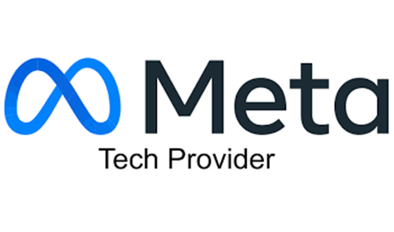
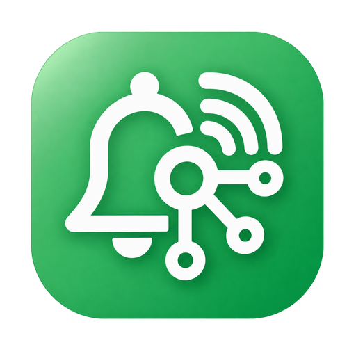
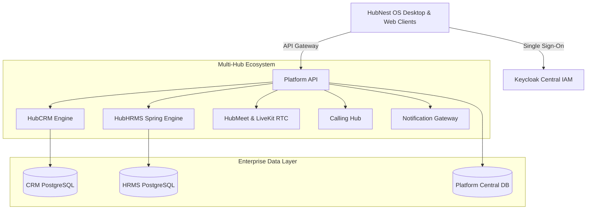

# Welcome to HubNest

  

{ align=center style="border-radius: 8px; box-shadow: 0 4px 20px rgba(0,0,0,0.15); margin-bottom: 2rem;" }

**SRJ HubNest** is an enterprise-grade, all-in-one operating platform built to streamline and connect your core business operations. Instead of paying for and juggling 10 different fragmented SaaS tools, HubNest unifies video conferencing, customer relationship management, workforce HR operations, cloud telephony, notification engines, and billing into **one seamless desktop and cloud ecosystem**.

  
  
Official Meta Business Technology Provider for WhatsApp Campaigns & Automation

---

## 1. Platform Introduction & Value Proposition

### What is HubNest?
HubNest is a multi-tenant business operating system designed for modern companies. It provides native Windows desktop apps, responsive web interfaces, and centralized Single Sign-On (SSO) to eliminate silos between departments.

### Mission & Vision
* **Mission**: To democratize enterprise-grade operational software by providing high-performance, cost-effective tools for businesses of all scales.
* **Vision**: A unified workplace where an employee can transition from a video conference, update a CRM deal, approve an employee leave request, and trigger a client WhatsApp campaign—all without switching windows or authenticating twice.

### Problems HubNest Solves
| Problem in Traditional Workplaces | How HubNest Solves It |
| :--- | :--- |
| **Tool Sprawl & High Subscription Costs** | Consolidates CRM, HRMS, Video Conferencing, VoIP, and WhatsApp notification tools into a single predictable pricing plan. |
| **Fragmented Identity & Multiple Passwords** | Centralized Keycloak SSO delivers one-click session authentication across all hubs. |
| **Data Silos Between Sales and HR** | Shared organizational directories and tenant isolation ensure unified company data flows. |
| **Complex Desktop Deployments** | Single installer `.msi` package with automated background delta updates. |

### Target Industries & Use Cases
* **IT & SaaS Enterprises**: Sprint planning video calls, candidate applicant tracking, client proposal pipelines, and developer webhook automations.
* **Non-IT & Service Businesses**: Retail/Trading sales pipelines, factory worker shift attendance & biometric integration, client quotation delivery, and payment collections.
* **BPOs & Call Centers**: Softphone dialers, automatic call recordings, customer support tickets, and performance analytics.

---

## 2. Product Ecosystem

Explore the specialized hubs that power the HubNest ecosystem:

-    **[HubNest CRM / Sales](hubcrm/index.md)**

    ---

    Complete sales pipeline management with Kanban boards, deal forecasting, client accounts, and automated quotation-to-invoice workflows.

    * **Target Users**: Sales Executives, Account Managers, VP of Sales.
    * [Explore HubCRM Guide :octicons-arrow-right-24:](hubcrm/index.md)

-    **[HubNest HRMS](hrms/index.md)**

    ---

    Full lifecycle workforce management: employee records, clock-in/out attendance, shift rotations, leave approvals, and one-click salary payslips.

    * **Target Users**: HR Managers, People Operations, Employees.
    * [Explore HubHRMS Guide :octicons-arrow-right-24:](hrms/index.md)

-    **[JobNest / Hub Recruiter](hubcrm/leads-pipeline.md)**

    ---

    Automated candidate sourcing, resume parsing, interview scheduling, and recruitment pipeline stages.

    * **Target Users**: Talent Acquisition Specialists, Recruiters.
    * [Explore Recruiter Hub :octicons-arrow-right-24:](hubcrm/leads-pipeline.md)

-    **[NestMeet AI / HubMeet](hubmeet/index.md)**

    ---

    Ultra-HD WebRTC video conferencing with AI noise reduction, live transcription, interactive whiteboard, and automatic AI meeting summaries.

    * **Target Users**: Cross-functional Teams, Executives, External Clients.
    * [Explore HubMeet Guide :octicons-arrow-right-24:](hubmeet/index.md)

-    **[Notification Gateway](notification/index.md)**

    ---

    Omni-channel marketing and transactional alert gateway supporting WhatsApp Business API, SMS templates, and automated webhook triggers.

    * **Target Users**: Marketing Teams, Customer Support, DevOps.
    * [Explore Notifications :octicons-arrow-right-24:](notification/index.md)

-    **[HubNest Pay & Billing](billing/plans-invoices.md)**

    ---

    Unified subscription management, tax invoice downloads, and integrated payment gateways (PhonePe, Razorpay, Offline Bank Transfers).

    * **Target Users**: Finance Officers, CFOs, Company Owners.
    * [Explore Billing Guide :octicons-arrow-right-24:](billing/plans-invoices.md)

-    **[Calling Hub (VoIP)](calling/index.md)**

    ---

    Cloud telephony with an in-browser softphone dialpad, call queues, extension routing, and audio recordings.

    * **Target Users**: Tele-callers, Support Representatives.
    * [Explore Calling Hub :octicons-arrow-right-24:](calling/index.md)

---

## 3. Choose Your Role

Users do not need to read the entire documentation. Follow the tailored onboarding path designed for your role:

=== "👔 Business Owner / Administrator"
    **Your Goal:** Set up your company organization, invite staff, configure subscription licenses, and enforce access controls.
    
    1. **[Create Organization](getting-started/account-setup.md)**: Finalize company profile and corporate domain.
    2. **[Subscribe to Hubs](billing/plans-invoices.md)**: Select individual hub licenses or the complete All-in-One enterprise bundle.
    3. **[Invite Your Team](billing/team-management.md)**: Add employees via email and assign role-based permissions (RBAC).
    4. **[Enforce Security](getting-started/login-security.md)**: Configure Multi-Factor Authentication (MFA) and review audit logs.

=== "👩‍💼 Recruiter & HR Professional"
    **Your Goal:** Manage hiring pipelines, staff attendance, leave balances, and monthly payroll.
    
    1. **[HRMS Setup](hrms/index.md)**: Import your employee directory and set up departments.
    2. **[Configure Shifts & Policies](hrms/attendance.md)**: Define shift timings, grace periods, and leave quotas.
    3. **[Run Monthly Payroll](hrms/payroll.md)**: Verify deductions and generate automated employee payslips.
    4. **[Hiring Workspace](hubcrm/leads-pipeline.md)**: Post job openings and track applicant interview stages.

=== "💼 Sales & Employee"
    **Your Goal:** Close customer deals, attend team sync calls, and log daily work logs.
    
    1. **[Install HubNest OS](getting-started/installing-desktop-app.md)**: Set up the Windows desktop workspace.
    2. **[Sales Pipeline](hubcrm/leads-pipeline.md)**: Add leads, create quotations, and move deals across stages.
    3. **[Join HubMeet](hubmeet/index.md)**: Connect with clients using instant video links and screen sharing.
    4. **[Self-Service HR](hrms/leaves.md)**: Clock in your daily attendance and submit leave applications.

=== "💻 Developer & Technical Team"
    **Your Goal:** Integrate HubNest APIs, automate webhooks, and explore custom hub extensions.
    
    1. **[API Authentication](getting-started/integrations.md)**: Retrieve your bearer token and API base URLs.
    2. **[Webhook Triggers](notification/campaigns.md)**: Subscribe to payment, meeting, or CRM event payloads.
    3. **[Security Overview](help/troubleshooting.md)**: Review tenant isolation schemas, rate limits, and CORS policies.

---

## 4. How HubNest Works

HubNest relies on an enterprise microservice and federated identity architecture:

* **Federated Single Sign-On (SSO)**: One master identity token grants scoped, one-time 60-second access codes (`/platform/sso/mint`) to each specialized hub.
* **Strict Tenant Isolation**: Data from different organizations is isolated at database schema and role levels (`withTenantSchema()`).
* **Cross-Hub Automation**: Converting a lead to "Won" in HubCRM can automatically generate an invoice in HubNest Pay and trigger a welcome WhatsApp message via Notification Gateway.

---

## 5. Documentation Resources & Quick Links

* 🚀 **[Getting Started Guide](getting-started/index.md)** — Step-by-step onboarding walkthrough.
* 💻 **[HubNest OS Desktop Manual](desktop/workspace.md)** — Multi-hub tabs, performance, and updates.
* 🎥 **[HubMeet User Guide](hubmeet/index.md)** — In-call controls, recording, and whiteboard.
* 📊 **[HubCRM Manual](hubcrm/index.md)** — Pipeline management, quotes, and reports.
* 👥 **[HubHRMS Manual](hrms/index.md)** — Employees, attendance, leaves, and payroll.
* 💳 **[Billing & Invoices](billing/plans-invoices.md)** — Subscriptions, tax invoices, and payment gateways.
* 🔧 **[Troubleshooting & FAQs](help/troubleshooting.md)** — Audio/video diagnostic and common error resolution.

---

## 6. Latest Release Notes (v1.7.0)

!!! note "Release Version 1.7.0 Highlights (October 2026)"
    * **WebRTC Native Fixes**: Resolved Windows WebView2 audio/microphone permissions for HubMeet.
    * **Cloudflare WAF Protection**: Deployed L7 security rules and bypass optimizations for LiveKit signalling (`rtc.srjhubnest.com`).
    * **Security Hardening**: Closed path traversal risks, secured S3 storage proxies, and implemented fail-closed payment webhook validation.
    * **Auto-Update Engine**: Windows client now supports seamless in-app version update detection.

---

## 7. Help & Support

Need assistance with onboarding, enterprise licensing, or technical issues?

* 📧 **Email**: `support@srjhubnest.com`
* 📞 **Phone**: `+918031830008`
* ⏰ **Support Hours**: Monday to Saturday, 10:00 AM – 7:00 PM IST
* 🏢 **Headquarters**: SRJ HubNest Enterprise Solutions
