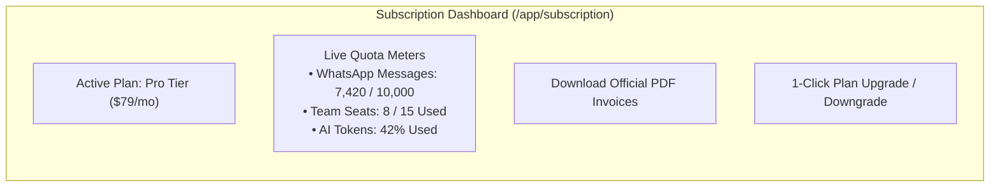
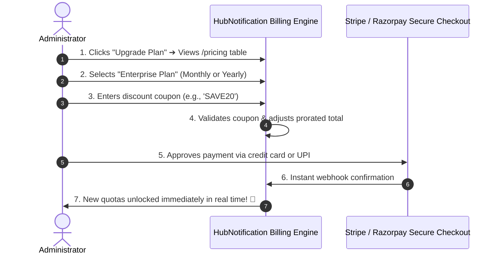

# 💳 Managing Subscriptions, Quota Limits & Billing

Every business has different messaging requirements. A local retail boutique might send 2,000 WhatsApp updates a month, while a nationwide e-commerce brand sends 500,000 automated tracking alerts.

The **Subscription & Billing Hub** (`/app/subscription` and `/app/billing`) gives administrators full control over their plan limits, message quota meters, payment methods, and downloadable tax invoices.

---

## 📊 Monitoring Live Usage Quota Meters

Navigate to **Subscription** (`/app/subscription`):

At the top of the screen, you will see circular progress meters showing your current month's resource consumption:

| Quota Meter | What It Measures | What Happens When Limit is Reached |
| :--- | :--- | :--- |
| **WhatsApp Messages** | Total outbound broadcast and template messages sent this billing cycle. | Outbound marketing broadcasts pause until the next cycle or until you upgrade your plan. |
| **Campaigns / Month** | Number of separate broadcast blasts launched. | You cannot schedule new bulk blasts until quota resets or upgrades. |
| **AI Token Credits** | Tokens consumed by AI Chatbots answering customer questions. | Chatbots switch to basic keyword auto-replies or direct human handover. |
| **Max Contacts** | Total active contacts stored in your CRM directory. | You must delete old inactive contacts or upgrade your tier to import more. |
| **Team Seats** | Active staff member accounts in your workspace. | You must purchase additional seat add-ons or upgrade tier to invite more staff. |

---

## 🚀 How to Upgrade or Change Your Plan: Step-by-Step

When your business expands and requires higher messaging limits:

1. In the **Subscription** page, click the **Change Plan** or **Upgrade** button (or navigate to `/pricing`).
2. Review the plan comparison table:
   * **Starter**: Ideal for small businesses (1–3 team seats, 2,500 messages).
   * **Pro**: Ideal for growing brands (5–10 team seats, 25,000 messages, AI chatbots).
   * **Enterprise**: Tailored for high-volume stores (unlimited team seats, dedicated account manager, custom API throughput).
3. Choose **Monthly** or **Yearly Billing** (Yearly billing includes a 20% discount).
4. Click **Select Plan**.
5. **Apply a Coupon Code**: If you have a promo code, enter it in the **Coupon Code** box and click **Verify**. The discounted total updates automatically.
6. Complete payment via the secure gateway (Stripe, Razorpay, or Credit Card).
7. Your new higher limits are unlocked immediately without any service interruption!

---

## 🧾 Downloading Official Tax Invoices & Receipts (`/app/billing`)

For accounting, tax audits, and GST/VAT claims:

1. Navigate to **Billing** (`/app/billing`).
2. You will see a chronological table of all past transactions:
   * **Transaction Date**
   * **Plan Name** (e.g., *Pro Plan — Annual*)
   * **Amount Paid** (e.g., *₹7,999 + GST*)
   * **Payment Status** (*Paid / Successful*)
3. Click the **Download Invoice (🧾)** icon on any transaction row.
4. An official, tax-compliant PDF invoice is downloaded to your computer containing your company name, GST/Tax identification number, and billing address.

---

## 💡 Billing Best Practices

> [!TIP]
> **Add Your Corporate GST / VAT ID:** Go to **Settings ➔ Billing Details** and enter your registered company GST or VAT number. It will be printed automatically on every monthly invoice for easy tax deductions.

> [!IMPORTANT]
> **Prorated Upgrades:** When you upgrade mid-month, HubNotification automatically credits you for the unused days of your previous plan. You only pay the prorated difference!

> [!NOTE]
> **Canceling or Downgrading:** You can downgrade or cancel your subscription at any time. Your workspace remains fully active until the end of your prepaid billing period, with zero cancellation fees.
