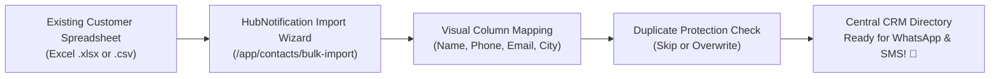
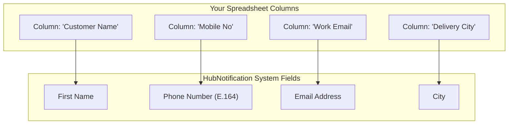

# 👥 Contact Directory & Bulk CSV Data Migration

Your contacts are your company's most valuable business asset. Whether you have 500 loyal local clients or 250,000 global e-commerce subscribers, **HubNotification's Contact Directory** (`/app/contacts`) serves as your single source of truth for all customer communications.

---

## 🧭 The Central Contacts Directory (`/app/contacts`)

Navigate to **Contacts** (`/app/contacts`):

* **Search Bar**: Instant search by phone number, email address, or name.
* **Filter Pills**: Filter contacts by assigned tags (e.g., `VIP`, `Wholesale`), city, or country.
* **Contact Detail View**: Click on any contact to view their full profile:
  * Full communication history across WhatsApp, SMS, and Email.
  * Attached notes and customer support tickets.
  * E-commerce orders and lifetime value (LTV).
  * Custom attribute values (e.g., GST number or birthday).

---

## 📥 How to Execute a Bulk CSV / Excel Import: Step-by-Step

When migrating contacts from an old CRM, an Excel sheet, or a Google Sheet:

### Step 1: Prepare Your Spreadsheet
Ensure your spreadsheet has clear column headers on the very first row:
* `First Name`
* `Phone Number` (with country code, e.g., `+919876543210` or `+12025550192`)
* `Email Address`
* `City`
* `Tags` (comma-separated, e.g., `Retail, Bangalore`)

---

### Step 2: Upload Your File
1. Go to **Contacts** (`/app/contacts`) and click **Bulk Import (📥)** in the top right corner.
2. Drag and drop your `.csv` or `.xlsx` spreadsheet into the upload zone.
3. HubNotification reads the file and displays a preview of your first 3 rows.
4. Click **Next: Map Columns**.

---

### Step 3: Visual Column Mapping
Match your spreadsheet headers to HubNotification's database fields:

* If a column doesn't match an existing field, select **+ Create Custom Field** (e.g., create a custom field for *"Loyalty Card Number"* or *"Account Manager"*).
* Click **Next: Duplicate Handling**.

---

### Step 4: Duplicate Protection Strategy
What should happen if a phone number in your spreadsheet already exists in HubNotification?

| Option | How It Works | Recommended When |
| :--- | :--- | :--- |
| **Skip Duplicates** | Ignores the spreadsheet row; keeps the existing contact data untouched. | Importing new leads without altering existing customer records. |
| **Update / Overwrite** | Updates existing contacts with new email addresses, cities, or tags from the sheet. | Refreshing customer records with updated addresses or purchase tags. |

### Step 5: Assign an Import Batch Tag
* Always tag the batch (e.g., `Import-TradeFair-Oct2026`).
* This lets you instantly create a targeted broadcast to this exact list later!
* Click **Start Import**. The background queue processes up to 10,000 contacts per minute.

---

## 📤 Exporting Your Contacts Database (`/app/contacts/export`)

Only accounts with the **Administrator** role can export contacts, safeguarding your database from unauthorized employee downloads:

1. In the Contacts table, apply any filters if you only want a subset (e.g., filter by `Tag = VIP`).
2. Click the **Export CSV (📤)** button in the top right.
3. Select whether to include custom fields and purchase history.
4. Click **Download Export**.
5. The complete spreadsheet is generated securely and downloaded to your computer.

---

## 💡 Contact Management Best Practices

> [!TIP]
> **Use the International E.164 Format:** Always include country codes (e.g., `+91` for India, `+1` for North America, `+44` for UK). Phone numbers without country codes cannot be reached by WhatsApp Cloud API.

> [!IMPORTANT]
> **Custom Fields for Deep Personalization:** Use custom fields (e.g., `Vehicle Model` for a car dealership, or `Pet Breed` for a veterinary clinic) to personalize your WhatsApp templates with dynamic variables like `{{1}}` and `{{2}}`.

> [!NOTE]
> **Automatic Unsubscribe Compliance:** If a contact is marked as *"Opted Out"* (they replied STOP), HubNotification protects you by automatically skipping them during bulk marketing broadcasts.
