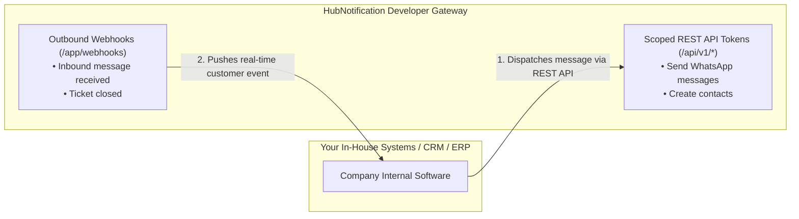
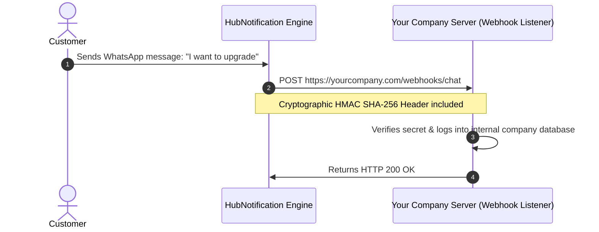

# 💻 Developer Tools, API Tokens & Webhooks

While HubNotification provides complete visual dashboards, enterprise businesses often need to connect in-house applications—such as a custom ERP, internal accounting database, or automated mobile app.

The **Developer Studio** (`/app/api-tokens` and `/app/webhooks`) allows administrators to generate secure **REST API Access Tokens** and register **Outbound Webhooks** so your other software systems stay synchronized in real time.

---

## 🔑 Generating Scoped API Tokens (`/app/api-tokens`)

To allow an external program to send messages or fetch contacts through HubNotification:

1. Navigate to **Developer Tools ➔ API Tokens** (`/app/api-tokens`).
2. Click the **+ Generate New Token** button in the top right.
3. Configure the Token:
   * **Token Name**: Give it an identifiable label (e.g., *"Custom ERP Order Dispatcher"* or *"Mobile App Lead Sync"*).
   * **Expiration**: Select *90 Days*, *1 Year*, or *Never Expires*.
4. **Select Capability Scopes (Principle of Least Privilege)**:
   * Rather than granting god-mode access, check only the specific permissions this integration needs:
     * `contacts:read` / `contacts:write`: Read or create contacts.
     * `messages:write`: Trigger transactional WhatsApp or SMS alerts.
     * `campaigns:read`: Fetch broadcast analytics.
     * `ai:write`: Trigger AI chatbot inference.
5. Click **Create Token**.
6. **Copy Your Token Immediately**:
   * HubNotification displays your token (starts with `hb_live_...`).
   * *For security reasons, this token will only be shown ONCE*. Copy it to a secure password manager. If lost, you will need to revoke it and generate a new one.

---

## 📡 Registering Outbound Webhooks (`/app/webhooks`)

Webhooks allow HubNotification to notify your external servers immediately whenever an important event happens (e.g., a customer sends a WhatsApp reply, or a support ticket is closed).

### Steps to Register an Outbound Webhook:
1. Navigate to **Developer Tools ➔ Webhooks** (`/app/webhooks`).
2. Click **+ Add Webhook Endpoint**.
3. Fill in the Destination Info:
   * **Endpoint URL**: The HTTPS address of your server listener (e.g., `https://api.yourcompany.com/webhooks/hubnest`).
   * **Description**: (e.g., *"Sync customer chats to internal data warehouse"*).
4. **Select Subscribed Events**:
   * Check the boxes for events you care about:
     * `message.received`: Triggers when an inbound WhatsApp, IG, or Messenger message arrives.
     * `message.delivered`: Triggers when an outbound message reaches the customer's phone.
     * `contact.created`: Triggers when a new customer profile is saved.
     * `conversation.status_updated`: Triggers when a ticket is marked *Closed*.
5. Click **Save Endpoint**.

---

## 🔒 Cryptographic Secret Verification & Rotation

To guarantee that incoming webhook requests genuinely originate from HubNotification and not an imposter:

* HubNotification assigns a unique **Signing Secret** to each webhook endpoint (e.g., `whsec_98217a...`).
* Every outbound request includes a signature header (`X-HubNotification-Signature`) computed via HMAC SHA-256.
* **Secret Rotation**: If an internal developer leaves your company or an API key is accidentally committed to GitHub, click **Rotate Secret (🔄)** on the webhook card. HubNotification generates a fresh secret instantly and deprecates the old one.

---

## 🧪 Testing Deliveries & Inspecting Logs

How do you know if your webhook listener is working properly?

1. On your webhook card, click the **Test Delivery (⚡)** button.
2. HubNotification dispatches a sample ping payload to your server.
3. Click **View Deliveries (📜)** to inspect the live audit log:
   * **HTTP Status Code**: e.g., `200 OK` (Green) or `500 Server Error` (Red).
   * **Request Payload**: Inspect the exact JSON data sent.
   * **Response Body**: See what your server returned.
   * **Retry Button**: If your server was temporarily down during a deployment, click **Retry** to resend the event!

---

## 💡 Developer Best Practices for Administrators

> [!TIP]
> **Use HTTPS Endpoints Only:** HubNotification will never send webhook events to unencrypted `http://` URLs. Always ensure your server listener uses valid SSL certificates.

> [!IMPORTANT]
> **Acknowledge Quickly with HTTP 200:** Your webhook listener should return an HTTP `200 OK` response within 3 seconds of receiving an event. If your server takes longer than 10 seconds, HubNotification considers it a timeout and attempts retries.

> [!NOTE]
> **Audit Token Creation:** Every time an administrator creates or deletes an API token, the action is logged permanently in your organization's **Audit Log** (`/app/audit-log`).
