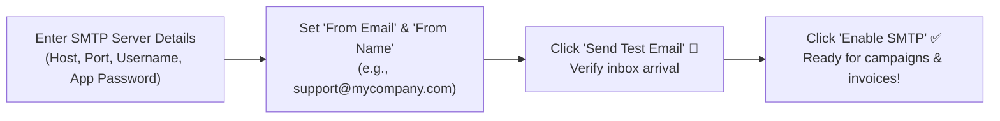
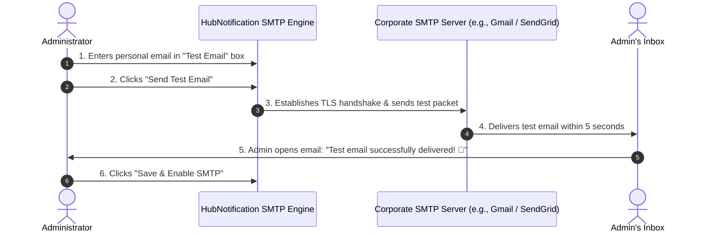

# 📧 Configuring Corporate Email SMTP & Test Sends

When your marketing team sends promotional newsletters or your system dispatches order invoices, those emails should come from your official domain (e.g., `updates@yourcompany.com`), not from a generic third-party address.

Connecting your **Corporate SMTP Server** (`/app/broadcasts/email-server`) ensures high deliverability, protects your domain reputation, and keeps your outgoing emails out of customer spam folders.

---

## 🛠️ Step-by-Step SMTP Configuration

Navigate to **Broadcasts ➔ Email Server** (`/app/broadcasts/email-server`):

### 1. Fill in the Connection Parameters
* **SMTP Host**: The outgoing mail server address provided by your email provider.
* **SMTP Port**:
  * Use **`587`** for modern TLS encryption (recommended).
  * Use **`465`** for legacy SSL encryption.
* **Encryption**: Select **TLS** or **SSL**.
* **Username**: Your full email address or API username.
* **Password**: Your email account password or provider API key.
* **From Email**: The sender address that appears in the customer's inbox (e.g., `support@yourdomain.com`).
* **From Name**: The friendly display name (e.g., `HubNest Customer Care`).

---

## 🌐 Common Provider Setup Settings

### 1. Google Workspace / Gmail
If your company uses Gmail or Google Workspace for business email:

| Field | Value | Notes |
| :--- | :--- | :--- |
| **Host** | `smtp.gmail.com` | Standard Google SMTP server. |
| **Port** | `587` | Use TLS encryption. |
| **Username** | `yourname@yourcompany.com` | Your Google Workspace email. |
| **Password** | `xxxx xxxx xxxx xxxx` | **Must be a Google App Password**, not your normal login password! |

> [!IMPORTANT]
> **How to Generate a Google App Password:**
> 1. Log into your Google Account ➔ **Security ➔ 2-Step Verification**.
> 2. Scroll to the bottom and click **App passwords**.
> 3. Select app: *Mail*, select device: *Other (HubNotification)*.
> 4. Google generates a 16-character password. Copy and paste this into HubNotification.

---

### 2. SendGrid
For high-volume transactional and marketing email delivery:
* **Host**: `smtp.sendgrid.net`
* **Port**: `587` (TLS)
* **Username**: `apikey` (literally type the word `apikey`)
* **Password**: Your generated SendGrid API Key (starts with `SG...`)

---

### 3. Amazon Simple Email Service (SES)
For enterprise-scale reliability:
* **Host**: `email-smtp.us-east-1.amazonaws.com` (use your AWS region)
* **Port**: `587` (TLS)
* **Username**: Your AWS SES SMTP Username
* **Password**: Your AWS SES SMTP Password

---

## 📨 The Mandatory Test Email Verification

Before activating your SMTP server, HubNotification requires a live test send to protect you from misconfigured passwords:

1. In the **Test Delivery** box at the bottom of the page, type your personal email address.
2. Click **Send Test Email**.
3. Open your inbox:
   * Look for an email titled *"HubNotification SMTP Verification"*.
   * Confirm that the **From Name** and **From Email** display correctly.
4. Click **Save & Enable**. Your workspace is now fully authorized to dispatch bulk newsletters, invoice PDFs, and customer transactional alerts!

---

## 💡 Email Best Practices & Deliverability

> [!TIP]
> **Configure SPF, DKIM & DMARC:** To ensure your emails land in the primary inbox (and not in the Promotions or Spam folders), ask your IT administrator or domain registrar (GoDaddy, Cloudflare, Namecheap) to add official SPF and DKIM records for your sender domain.

> [!IMPORTANT]
> **Respect Daily Sending Limits:** If using standard Google Workspace accounts, be aware that Google limits outgoing emails to 2,000 per day. For broadcasting to 10,000+ recipients, always use a dedicated bulk provider like SendGrid, Mailgun, or Amazon SES.

> [!NOTE]
> **Automated Bounce Tracking:** HubNotification automatically tracks bounced emails and failed addresses, excluding them from future campaigns so your sender reputation remains pristine.
