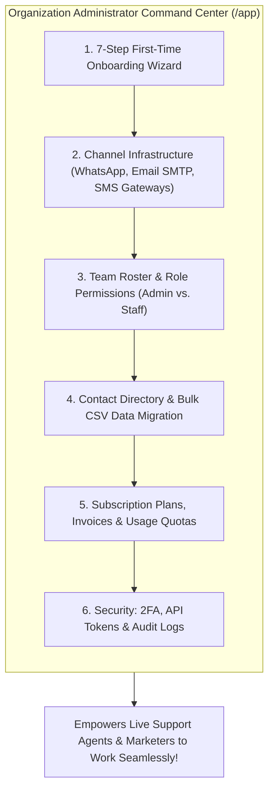
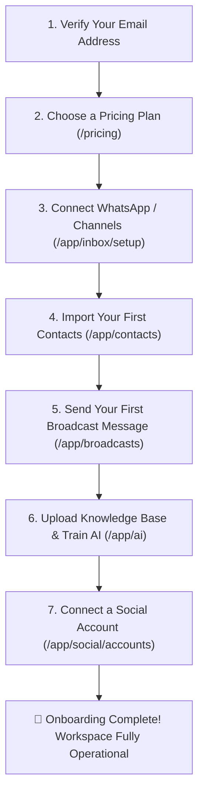

# 🏢 Organization Administrator — Overview & Onboarding

Welcome to the **HubNotification Organization Administrator** user manual.

As an Organization Administrator (or Business Owner), you hold the keys to your company's communication infrastructure. You are responsible for connecting your official **WhatsApp Business API account**, setting up **corporate email and SMS delivery gateways**, inviting your support and marketing team members, managing customer contact lists, and monitoring your monthly subscription limits.

---

## 🚀 The 7-Step First-Time Onboarding Checklist

When you create a brand-new workspace or log in for the first time, HubNotification guides you through a 7-step onboarding wizard (`/onboarding`). Each step automatically detects completion:

| Step # | Task | Where to Go in App | What It Does |
| :---: | :--- | :--- | :--- |
| **1** | **Verify Email** | Account Settings | Confirms account ownership and unlocks outbound notifications. |
| **2** | **Choose a Plan** | `/pricing` | Selects your monthly messaging limits and team seat allowances. |
| **3** | **Connect First Channel** | `/app/inbox/setup` | Launches the one-click Meta Embedded Signup to link your WhatsApp Business number. |
| **4** | **Import Contacts** | `/app/contacts/bulk-import` | Upload your existing customer Excel or CSV spreadsheet. |
| **5** | **Send First Message** | `/app/broadcasts/campaigns/create` | Send your first test announcement or customer welcome message. |
| **6** | **Train an AI Chatbot** | `/app/ai/chatbots` | Upload company policy PDFs so your AI bot can answer FAQs 24/7. |
| **7** | **Connect Social Media** | `/app/social/accounts` | Link your Facebook Page or LinkedIn company profile for scheduling. |

---

## 👥 Understanding User Roles in Your Organization

HubNotification keeps team permissions clean and simple:

| Capability | Administrator Role | Staff Member Role |
| :--- | :---: | :---: |
| Reply to customer chats in Live Inbox | ✅ | ✅ |
| Send broadcasts & create templates | ✅ | ✅ |
| Train AI Chatbots & Knowledge Bases | ✅ | ✅ |
| Connect e-commerce stores & share products | ✅ | ✅ |
| Invite or remove team members | ✅ | ❌ |
| Change subscription plan & view invoices | ✅ | ❌ |
| Connect or disconnect core WhatsApp / SMS gateways | ✅ | ❌ |
| View organization security audit logs | ✅ | ❌ |

---

## 🛠️ The Administrator's Weekly Routine

1. **Monitor Quota Consumption (`/app/subscription`)**: Keep an eye on monthly message allocations (WhatsApp messages, SMS credits, AI tokens) so your team never runs out of capacity mid-campaign.
2. **Audit Team Performance (`/app/inbox`)**: Verify that incoming customer inquiries are being claimed and resolved in a timely manner.
3. **Review Audit Logs (`/app/audit-log`)**: Periodically check team login activity, contact data exports, and credential updates for strict security compliance.
4. **Manage Gateway Health**: Verify that your SMS gateway balances and email SMTP servers are operating with zero delivery bounces.

---

## 💡 Administrator Golden Rules

> [!TIP]
> **Use Meta Embedded Signup for WhatsApp:** Never try to configure raw Meta API tokens manually. Use the one-click **Connect WhatsApp** flow on the Channel Setup page; Meta handles long-lived token exchanges and webhook registrations automatically!

> [!IMPORTANT]
> **Enforce Two-Factor Authentication (2FA):** As an administrator, your account has access to customer databases and communication gateways. Always enable 2FA on your profile to protect your company from unauthorized access.

> [!NOTE]
> **Multi-Workspace Switching:** If you operate multiple sister companies or separate regional divisions, you can create separate workspaces (`/app/workspaces`) under one user account and switch between them in one click.

---

## 📚 What You Will Master in This Section

1. [Connecting WhatsApp Business API via Meta Embedded Signup](meta-embedded-signup.md)
2. [Configuring Corporate Email SMTP & Test Sends](email-smtp-setup.md)
3. [Setting Up SMS Gateways & Indian DLT Headers](sms-gateway-setup.md)
4. [Team Roster, Inviting Staff & Role Permissions](team-management.md)
5. [Contact Directory, Custom Fields & CSV Migration](contacts-management.md)
6. [Managing Subscriptions, Quota Limits & Billing](billing-plans.md)
7. [Developer Tools, API Tokens & Webhooks](developer-webhooks.md)
8. [Two-Factor Authentication & Activity Audit Logs](security-audit-logs.md)
