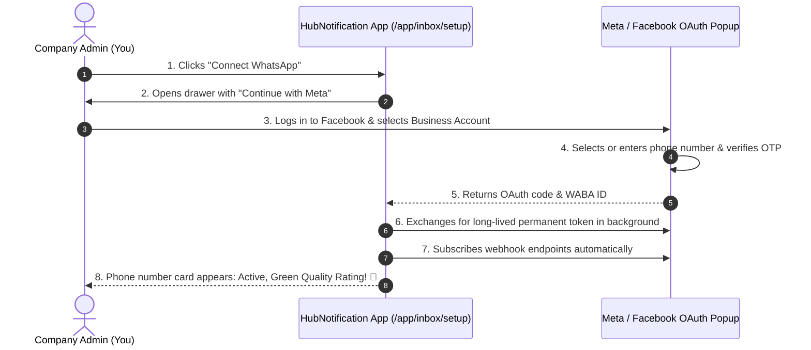
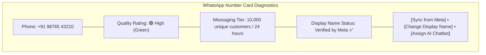

# 💬 Connecting WhatsApp via Meta Embedded Signup

Connecting an official **WhatsApp Business API Account (WABA)** historically required reading complex developer documentation, creating cloud apps, and copying long cryptographic tokens.

HubNotification utilizes **Meta Embedded Signup** (`/app/inbox/setup`). This allows any business owner to connect their official WhatsApp number in less than 3 minutes using a simple Facebook popup window!

---

## 📋 Prerequisites Before You Begin

Before clicking the connect button, make sure you have:
1. **A Facebook Account**: With administrative rights to your company's Facebook Business Portfolio (Meta Business Manager).
2. **A Clean Phone Number**:
   * The phone number you use **must not be currently active on standard WhatsApp or WhatsApp Business mobile apps**.
   * If the number is currently on regular WhatsApp, open WhatsApp on your phone ➔ go to **Settings ➔ Account ➔ Delete Account** first. This releases the number so it can be upgraded to the Enterprise Cloud API.
3. **Ability to Receive SMS or Phone Call**: To receive a 6-digit verification OTP during the signup flow.

---

## 🛠️ Step-by-Step Connection Guide

1. Navigate to **Channel Setup** (`/app/inbox/setup`) from the main sidebar.
2. At the top of the page, click the green button labeled **Connect WhatsApp**.
3. A slide-over drawer opens. Click the blue button labeled **Continue with Meta – WhatsApp**.
4. A secure Facebook popup window opens on your screen:
   * **Step A**: Log in with your Facebook credentials (if not already logged in).
   * **Step B**: Click **Get Started** to grant HubNotification permission to manage your messaging.
   * **Step C**: Select your **Meta Business Account** (or click *Create a Business Account*).
   * **Step D**: Select or create your **WhatsApp Business Account (WABA)**.
   * **Step E**: Enter your **WhatsApp Business Display Name** (e.g., *"HubNest Electronics"*).
   * **Step F**: Enter your business phone number and choose your verification method (**Text Message / SMS** or **Voice Call**).
   * **Step G**: Enter the 6-digit verification code received on your phone and click **Verify**.
5. Once verified, click **Finish**. The popup closes automatically.
6. Look at your HubNotification screen: A new **WhatsApp Business Account Card** appears displaying your verified phone number, display name, and active status!

---

## 🧭 Managing Your Phone Number Card

On the Channel Setup page, each connected WhatsApp number displays important diagnostic information:

### 1. Quality Rating (Green, Yellow, Red)
Meta tracks how customers respond to your messages:
* 🟢 **Green (High Quality)**: Excellent reputation. Customers rarely report or block your messages.
* 🟡 **Yellow (Medium Quality)**: Warning. Some customers have blocked your number. Review your broadcast targeting.
* 🔴 **Red (Low Quality)**: Danger. High block rate. Meta may restrict your daily messaging tier.

### 2. Messaging Tiers (Daily Send Limits)
Meta limits how many unique recipients you can initiate conversations with in a rolling 24-hour window:
* **Tier 1**: 1,000 unique customers per day (default for new numbers).
* **Tier 2**: 10,000 unique customers per day (upgrades automatically as you send high-quality broadcasts).
* **Tier 3**: 100,000 unique customers per day.
* **Tier 4**: Unlimited customers per day.

---

## 🔧 Maintenance Actions

* **Sync from Meta (🔄)**: If you just updated your business profile on Facebook or received a tier upgrade, click **Sync from Meta** to refresh your card immediately.
* **Change Display Name**: Need to rebrand? Click **Change Display Name**, enter your new company title, and submit it directly to Meta for review.
* **Re-Register Webhook (🛠️)**: In the rare event that incoming customer messages stop appearing in your inbox, click the card options menu and select **Re-register Webhook**. This repairs the Meta callback link in 5 seconds without disconnecting your number!

---

## 💡 Administrator Tips for WhatsApp API

> [!TIP]
> **Use a Dedicated Landline or Toll-Free Number:** The WhatsApp Business API supports regular landline numbers (e.g., `022-12345678`)! When adding a landline during signup, choose the **Voice Call** option to receive your 6-digit OTP over an automated phone call.

> [!IMPORTANT]
> **Green Verification Badge:** The official green checkmark badge next to a company name is awarded by Meta to notable brands. Once your number reaches Tier 2 or Tier 3, your administrator can apply for the Green Badge directly inside Meta Business Manager.

> [!NOTE]
> **Zero Infrastructure Costs:** WhatsApp Cloud API is hosted directly on Meta's ultra-reliable global infrastructure. You do not need to host or maintain separate proxy servers or Docker containers.
