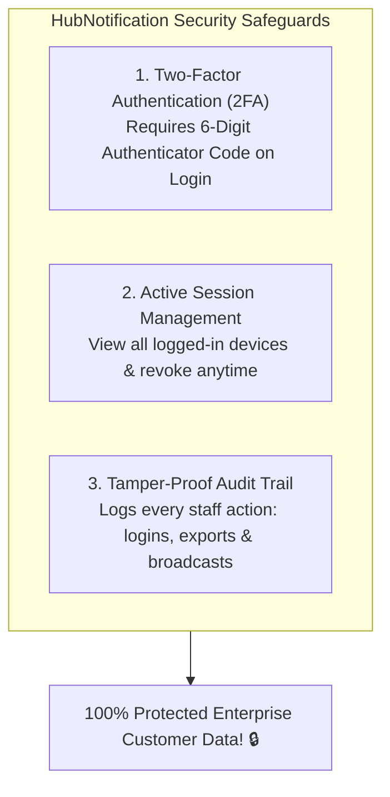
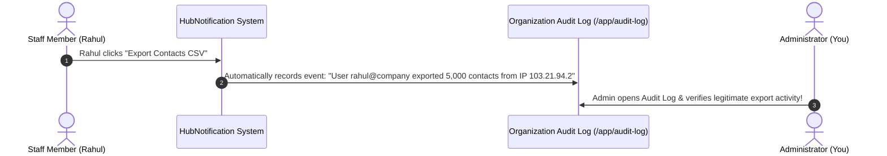

# 🛡️ Two-Factor Authentication & Audit Logs

When customer contact lists, payment receipts, and direct WhatsApp messaging channels are stored in your workspace, security is not an afterthought—it is a critical business obligation.

HubNotification provides enterprise-grade security tools including **Two-Factor Authentication (2FA)**, **Active Device Session Management**, and an immutable **Organization Audit Trail** (`/app/audit-log`).

---

## 🔐 Setting Up Two-Factor Authentication (2FA)

Two-Factor Authentication adds an impenetrable second layer of defense. Even if an unauthorized party learns an administrator's password, they cannot log in without the physical smartphone:

### Step-by-Step 2FA Setup:
1. Click on your profile avatar in the upper right corner and select **Profile & Security** (or navigate to `/profile/two-factor`).
2. In the Two-Factor Authentication card, click **Enable 2FA**.
3. Open your preferred authenticator app on your smartphone:
   * **Google Authenticator**
   * **Microsoft Authenticator**
   * **Authy**
4. Tap the plus icon (`+`) in your authenticator app and **Scan the QR Code** displayed on your screen.
5. Enter the 6-digit code generated by your app into HubNotification and click **Verify & Enable**.
6. **Save Your Recovery Codes**:
   * HubNotification displays eight 8-digit **Emergency Recovery Codes**.
   * Print or copy these codes to a secure offline vault. If you ever lose your phone, a recovery code will allow you to regain access to your account.

---

## 📱 Reviewing & Revoking Active Sessions (`/profile/sessions`)

Have you ever logged into HubNotification on an office computer or hotel laptop and wondered if you forgot to log out?

1. Navigate to **Profile ➔ Active Sessions** (`/profile/sessions`).
2. HubNotification displays a detailed list of every computer, tablet, and smartphone currently logged into your account:
   * **Device Type**: e.g., *Windows Desktop (Chrome)*, *iPhone (Safari)*.
   * **IP Address & Location**: e.g., *Mumbai, Maharashtra, India*.
   * **Last Active Time**: e.g., *Current Session (Active Now)* or *2 days ago*.
3. **Emergency Log Out**:
   * Click **Log Out Other Browser Sessions**.
   * Enter your password to confirm.
   * Every other computer and mobile phone is instantly logged out!

---

## 📜 Reviewing Organization Audit Logs (`/app/audit-log`)

For regulatory compliance (GDPR, ISO, SOC2) and internal security investigations, administrators have access to an immutable **Audit Log** (`/app/audit-log`):

### What Actions Are Tracked in the Audit Log?
* **User Authentication**: Logins, logouts, failed password attempts, and 2FA activations.
* **Team & Permission Changes**: When a teammate is invited, promoted to Admin, or deleted.
* **Contact Data Access**: Bulk contact imports and CSV database exports.
* **Gateway & Credential Changes**: Connecting or disconnecting WhatsApp, SMS, or SMTP servers.
* **Campaign Launches**: When a broadcast is scheduled, paused, or dispatched.

---

## 🔍 How to Filter the Audit Trail

1. Navigate to **Audit Log** (`/app/audit-log`) from the sidebar.
2. Use the filter controls:
   * **Filter by User**: Select a specific employee to review all actions performed by that staff member.
   * **Filter by Action**: Filter by `auth.login`, `contacts.export`, `campaign.launched`, etc.
   * **Date Range**: Select *Today*, *Last 7 Days*, or a custom date range.
3. Each row shows the exact timestamp, actor name, target resource, and originating IP address.

---

## 💡 Security Best Practices for Administrators

> [!TIP]
> **Mandate 2FA for All Team Members:** Ask your staff to turn on 2FA on their first day of work. A single compromised employee password should never compromise your entire company's WhatsApp channel.

> [!IMPORTANT]
> **Watch for Unusual Contact Exports:** Periodically check the audit log for `contacts.export` events. If you see a staff member downloading the customer database late at night, investigate immediately.

> [!NOTE]
> **Tamper-Proof Logs:** Audit log entries are read-only and cannot be altered or deleted, even by the highest-level administrator, ensuring full legal audit integrity.
