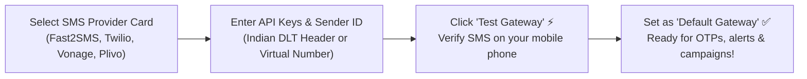
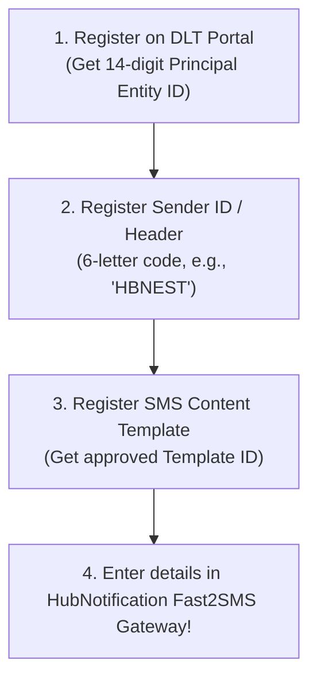

# 📱 Setting Up SMS Gateways & Indian DLT Headers

While WhatsApp is the king of rich multimedia engagement, **SMS (Short Message Service)** remains the undisputed champion of universal delivery. SMS reaches every mobile phone on earth—including basic keypad feature phones in rural areas with zero internet connectivity.

HubNotification connects to leading domestic and global SMS providers via **SMS Gateways** (`/app/broadcasts/sms-gateways`).

---

## 🌐 Supported SMS Providers at a Glance

| Provider | Best For | Key Configuration Fields |
| :--- | :--- | :--- |
| **Fast2SMS** | **India Routes** (DLT Compliant) | API Key, DLT Sender ID, Route (Quick SMS / OTP / DLT). |
| **Twilio** | **Global / USA / Europe** | Account SID, Auth Token, Twilio Phone Number. |
| **Vonage (Nexmo)** | **International Enterprise** | API Key, API Secret, Sender ID. |
| **Plivo** | **High-Throughput Global** | Auth ID, Auth Token, Sender Name. |
| **Amazon SNS** | **Cloud-Scale AWS Users** | Access Key, Secret Key, AWS Region, Sender ID. |

---

## 🇮🇳 Special Guide for India: Telecom DLT Compliance

In India, the Telecom Regulatory Authority of India (TRAI) strictly requires all commercial SMS senders to register on a **DLT (Distributed Ledger Technology)** portal (such as Jio DLT, Airtel DLT, or Vodafone Idea DLT):

### 3 Mandatory DLT Terms Explained in Simple Language:
1. **Principal Entity (PE) ID**: Your company's unique 14-digit registration number on the telecom portal.
2. **Sender Header (6 Letters)**: The 6-character sender title that appears at the top of the customer's SMS inbox (e.g., `VK-HBNEST` or `AD-HBNEST`).
3. **Template ID**: The unique approval number assigned to your exact message wording by telecom operators.

---

## 🛠️ Step-by-Step Gateway Setup (Fast2SMS Example)

1. Navigate to **Broadcasts ➔ SMS Gateways** (`/app/broadcasts/sms-gateways`).
2. Locate the **Fast2SMS** card and click **Configure**.
3. Fill in your provider credentials:
   * **API Key**: Copy your secret API key from your Fast2SMS dashboard.
   * **Route**: Choose **DLT** for official business alerts or **OTP** for verification codes.
   * **Sender ID**: Enter your approved 6-letter DLT header (e.g., `HBNSTT`).
   * **Entity ID**: Enter your 14-digit corporate DLT Entity ID.
4. Click **Save Gateway**.
5. Click **Test SMS**: Enter your personal phone number and confirm that the text message arrives within 10 seconds.
6. Toggle the switch: **Set as Default SMS Provider**.

---

## 🌍 Setting Up Twilio for Global Dispatches

For sending international SMS to customers in the US, UK, Canada, Australia, and the Middle East:

1. Click **Configure** on the **Twilio** card.
2. Enter your credentials from your Twilio Console:
   * **Account SID**: Starts with `AC...`.
   * **Auth Token**: Your secret token.
   * **Twilio Number / Sender ID**: Your purchased E.164 phone number (e.g., `+12025550192`) or approved Alphanumeric Sender ID.
3. Click **Save & Test**.

---

## 💡 SMS Gateway Best Practices

> [!TIP]
> **Keep Character Counts Under 160:** Standard GSM SMS messages are 160 characters long. If your text is 161 characters, telecom operators will bill you for two SMS segments! Keep messages concise to cut costs in half.

> [!IMPORTANT]
> **Exact DLT Variable Matching in India:** When sending DLT SMS in India, your message variables must strictly match the approved format (e.g., `{#var#}`). Even a missing period or extra space can cause the telecom firewall to reject the SMS.

> [!NOTE]
> **Balance Monitoring Alerts:** Set a calendar reminder to check your SMS gateway wallet balance weekly so your system never pauses automated OTPs due to zero funds.
