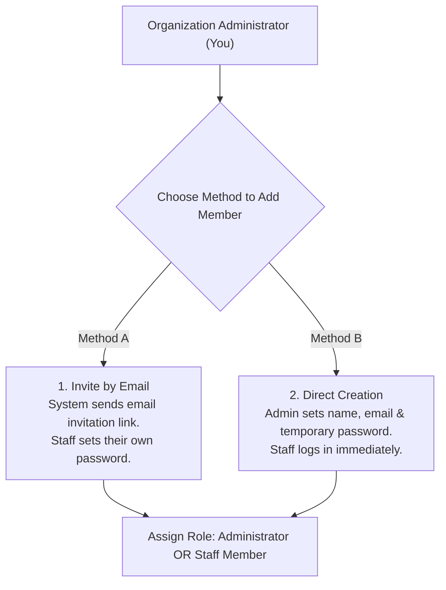
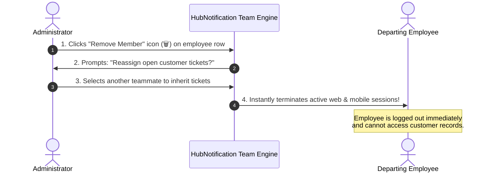

# 👥 Team Roster, Inviting Staff & Permissions

Customer support agents, marketing specialists, and e-commerce operators all need access to HubNotification to perform their daily duties. However, you do not want support agents viewing financial invoices or modifying core WhatsApp API credentials.

The **Team Management** module (`/app/team`) allows administrators to invite teammates, set access boundaries, and revoke access when employees leave the company.

---

## 🛡️ Role Comparison: Administrator vs. Staff

| System Capability | Administrator | Staff Member |
| :--- | :---: | :---: |
| Access Live 3-Pane Inbox (`/app/inbox`) | ✅ | ✅ |
| Send Broadcast Campaigns & Meta Templates | ✅ | ✅ |
| Use AI Studio & Knowledge Bases | ✅ | ✅ |
| View Customer Orders & Share Product Cards | ✅ | ✅ |
| **Invite or Delete Team Members** | ✅ | ❌ |
| **Upgrade / Cancel Subscription Plan** | ✅ | ❌ |
| **View Payment Invoices & Billing History** | ✅ | ❌ |
| **Connect / Disconnect WhatsApp & SMS Gateways** | ✅ | ❌ |
| **Export Full Master Contacts Database to CSV** | ✅ | ❌ |
| **Access Organization Security Audit Trail** | ✅ | ❌ |

---

## ➕ Two Ways to Add Team Members

Navigate to **Team** (`/app/team`):

### Method A: Invite by Email (Recommended)
This is the most secure method because the employee sets their own private password:
1. Click the **Invite Teammate** button in the upper right.
2. Enter the employee's work email address (e.g., `priya@yourcompany.com`).
3. Select their Role: **Staff** or **Administrator**.
4. Click **Send Invitation**.
5. The employee receives an invitation email containing a secure 24-hour verification link. Once they click the link and choose a password, their account activates immediately.

---

### Method B: Direct Account Creation (Fastest)
If you want to set up an account for a team member right away without waiting for them to check email:
1. Click the **+ Add Member Directly** button.
2. Fill in their details:
   * **Full Name**: (e.g., *"Rahul Sharma"*).
   * **Work Email**: (e.g., `rahul@yourcompany.com`).
   * **Temporary Password**: Set a strong temporary password (e.g., `SecureHub2026!`).
   * **Role**: Select **Staff**.
3. Check the box: **"Require password change on first login"**.
4. Click **Create Member**. Share the temporary credentials with the employee securely.

---

## ✏️ Editing Profiles & Resetting Passwords

From the Team Roster table:
* **Change Role**: Click the **Edit (✏️)** button next to any teammate to promote them from *Staff* to *Administrator*, or vice versa.
* **Force Password Reset**: If an employee forgets their password, click **Reset Password** to send an instant password recovery email to their inbox.

---

## 🚫 Revoking Access for Departing Employees

When an employee resigns or transitions to another department, immediately revoke their access to protect customer contact data:

1. Locate the employee's row in the Team table.
2. Click the red **Delete / Remove (🗑️)** icon.
3. HubNotification asks where to transfer their open customer conversations. Select an active teammate from the dropdown so no customer queries are lost.
4. Click **Confirm Removal**.
5. The user's account is deleted, and their mobile app and desktop sessions are terminated in real time!

---

## 💡 Team Security Best Practices

> [!TIP]
> **Keep Admins to a Minimum:** Only give the **Administrator** role to business owners and trusted department heads. Everyone else (support agents, sales reps, marketers) should have the **Staff** role to safeguard your billing and gateway credentials.

> [!IMPORTANT]
> **Check Team Seat Limits:** Each subscription plan includes a specific number of team seats (e.g., 5 seats on Starter, 15 seats on Pro). If you reach your limit, upgrade your plan in `/app/subscription` before inviting new members.

> [!NOTE]
> **Session Revocation:** If an employee loses a work phone or laptop, an administrator can instantly revoke that specific device session from **Team ➔ Member Profile ➔ Active Sessions**.
