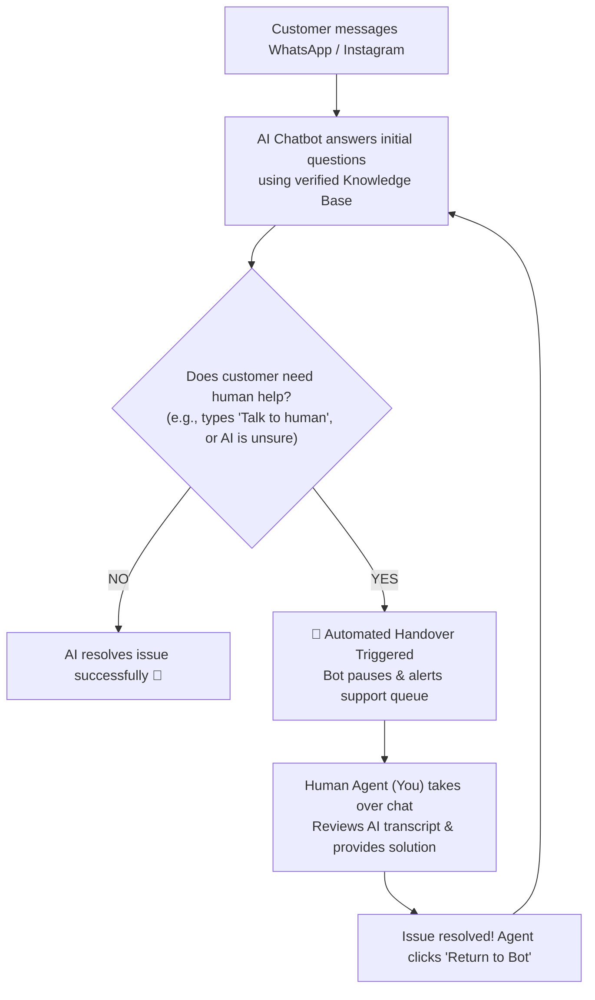
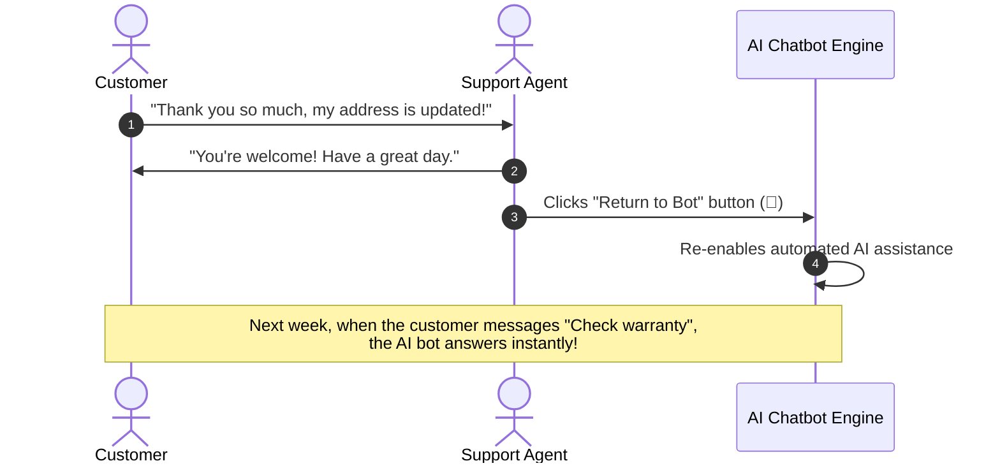

# 🤖 Managing AI Chatbot Handover

HubNotification uses a **Hybrid Support Model** where artificial intelligence and human agents work in harmony. 

AI chatbots handle routine, repetitive questions around the clock (e.g., *"What are your store hours?"*, *"Where is my tracking number?"*, or *"Do you deliver to Pune?"*). However, when a customer has a complicated problem, an emotional grievance, or a custom quotation request, the conversation seamlessly hands over to a human agent.

---

## 🔍 How to Identify an AI-Controlled Conversation

In the left-hand conversation list of the **Live Inbox** (`/app/inbox`):

* **Bot Badge (🤖)**: An icon showing a small robot appears next to the customer's name when an AI chatbot is actively responding to them.
* **Real-Time Transcript Visibility**: You can watch the customer and bot conversing in real-time in the center pane.
* **No Accidental Interference**: While the bot is in control, the bottom composer shows an alert: *"AI Chatbot is currently managing this conversation"*.

---

## 🙋 Taking Over from the AI Bot (Manual Takeover)

If you are monitoring incoming chats and notice that a customer is asking something nuanced, or if a high-value VIP customer reaches out, you can take control instantly:

1. Click on the bot-managed conversation thread in the left pane.
2. In the top banner of the chat window, click the purple button labeled **Take Over Conversation (🙋)**.
3. The AI bot is immediately silenced on this thread. It will **not** send any further automated replies to this customer.
4. The standard typing composer opens for you.
5. Send a warm message introducing yourself:
   * *Example*: *"Hello Mr. Sharma, I am Priya from customer care. I am taking over this conversation to personally help you with your exchange request!"*

---

## 🚨 Automated Handover: When the Bot Hands Over to You

The AI chatbot is programmed to automatically surrender control and alert human agents in three specific situations:

1. **Explicit Customer Request**: If the customer types phrases like *"I want to talk to a person"*, *"human agent"*, *"customer executive"*, or *"call me"*.
2. **Knowledge Base Fallback**: If the customer asks a question that is not covered in your company's uploaded documents, the bot politely informs the customer and triggers an automated handover rather than hallucinating an inaccurate response.
3. **Sentiment & Frustration Detection**: If the customer uses angry words, exclamation marks, or expresses dissatisfaction, the bot flags the conversation with the `Urgent` label and assigns it to the human queue.

When this occurs, you will hear a notification chime, and the thread will appear in your **Unassigned** or personal inbox with a banner stating: *"AI requested human handover: Customer requested representative."*

---

## 🔄 Returning the Conversation to the AI Bot

Once you have successfully resolved the customer's specific question, you do not want to keep the bot permanently disabled for that customer:

### Steps to Re-enable the Bot:
1. At the top of the chat window, locate the **Bot Status** dropdown.
2. Click **Return to AI Bot (🤖)**.
3. A confirmation dialog will appear: *"Re-enable AI assistance for this customer?"*.
4. Click **Confirm**.
5. The conversation status is updated. Future general inquiries from this customer will once again be handled autonomously by your 24/7 AI chatbot!

---

## 💡 Best Practices for Bot-Human Collaboration

> [!TIP]
> **Read the AI Transcript First:** Before typing your first message after a handover, spend 10 seconds scanning the previous 3–4 messages exchanged between the customer and the bot. Never ask the customer *"What is your problem?"* when they have already explained it to the bot!

> [!IMPORTANT]
> **Always Acknowledge the Handover:** Customers feel immense relief when they know a real human has stepped in. Always start with a friendly greeting confirming that you have taken over personally.

> [!NOTE]
> **Zero Delay in Takeover:** Clicking "Take Over" takes effect in milliseconds across Meta's cloud servers, ensuring the bot will not accidentally send a message while you are typing.
