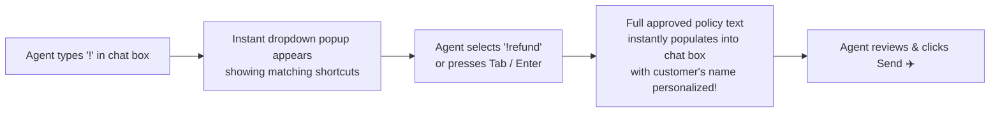

# ⚡ Speeding Up Conversations with Canned Replies

Typing the exact same answers repeatedly—such as your business hours, return policies, bank account details, or greeting messages—wastes valuable support time and leads to typing mistakes.

**Canned Replies** (available at `/app/inbox/canned-replies` and directly inside the chat window) are pre-written, verified responses that you can insert into any chat in less than two seconds by typing an exclamation mark (`!`) shortcut.

---

## 🚀 How to Insert a Canned Reply in Real-Time

When chatting with a customer in the **Live Inbox** (`/app/inbox`):

1. Click into the message reply box.
2. Type an exclamation mark (`!`) followed by a keyword (e.g., `!greet`, `!price`, `!bank`).
3. An autocomplete pop-up menu instantly appears above your cursor displaying matching snippets.
4. Use your keyboard's **Up/Down arrow keys** to highlight the snippet you want, then press **Enter** or **Tab**.
5. The full message text will instantly appear in your composer.
6. Make any quick personalized adjustments if needed, then press **Enter** to send!

---

## 📝 Popular Canned Reply Examples & Shortcuts

| Shortcut | Title / Category | Message Preview |
| :--- | :--- | :--- |
| `!greet` | Standard Greeting | *"Hello {{contact.name}}! Thank you for contacting {{company.name}}. My name is {{agent.name}}. How may I assist you today?"* |
| `!hours` | Operating Hours | *"Our support desk is open Monday to Saturday from 9:00 AM to 8:00 PM IST. Inquiries received after hours are answered first thing the following morning!"* |
| `!refund` | Return Policy | *"Items can be returned within 14 days of delivery provided they are unused and in original packaging. Please share your Order ID so I can generate a return pickup label for you."* |
| `!bank` | Payment Details | *"Here are our official company bank details for direct RTGS/NEFT transfers: Bank: HDFC Bank, A/C Name: HubNest Tech Pvt Ltd, A/C No: 50200012345678, IFSC: HDFC0001234."* |
| `!hold` | Brief Investigation | *"Thank you for providing those details. Please give me 2–3 minutes while I check your shipment status with our logistics partner. I will update you right here shortly!"* |
| `!bye` | Friendly Sign-Off | *"You're very welcome, {{contact.name}}! Is there anything else I can help you with today? If not, have a wonderful rest of your day!"* |

---

## 🛠️ How to Create & Manage Canned Replies

Support agents and team administrators can create new canned replies to share with the whole team:

1. Click the **Canned Replies** icon on the top right of the Inbox, or navigate to **`/app/inbox/canned-replies`**.
2. Click the **+ New Canned Reply** button in the top right corner.
3. Fill in the three fields:
   * **Shortcut**: A short, memorable keyword preceded by an exclamation mark (e.g., `!promo`). Keep it lowercase with no spaces.
   * **Title**: A human-readable label (e.g., *"Diwali 20% Discount Code"*).
   * **Category**: Choose a folder grouping (e.g., `Greetings`, `Billing`, `Logistics`, `FAQs`).
   * **Message Content**: The actual text that will be inserted.
4. **Using Dynamic Smart Tags**:
   * Click **Insert Variable** to add dynamic tags:
     * `{{contact.name}}`: Inserts the customer's real first name.
     * `{{agent.name}}`: Inserts your own logged-in agent name.
     * `{{company.name}}`: Inserts your workspace enterprise name.
5. Click **Save Snippet**. It becomes immediately available to you and all team members across desktop and mobile apps!

---

## 🗂️ Categorizing Snippets for Faster Access

As your snippet library grows to dozens of responses, organize them into standard categories:
* **Greetings & Handshakes**: Welcome messages, introductions, and language preferences.
* **Pricing & Quotations**: Standard tier pricing, payment gateway links, and invoice delivery.
* **Troubleshooting & Technical**: Step-by-step guides, browser cache clearing, and password reset instructions.
* **Shipping & Fulfillment**: Delivery timelines, courier tracking links, and pickup arrangements.
* **Closing & CSAT Rating**: Ticket resolution confirmations and feedback requests.

---

## 💡 Best Practices for Support Agents

> [!TIP]
> **Combine Shortcuts with Personalization:** Canned replies should never feel robotic. After inserting a snippet like `!greet`, spend two seconds adding a personalized sentence (e.g., *"I see you are inquiring about our Mumbai workshop!"*) to show the customer they are talking to a thoughtful human.

> [!IMPORTANT]
> **Keep Shortcuts Short & Intuitive:** Use shortcuts that every teammate can guess naturally (e.g., `!track` instead of `!where_is_my_package_tracking_information`).

> [!NOTE]
> **Instant Sync Across Devices:** Any canned reply created on the desktop web app is immediately available inside the iOS and Android Mobile Agent apps.
