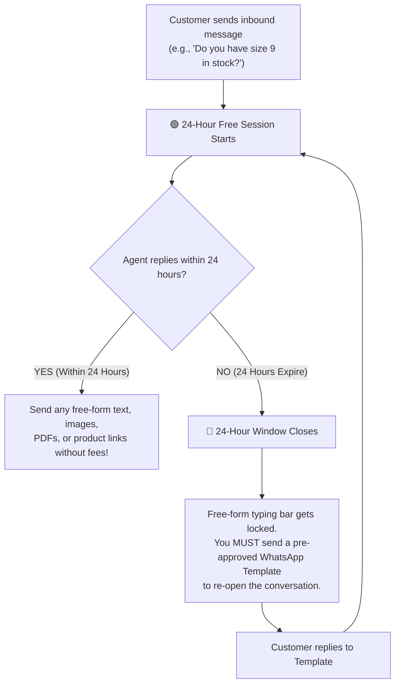
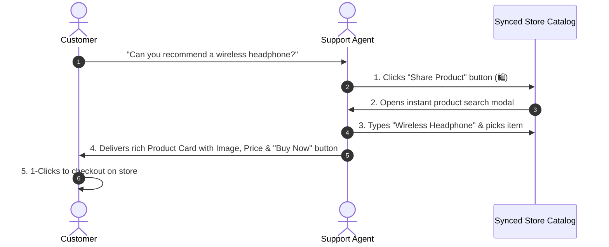

# 💬 Replying, Sending Media & Sharing Products

Once you have selected a customer conversation in the **Live Inbox** (`/app/inbox`), your primary work takes place in the lower composer bar of the center pane. This guide walks you through sending text, photos, documents, and interactive e-commerce product cards.

---

## ⏳ Critical Rule: The 24-Hour Customer Care Window

Before sending a message, it is essential to understand how **Meta (WhatsApp & Instagram)** handles customer messaging:

### What This Means in Practice:
1. **When the window is Open (🟢 Green)**: You can type any personalized reply, send photos, attach warranty PDFs, and share catalog links without restrictions.
2. **When the window has Expired (🔴 Red)**: The standard text box displays a lock icon stating *"24-hour messaging window has closed"*. To message the customer, click the **Send Template** button to send an officially approved transactional alert (e.g., *"Your order has shipped"* or *"Follow-up regarding your recent inquiry"*). Once the customer replies, the free 24-hour window reopens immediately!

---

## ✍️ Composing Text Replies

1. Click into the message text box at the bottom of the active chat window.
2. Type your response.
   * **Line Breaks**: Press `Shift` + `Enter` to start a new paragraph without sending the message.
   * **Emojis**: Click the smiley face icon (😊) to insert friendly emojis.
   * **Formatting**: Use standard WhatsApp markdown:
     * `*bold*` renders as **bold** text.
     * `_italic_` renders as *italicized* text.
     * `~strikethrough~` renders as ~~strikethrough~~ text.
3. Click the **Send Button (Paper Airplane ✈️)** or press `Enter` to dispatch the message immediately.

---

## 📎 Attaching Photos, Invoices & Voice Notes

Customers frequently require product images, user manuals, or payment receipts. HubNotification supports one-click media uploads:

1. Click the **Paperclip Icon (📎)** located next to the message input box.
2. Select the file type you wish to attach:
   * **Images (`.jpg`, `.png`, `.webp`)**: Ideal for sharing product photos, packaging pictures, or return condition screenshots.
   * **Documents (`.pdf`, `.docx`)**: Perfect for sending price quotes, official invoices, warranty cards, or terms documents.
   * **Audio / Voice Notes (`.mp3`, `.ogg`)**: Send quick voice explanations for complex technical instructions.
   * **Video (`.mp4`)**: Short demonstration clips or product unboxing previews (up to 16MB).
3. Add an optional caption text in the preview dialog.
4. Click **Upload & Send**. The file is delivered directly to the customer's phone with high-speed delivery.

---

## 🛍️ Sharing Live E-Commerce Product Cards

If your company has connected an online store (Shopify, WooCommerce, or BigCommerce), you can share interactive product cards with live pricing without copy-pasting URLs!

### Steps to Share a Product Card:
1. In the chat composer toolbar, click the **Shopping Bag Icon (🛍️ Share Product)**.
2. A search pop-up window opens displaying your live product catalog.
3. Type the product name or SKU in the search bar.
4. The screen displays the product image, inventory stock count, and price.
5. Click **Share in Chat**.
6. HubNotification instantly sends a formatted card to the customer's WhatsApp or Messenger containing the product photo, title, price, and a direct **[View & Order]** link!

---

## 🏷️ Updating Conversation Status

Keep your team organized by marking the conversation status in the upper right header:

| Status | When to Use | Color Badge |
| :--- | :--- | :---: |
| **Open** | The customer has an active question and is waiting for assistance. | 🟢 Green |
| **Pending** | You have asked the customer for details (e.g., photo of damaged item) or are waiting for warehouse confirmation. | 🟡 Yellow |
| **Closed** | The issue is resolved, the customer confirmed satisfaction, and no further action is required. | ⚪ Gray |

---

## 💡 Support Agent Best Practices

> [!TIP]
> **Check the Clock Before Writing a Long Answer:** Look at the customer's last message time. If it shows 23h 50m ago, quickly send a brief message (e.g., *"Hi, I am looking into your account right now!"*) to refresh the 24-hour clock before typing a detailed explanation.

> [!IMPORTANT]
> **Keep Documents Under 15MB:** While HubNotification supports large file sizes, WhatsApp limits mobile document downloads over cellular connections. Keeping PDFs under 10MB ensures instant downloading for customers on mobile data.

> [!NOTE]
> **Automatic Order Association:** When a customer messages from a phone number registered with an online store order, HubNotification automatically detects their past purchases and displays them in the right-hand panel for instant reference.
