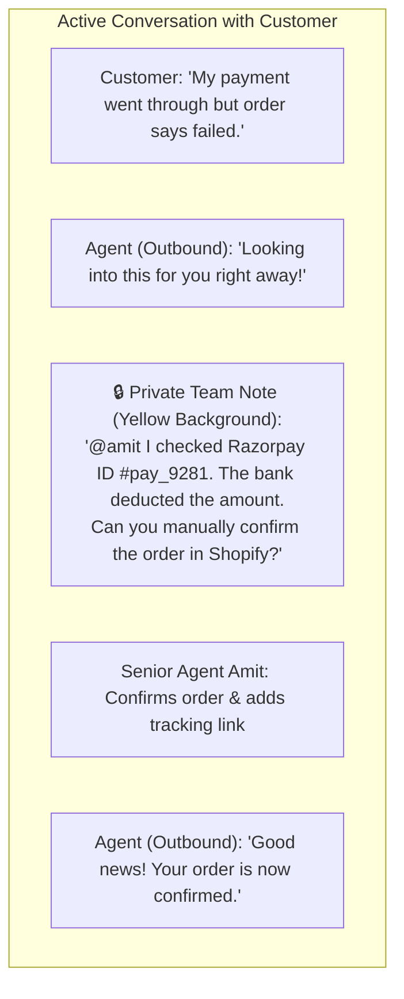
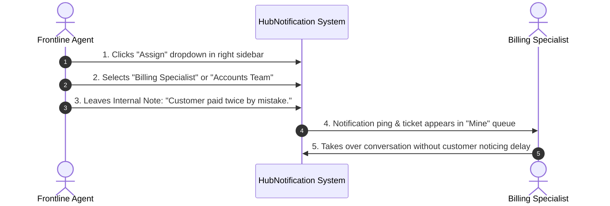

# 🤝 Internal Team Notes & Ticket Assignment

Customer support is a team sport. When a complex question requires advice from a billing manager, an engineer, or a warehouse supervisor, you should never make the customer repeat their story. 

HubNotification provides **Private Internal Notes** and **Smart Ticket Assignment** so your entire team can collaborate smoothly behind the scenes.

---

## 🔒 What Are Private Internal Notes?

Internal Notes allow you to document important facts, leave warnings, or ask teammates questions right inside the customer's chat transcript.

* **100% Invisible to Customers**: Notes are strictly for internal staff. Customers on WhatsApp, Instagram, or Messenger will **never** receive or see your notes.
* **Distinct Visual Highlighting**: Internal notes are displayed with a distinct **warm yellow background** and a clear **Lock Icon (🔒)** so you can easily distinguish them from messages sent to the customer.
* **Time-stamped & Attributed**: Each note records the exact agent name and timestamp when it was posted.

---

## ✍️ How to Post an Internal Note: Step-by-Step

1. In the **Live Inbox** (`/app/inbox`), open the relevant conversation thread.
2. In the composer area at the bottom of the center pane, click on the **Internal Note Tab (🔒)** next to the standard Chat tab.
3. Notice that the text area turns light yellow, and the send button changes to **Add Private Note**.
4. Type your message:
   * *Example*: *"Customer requested an urgent delivery for tomorrow morning. Warehouse team notified."*
   * *Example*: *"Verified identity via registered email. Approved for address change."*
5. Click **Add Private Note** or press `Ctrl` + `Enter`.
6. The note will be pinned into the conversation timeline for all teammates to review.

---

## 👥 Assigning Conversations to Teammates & Teams

When an inquiry falls outside your area of expertise (e.g., an invoice discrepancy requiring Accounts, or a defective product needing Technical Support), reassign the ticket:

### Steps to Reassign:
1. Locate the **Assignment Card** in the right-hand metadata pane.
2. Click on the current assignee dropdown (which might say *Unassigned* or your name).
3. Select the desired teammate from the list.
4. *(Optional)* Select a department queue (e.g., *Billing*, *Logistics*, *Tech Support*).
5. The conversation will immediately move into the selected teammate's personal queue, and they will receive a desktop/mobile push notification.

---

## 🏷️ Tagging Conversations with Color-Coded Labels

Labels allow supervisors and agents to categorize conversations at a glance.

### Common Label Examples:
* 🔴 **`Urgent` / `Escalation`**: Customer is dissatisfied or needs immediate executive attention.
* 🟢 **`VIP Client`**: High-value enterprise account with an expedited SLA.
* 🟡 **`Payment Issue`**: Double deduction, failed gateway, or refund request.
* 🔵 **`Presales Inquiry`**: Prospect asking for quotation, product demo, or feature roadmap.
* 🟣 **`Feature Request`**: Suggestions to be routed to the product engineering team.

### How to Attach or Remove Labels:
1. In the right-hand panel, find the **Labels** section.
2. Click **+ Add Label**.
3. Select an existing label from the dropdown, or type a new label name and choose a color badge.
4. To remove a label after resolving the issue (e.g., removing `Urgent` once solved), click the small **(x)** on the label badge.

---

## 💡 Team Collaboration Best Practices

> [!TIP]
> **Leave Shift Handover Notes:** Before logging off for the day, leave an internal note on every open conversation summarizing what has been done and what is expected next. Your evening teammate will thank you!

> [!IMPORTANT]
> **Check the Composer Mode Before Typing:** Always double-check whether your composer box is in **Chat Mode (White)** or **Internal Note Mode (Yellow)** before typing sensitive company remarks.

> [!NOTE]
> **Audit Trail Integrity:** Internal notes cannot be edited or deleted once posted. This preserves a complete and authentic audit trail for customer dispute resolution.
