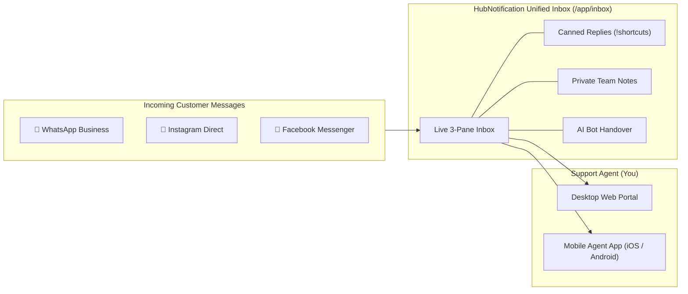

# 🎧 Customer Support Agent — Overview & Daily Routine

Welcome to the **HubNotification Customer Support & Live Chat Agent** user guide.

As a support agent, your primary mission is to provide fast, warm, and helpful assistance to customers reaching out across multiple messaging channels. In the past, companies required support agents to open separate browser tabs for WhatsApp Web, Instagram Direct, and Facebook Business Suite. **With HubNotification, all customer messages flow into one unified 3-pane Live Inbox (`/app/inbox`).**

---

## ☀️ The Support Agent's Daily Routine

To ensure high customer satisfaction (CSAT) and zero missed messages, follow this daily operational checklist:

### 1. Shift Start: Clock In & Readiness (0–10 Mins)
* **Open the Unified Inbox**: Navigate to **Live Inbox** (`/app/inbox`) from the left-hand navigation sidebar.
* **Filter by Assigned to Me**: In the conversation filter dropdown, select **"Assigned: Me"** to view tickets currently in your personal queue.
* **Review Pending Follow-ups**: Check conversations marked with the `Pending` status where customers have replied overnight or provided additional documents.
* **Check Internal Announcements**: Review any pinned team notes or banner notices regarding product updates, scheduled server maintenance, or ongoing promotional discounts.

### 2. Core Shift: Real-Time Omnichannel Resolution
* **Reply Promptly to Inbound Inquiries**: Customers contacting via WhatsApp or Instagram expect rapid answers. Aim for a first-response time of under 3 minutes.
* **Use Canned Replies (`!shortcuts`)**: Save time on repetitive questions (pricing plans, return policy, store hours) by typing an exclamation mark `!` followed by the shortcut name (e.g., `!refund`).
* **Tag Conversations with Labels**: Apply color-coded tags like `VIP`, `Billing Issue`, or `Urgent` so teammates and managers can instantly recognize ticket priority.
* **Collaborate via Private Notes**: If you need advice from a senior technician or billing specialist, leave an internal private note instead of asking the customer to repeat their issue.

### 3. Shift Handover & Wrap-Up
* **Clear Your Active Queue**: Aim for zero unaddressed `Open` tickets at the end of your shift.
* **Update Ticket Status**:
  * Mark conversations as **Closed** once the customer confirms their issue is solved.
  * Mark as **Pending** if you are waiting for a tracking number, technician response, or customer reply.
* **Log Out or Reassign**: If you are logging off for the day and have unresolved conversations requiring urgent attention, reassign them to the night shift agent or support pool.

---

## 🧭 Live Inbox Key Concepts at a Glance

| Feature | What It Does | Why It Helps You |
| :--- | :--- | :--- |
| **Unified 3-Pane View** | Displays conversation threads, active chat window, and customer details side-by-side. | You never have to switch between screens or tabs while talking to a customer. |
| **24-Hour Messaging Window** | WhatsApp & Meta allow free direct replies within 24 hours of the customer's last message. | Reminds you to resolve tickets promptly; after 24 hours, you must use an approved template. |
| **Canned Replies (`!`)** | Pre-written, approved company answers inserted with quick keystrokes. | Ensures 100% accurate information with zero typing fatigue. |
| **Private Internal Notes** | Yellow-tinted notes visible only to company team members, completely hidden from the customer. | Enables seamless handover between morning and night shifts without confusion. |
| **AI Bot Handover** | Take over live chats from automated chatbots when complex issues arise, or hand back to AI. | Handles routine FAQs automatically while freeing you to tackle high-value inquiries. |
| **Mobile Agent App** | Full chat functionality on your smartphone via `/api/v1/mobile`. | Handle urgent VIP escalation alerts even when stepping away from your desk. |

---

## 💡 Pro Tips for Exceptional Customer Support

> [!TIP]
> **Use Customer Names Early:** HubNotification automatically extracts the customer's WhatsApp profile name or Instagram handle. Personalize your greeting (e.g., *"Hello Rajesh, thank you for contacting us today!"*) to build instant trust.

> [!IMPORTANT]
> **Beware the 24-Hour WhatsApp Timer:** Look at the message timestamp. If a customer sent their message 23 hours ago, prioritize sending a reply immediately. Once 24 hours pass without interaction, Meta closes the free reply session, requiring you to send a pre-approved template message to re-open the chat.

> [!NOTE]
> **Zero Customer Confusion:** Everything you type in the yellow **Internal Notes** tab stays private within your team. Customers will only ever see messages sent through the main chat input bar.

---

## 📚 What You Will Learn in This Manual

In the following chapters, you will master every screen and tool in your support toolkit:
1. [Navigating the 3-Pane Unified Inbox](unified-inbox.md)
2. [Replying, Sending Media & Product Cards](chat-handling.md)
3. [Speeding Up Conversations with Canned Replies](canned-replies.md)
4. [Internal Team Notes & Ticket Assignment](collaboration-notes.md)
5. [Managing AI Chatbot Handover](bot-handover.md)
6. [Using the Mobile Agent App On the Go](mobile-agent-app.md)
