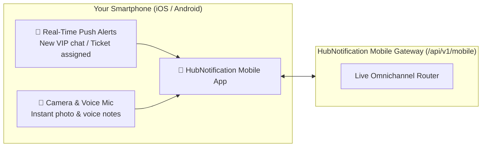

# 📱 Using the Mobile Agent App On the Go

Modern customer support does not stop when you step away from your desk. Whether you are traveling between office locations, inspecting warehouse shipments, or providing on-call weekend support, the **HubNotification Mobile Agent App** gives you complete live chat capabilities right in your pocket.

---

## 📲 Logging In to the Mobile App

1. Open the **HubNotification** mobile app on your smartphone (or open your mobile browser to your company's URL, e.g., `https://hubnotification.srjhubnest.com`).
2. Enter your **Workspace Email** and **Password**.
3. If your company enforces Two-Factor Authentication (2FA), enter the 6-digit verification code from your authenticator app (Google Authenticator or Microsoft Authenticator).
4. Tap **Enable Biometric Login** (Face ID or Fingerprint) to unlock the app quickly in the future without re-typing passwords.

---

## 🧭 Mobile Screen Navigation Tour

The mobile interface is designed for fast, one-thumb operation with a clean bottom navigation bar:

| Tab | Icon | What You Can Do |
| :--- | :---: | :--- |
| **Chats** | 💬 | View all active conversation threads with unread counters and channel badges (WhatsApp, IG, Messenger). |
| **Contacts** | 👥 | Fast directory search by phone number or name; view customer addresses and purchase history. |
| **Snippets** | ⚡ | Browse your library of pre-written Canned Replies and copy-paste them with a single tap. |
| **Settings** | ⚙️ | Configure notification sounds, set your availability status (*Online*, *Away*, *Offline*), and view active logins. |

---

## 💬 Handling Conversations from Your Phone

When you tap a conversation thread in the mobile chat list:

### 1. Sending Quick Text & Media
* **Typing Composer**: Tap the bottom input bar to type your response.
* **Camera Direct Capture**: Tap the **Camera Icon (📷)** to snap an immediate photo of a product, packaging box, or showroom item and send it directly to the customer.
* **Photo Library**: Tap the **Image Icon (🖼️)** to attach existing screenshots or saved warranty documents.
* **Voice Notes (WhatsApp Style)**: Press and hold the **Microphone Icon (🎙️)** to record a clear voice explanation, then release to send.

### 2. Using Canned Replies on Mobile
You don't have to type long explanations on a small touch keyboard:
1. In the chat composer, type an exclamation mark (`!`).
2. A floating drawer opens displaying your matching canned replies.
3. Tap the desired snippet (e.g., `!hours` or `!refund`).
4. The full text is instantly inserted into the message box.
5. Tap the **Blue Send Button**.

### 3. Adding Private Team Notes & Changing Assignee
* Swipe left on the chat header or tap the **Details (ℹ️)** button in the top right corner.
* Tap **Internal Notes (🔒)** to type a private yellow note for your desktop teammates.
* Tap **Assigned Agent** to transfer the conversation to another agent on duty.
* Tap **Status** to change between `Open`, `Pending`, or `Closed`.

---

## 🔔 Push Notifications & On-Call Alerts

Never worry about missing an important customer message:
* **Immediate Sound & Vibration Chimes**: You receive an instant push notification whenever a customer replies in a conversation assigned to you.
* **VIP & Escalation Badges**: High-priority tickets flagged with the `Urgent` label trigger distinct ringtone chimes.
* **Do Not Disturb Schedule**: When your shift ends, switch your status in the **Settings** tab to **Offline** or set a sleep schedule so work notifications are silenced during your personal rest hours.

---

## 🔒 Mobile Security Best Practices

> [!TIP]
> **Use Biometric Lock:** Always enable Face ID or Fingerprint lock in the app settings. This ensures that even if you hand your unlocked phone to a family member or friend, company customer data remains completely protected.

> [!IMPORTANT]
> **Never Download Sensitive Documents to Personal Storage:** When reviewing customer identity proofs or invoices on mobile, view them directly inside the in-app secure viewer rather than saving them to your phone's personal camera roll.

> [!NOTE]
> **Remote Device Wipe:** If your smartphone is ever lost or stolen, immediately log into your desktop dashboard from a computer, go to **Profile ➔ Active Sessions**, and click **Revoke Mobile Session** to log out your lost phone instantly.
