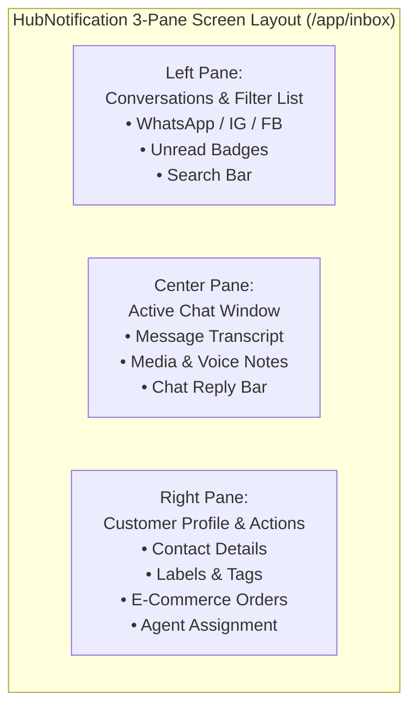
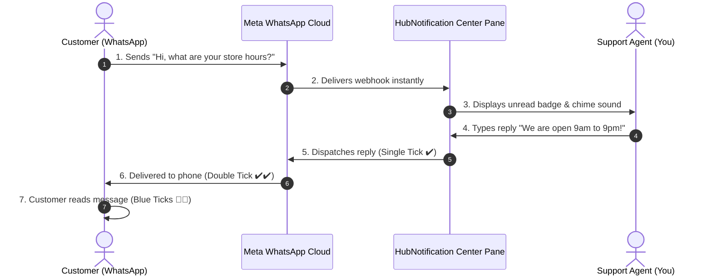

# 📥 Navigating the 3-Pane Unified Inbox

The **Live Inbox** (`/app/inbox`) is your primary command center. Rather than forcing you to jump between different social media websites or mobile phones, HubNotification consolidates all customer messages into a modern, three-pane workspace.

---

## 🧭 Understanding the 3 Panes

### 1. Left Pane: Conversations List & Queue Filters
The left column displays all customer conversation threads in real time.

* **Top Search Bar**: Quickly locate any past or present conversation by typing the customer's phone number, name, or keywords from their recent message.
* **Queue Filter Tabs**:
  * **All**: Displays every active conversation across all channels in your workspace.
  * **Mine**: Shows only conversations currently assigned to your user account.
  * **Unassigned**: Displays incoming messages waiting to be claimed by an available agent.
  * **Closed**: Archived conversations that have been marked as resolved.
* **Channel Source Icons**:
  * 🟢 **WhatsApp**: Identifiable by the green WhatsApp icon and phone number.
  * 🟣 **Instagram**: Identifiable by the Instagram gradient icon and `@username`.
  * 🔵 **Facebook Messenger**: Identifiable by the blue Messenger icon.
* **Unread Counter**: A bold number badge indicates how many new messages have arrived in that thread since you last viewed it.

---

### 2. Center Pane: Active Message Transcript
When you click any conversation in the left pane, the center pane immediately loads the full message history.

* **Message Bubbles**:
  * **White / Gray Bubbles (Left)**: Inbound messages sent by the customer.
  * **Colored Bubbles (Right)**: Outbound messages sent by your team or AI chatbot.
* **Delivery Status Checkmarks (WhatsApp)**:
  * 🕒 **Clock**: Message is currently in transit or queued on the server.
  * ✔️ **Single Checkmark**: Message has successfully left HubNotification and reached Meta's servers.
  * ✔️✔️ **Double Gray Checkmarks**: Message has successfully delivered to the customer's mobile device.
  * 🔵🔵 **Double Blue Checkmarks**: The customer has opened and read your message.
* **Live Typing Indicator**: When the customer is actively typing a reply, an animated typing bubble appears at the bottom of the transcript.

---

### 3. Right Pane: Customer Details & Workspace Sidebar
The right column provides instant customer context so you never have to ask repetitive questions like *"What is your email?"* or *"What did you order?"*.

* **Customer Card**: Displays the contact's name, profile avatar, phone number (with country flag), and email address.
* **Conversation Status Selector**:
  * **Open**: The issue is active and requires agent attention.
  * **Pending**: You are waiting on external information (e.g., courier update or customer response).
  * **Closed**: The inquiry has been fully resolved.
* **Assigned Agent**: Shows who currently owns the conversation. You can click the dropdown to reassign the ticket to another teammate or team queue.
* **Conversation Labels**: Click **+ Add Label** to attach tags such as `Urgent`, `VIP Customer`, `Product Inquiry`, or `Refund Requested`.
* **Recent E-Commerce Orders**: If your company has connected a Shopify or WooCommerce store, this section displays the customer's recent order IDs, payment status, and parcel delivery tracking links.

---

## 🛠️ How to Search & Filter Conversations: Step-by-Step

1. Navigate to **Live Inbox** (`/app/inbox`).
2. To find unhandled incoming queries, click the **Unassigned** tab at the top of the left pane.
3. Click on the topmost conversation thread to view the customer's question in the center pane.
4. In the right pane, click the **Assign** dropdown and select **Assign to Me**.
5. The thread will move into your personal **Mine** queue, preventing other agents from answering the same question simultaneously.

---

## 💡 Quick Tips for Inbox Navigation

> [!TIP]
> **Keyboard Shortcuts:** You can use your keyboard's up and down arrow keys to quickly cycle through conversation threads in the left pane without touching your mouse!

> [!IMPORTANT]
> **Never Leave Threads in Unassigned:** If your team uses a shared queue, make sure to claim threads by assigning them to yourself before replying. This prevents two agents from sending conflicting answers to the same customer.

> [!NOTE]
> **No Page Reloads Needed:** The Live Inbox uses high-speed WebSocket technology. New incoming customer messages, delivery ticks, and typing indicators appear instantly on your screen without ever needing to press browser refresh (`F5`).
