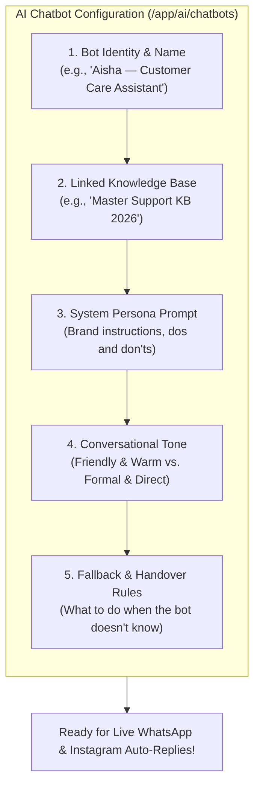

# 🧠 Configuring AI Chatbot Personas & Tones

An AI chatbot should not feel like an emotionless robotic answering machine. It should feel like a helpful, polite, and knowledgeable member of your customer support team who reflects your exact brand personality.

The **AI Chatbot Studio** (`/app/ai/chatbots`) allows you to define custom agent personas, select conversational tones (friendly, professional, formal), link private Knowledge Bases, and configure smart fallback rules.



---

## 🛠️ Step-by-Step Chatbot Configuration

Navigate to **AI ➔ Chatbots** (`/app/ai/chatbots`) and click the **+ New Chatbot** button.

### 1. Basic Identity
* **Chatbot Name**: Give your bot a friendly name (e.g., *"Aisha — Support Bot"* or *"Leo — Sales Concierge"*).
* **Avatar**: Choose a friendly customer care avatar so your team can easily recognize it.
* **Link Knowledge Base**: Select the Knowledge Base you created in the previous chapter. The bot will use these documents as its primary source of truth.

---

### 2. Crafting the System Persona Prompt
The **System Prompt** is the secret sauce that guides your bot's behavior in every situation. You write it in plain English:

```
You are "Aisha", a helpful, empathetic, and polite customer care assistant for HubNest.
Your goal is to answer customer questions accurately using our official Knowledge Base.

Guidelines:
1. Always greet the customer warmly using their name if available.
2. Keep answers concise (under 3 sentences) because customers are reading on mobile WhatsApp screens.
3. If an answer involves pricing or bank details, format it clearly using bullet points.
4. If a customer is angry or asks for an exchange, offer to connect them to a human agent immediately.
5. NEVER make up fake discount codes or promise delivery dates not found in the Knowledge Base.
```

---

### 3. Tuning the Conversational Tone

Choose a personality that matches your company's brand voice:

| Tone Option | How the Bot Speaks | Ideal For |
| :--- | :--- | :--- |
| **Friendly & Warm** | Uses casual phrases, polite greetings, and occasional tasteful emojis (😊, ✨). | E-commerce brands, fashion retailers, lifestyle services, fitness clubs. |
| **Professional** | Polite, clear, direct, and helpful without unnecessary slang. | B2B software, corporate consulting, real estate, medical clinics. |
| **Formal & Authoritative** | Strictly factual, highly respectful, and formal terminology. | Legal firms, financial institutions, chartered accountants, enterprise banks. |
| **Casual & Energetic** | Enthusiastic, modern, youthful wording. | Gaming communities, youth apparel, festival events, entertainment apps. |

---

### 4. Setting Context Chunks (Search Depth)
* **Max Context Chunks (Slider 1–20)**: This controls how many document paragraphs the AI reads before answering.
* **Recommended Setting: 3 to 5 chunks**. This provides ample context for complex questions while maintaining lightning-fast 1-to-2 second response times.

---

### 5. Configuring the Fallback Response (Safety Net)

What should happen if a customer asks a question that is **not** covered in your Knowledge Base (e.g., *"Can I pay in Bitcoin?"* or *"Who won the cricket match yesterday?"*)?

Rather than hallucinating or guessing, your bot should gracefully apologize:

* **Fallback Reply Text**:
  * *"I apologize, but I don't have that specific information in my system right now. Let me connect you with one of our human support executives who can help you right away!"*
* **Trigger Human Handover**: Check the box **"Automatically trigger human handover on fallback"**. When the bot doesn't know the answer, it alerts your live human support team in `/app/inbox`!

---

## 💡 Chatbot Tuning Best Practices

> [!TIP]
> **Keep Answers Short for Mobile:** Customers reading on WhatsApp or Instagram hate reading giant walls of text. Add the instruction *"Keep all replies under 60 words unless asked for detailed steps"* in your system prompt.

> [!IMPORTANT]
> **Instruct the Bot Never to Speculate:** Always include the sentence *"If the answer is not in the provided documents, politely state that you do not know"* to prevent your bot from promising unapproved discounts.

> [!NOTE]
> **Multi-Language Support:** HubNotification's AI bots automatically detect the customer's language. If a customer messages in Hindi, Spanish, or Arabic, the bot responds fluently in that exact same language!
