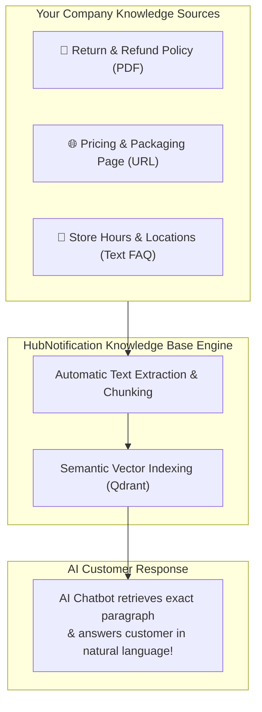
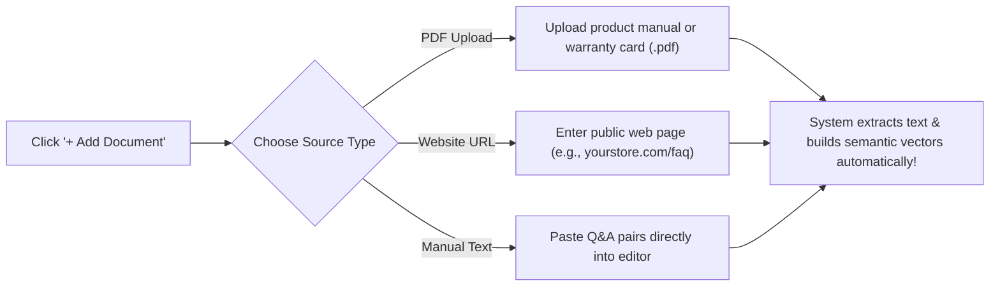

# 📚 Setting Up AI Knowledge Bases & Document Ingestion

Standard AI chatbots (like ChatGPT) know general facts about the world, but they know nothing about your company's specific warranty period, your return address in Mumbai, or your seasonal pricing packages.

An **AI Knowledge Base** (`/app/ai/knowledge-bases`) acts as a secure, private brain for your company. By uploading your official documents, PDFs, and website links, HubNotification breaks the information into searchable fragments. When a customer asks a question, the AI retrieves the exact answer from your documents—**delivering 100% accurate, hallucination-free answers in seconds!**

---

## 🔑 Step 1: Connecting an AI Provider (`/app/ai/providers`)

Before creating your first Knowledge Base, configure which AI intelligence engine will power your answers:

1. Navigate to **AI ➔ Providers** (`/app/ai/providers`).
2. You will see cards for supported AI intelligence providers:
   * **Google Gemini**: Recommended for blazing-fast speed and low cost (`gemini-1.5-flash`).
   * **OpenAI**: Industry-standard accuracy (`gpt-4o` or `gpt-4o-mini`).
   * **Anthropic Claude**: Exceptional for nuanced, warm, and natural customer service conversations (`claude-3-5-sonnet`).
3. Click **Configure** on your preferred provider card.
4. Paste your API key, select your default model, and click **Save & Verify**.
5. The card displays a green **Ready** checkmark.

---

## 📁 Step 2: Creating a Knowledge Base

Organize your documents by business function:

1. Navigate to **AI ➔ Knowledge Bases** (`/app/ai/knowledge-bases`).
2. Click the **+ New Knowledge Base** button.
3. Fill in the details:
   * **Name**: (e.g., *"Customer Support Master KB"* or *"Product Catalog 2026"*).
   * **Description**: (e.g., *"Contains all return policies, shipping timelines, and product care guidelines"*).
4. Click **Create Knowledge Base**.

---

## 📄 Step 3: Ingesting Documents, PDFs & URLs

Now, feed your knowledge base with your company's actual information:

### Option A: Uploading a PDF Document
1. Inside your Knowledge Base, click **+ Add Document** ➔ Select **File Upload**.
2. Select your PDF (e.g., `Warranty_Policy_2026.pdf` or `Product_Catalog.pdf`).
3. HubNotification reads every page, strips unneeded formatting, and extracts the core text.

### Option B: Crawling a Website URL
1. Click **+ Add Document** ➔ Select **Website URL**.
2. Enter the web address (e.g., `https://yourdomain.com/shipping-policy`).
3. HubNotification fetches the live page content and indexes it into your private knowledge library.

### Option C: Manual Text / Q&A Pairs
1. Click **+ Add Document** ➔ Select **Raw Text / FAQs**.
2. Paste your questions and answers directly into the text editor:
   * *Q: What are your store hours?*
   * *A: We are open Monday to Saturday from 9:00 AM to 8:00 PM IST.*

---

## 🔄 Reindexing When Policies Change

Whenever your company changes prices, updates terms, or adds new store branches:

1. Click on the document in your Knowledge Base.
2. Click the **Reindex (🔄)** button (or delete the old PDF and upload the revised version).
3. HubNotification refreshes the semantic vector index in under 10 seconds.
4. Your AI chatbots immediately begin using the new information on their very next customer conversation!

---

## 💡 Best Practices for High-Accuracy Knowledge Bases

> [!TIP]
> **Use Clean, Clear Headings:** When drafting company documents, use clear section titles (e.g., *"14-Day Return Policy"*, *"International Shipping Timelines"*). This helps the AI retrieve the exact relevant section with 100% precision.

> [!IMPORTANT]
> **Keep Documents Focused:** Avoid uploading massive 500-page mixed documents containing unrelated topics. Breaking your content into smaller, specialized documents (e.g., one for *"Shipping"*, one for *"Returns"*, one for *"Sizing"*) produces much faster and more accurate AI responses.

> [!NOTE]
> **Complete Privacy Guarantee:** Your uploaded documents are encrypted and used solely to answer questions from your company's own customers. They are never shared across other workspaces or used to train public AI models.
