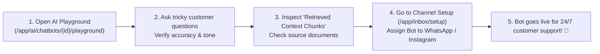
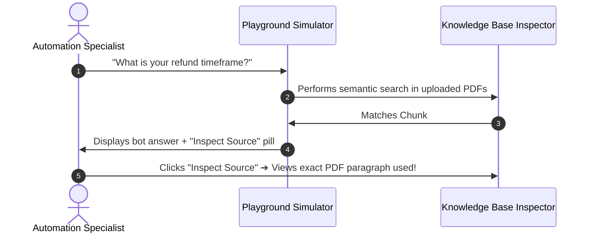

# 🧪 Testing in Live Playground & Channel Assignment

Before unleashing your newly trained AI chatbot on real paying customers, you should always test it thoroughly in a safe sandbox environment.

HubNotification provides a built-in **Live Playground** (`/app/ai/chatbots/{id}/playground`) where you can converse with your bot, inspect the exact document sentences it retrieves, and verify its tone. Once you are 100% satisfied, you can assign it to your live **WhatsApp Business number, Instagram DM, or Facebook Page** in one click.

---

## 🎮 How to Test in the Live Playground

1. Navigate to **AI ➔ Chatbots** (`/app/ai/chatbots`).
2. Click on your chatbot's card, or click the **Playground Icon (🧪)**.
3. A smartphone chat simulator opens on the screen:
   * Type a greeting: *"Hi, what are your store hours?"*
   * The bot answers in real time based on your Knowledge Base.
4. **Test Edge Cases & Challenging Questions**:
   * *The Specific Detail Test*: *"Can I return a product after 20 days if I opened the box?"*
   * *The Discount Test*: *"Can you give me an extra 50% discount right now?"* (Verify that the bot politely declines).
   * *The Handover Test*: *"I want to talk to an agent immediately."* (Verify that the bot acknowledges and triggers handover).
   * *The Multi-Language Test*: Try typing in Hindi (e.g., *"Aapka store kahan hai?"*) or another language to verify natural translation.

---

## 🔍 Inspecting Retrieved Document Chunks

Unlike mysterious black-box bots, HubNotification gives you complete transparency into **why** the AI answered the way it did:

* Below every bot reply in the Playground, click the small blue button labeled **View Source Chunks (🔍)**.
* A drawer slides open showing the exact sentences extracted from your uploaded PDFs or web URLs.
* If the bot answered incorrectly, you can see whether your source document had confusing wording and fix it immediately!

---

## 🚀 Assigning Your Chatbot to Live Channels (`/app/inbox/setup`)

Once your chatbot passes all tests in the Playground, connect it to your live customer messaging channels:

1. Navigate to **Channel Setup** (`/app/inbox/setup`).
2. You will see cards for your connected communication channels:
   * **WhatsApp Business Phone Numbers**
   * **Instagram Direct Accounts**
   * **Facebook Messenger Pages**
3. Locate the specific WhatsApp phone number or Instagram handle you want the bot to manage.
4. On that card, locate the dropdown labeled **Assigned AI Chatbot**:
   * Select your chatbot (e.g., *"Aisha — Customer Care Assistant"*).
5. Click **Save Changes**.
6. That's it! From this exact moment forward, any customer messaging your WhatsApp number or Instagram DM will be greeted instantly by your intelligent AI chatbot!

---

## 📊 Monitoring Live Bot Interactions

Once live, how do you keep tabs on what your chatbot is saying?
* Open the **Live Inbox** (`/app/inbox`).
* You will see active bot conversations marked with the purple **Bot Icon (🤖)** in real time.
* You can read the live transcript as it happens.
* If a customer ever needs personal assistance, click **Take Over Conversation (🙋)** to jump in seamlessly.

---

## 💡 Best Practices for Live AI Deployment

> [!TIP]
> **Start on One Channel First:** If you are deploying an AI bot for the first time, assign it to a secondary channel or web widget first for 2–3 days. Once you are confident in its responses, assign it to your primary WhatsApp Business phone number.

> [!IMPORTANT]
> **Check Token Limits:** Ensure your workspace has sufficient monthly AI credits in **Subscription ➔ Usage** so your bot never pauses during peak holiday shopping seasons.

> [!NOTE]
> **Instant Disconnect:** If you ever need to disable the AI chatbot temporarily (for example, during an emergency store closure), simply return to Channel Setup and set the dropdown to *"None (Human Only)"*.
