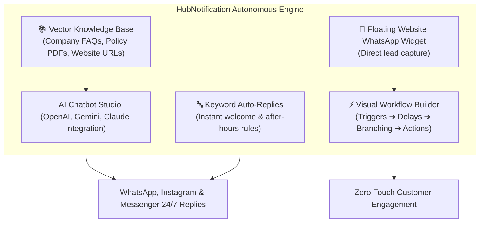
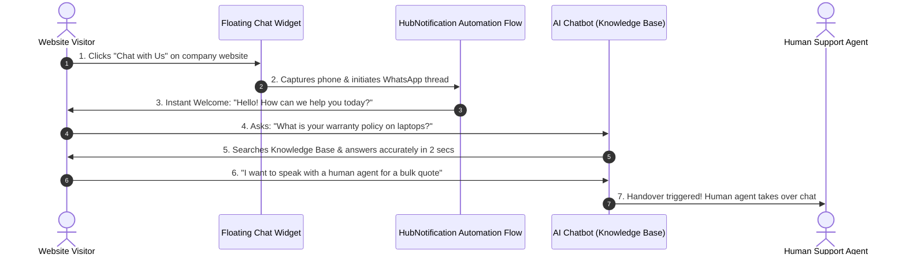

# 🤖 Automation & AI Specialist — Overview

Welcome to the **HubNotification Automation & AI Specialist** user guide.

In any thriving enterprise, manually replying to thousands of routine customer queries, manually sending follow-up reminders, and manually chasing abandoned carts is impossible without a massive support army.

As an **Automation & AI Specialist**, your mission is to build intelligent systems that work for your business 24/7/365. With HubNotification, you can automate complex customer journeys using a zero-code **Visual Flow Builder** (`/app/automations`) and train **Smart AI Chatbots** (`/app/ai/chatbots`) using your company's own knowledge base documents.

---

## 🎯 Core Capabilities in Your Automation Toolkit

| Tool | URL | What It Enables You to Do |
| :--- | :--- | :--- |
| **Visual Flow Builder** | `/app/automations` | Design drag-and-drop multi-step automation journeys (e.g., *"New Lead ➔ Wait 1 day ➔ WhatsApp Template ➔ If no reply ➔ Send SMS"*). |
| **AI Knowledge Base** | `/app/ai/knowledge-bases` | Upload your company product catalogs, refund policy PDFs, and FAQ URLs to create an instant private AI knowledge library. |
| **AI Chatbot Studio** | `/app/ai/chatbots` | Train intelligent chatbots with custom personas, brand tones (friendly, professional), and assign them to your live WhatsApp numbers. |
| **Live Chatbot Playground** | `/app/ai/chatbots/{id}/playground` | Test how your chatbot answers tricky questions in real time before going live to real customers. |
| **Keyword Auto-Replies** | `/app/whatsapp/auto-replies` | Set up instant automated replies when customers type specific words like `PRICE`, `MENU`, `LOCATION`, or `HELP`. |
| **Website Chat Widget** | `/app/whatsapp/widget` | Create an attractive floating "Chat on WhatsApp" button for your website with zero programming. |

---

## 🔄 A Typical Autonomous Customer Journey

Here is an example of what an Automation & AI Specialist can build in under an hour:

---

## 🛠️ The Automation Specialist's Operational Checklist

1. **Keep Knowledge Bases Updated**: Whenever company policies, store hours, or product prices change, re-upload the updated document and click **Reindex** so your AI never shares outdated facts.
2. **Review Automation Run Logs**: Check `/app/automations/{id}/runs` weekly to ensure external triggers, delays, and message deliveries are executing smoothly without errors.
3. **Inspect AI Fallback Responses**: Look at conversations where the AI chatbot was unable to find an answer, and add those missing answers to your Knowledge Base to make the bot smarter over time.
4. **Tune Auto-Reply Keywords**: Monitor customer search patterns and create new keyword triggers for high-frequency inquiries.

---

## 💡 Best Practices for Automation Architects

> [!TIP]
> **Always Provide a Human Escape Hatch:** No matter how smart an AI chatbot is, always ensure customers can easily reach a human by typing *"Agent"* or *"Help"*.

> [!IMPORTANT]
> **Respect WhatsApp Message Delays:** When building multi-step automations, always add realistic delays (e.g., *"Wait 15 minutes"* or *"Wait 1 day"*) between automated messages so your brand feels natural and helpful, rather than aggressive.

> [!NOTE]
> **No Coding Required:** Every automation flow, chatbot configuration, and website widget in HubNotification is built with visual drag-and-drop controls. You do not need to write code or know Python/JavaScript.

---

## 📚 What You Will Master in This Section

1. [Building Multi-Step Automation Flows](visual-flow-builder.md)
2. [Setting Up AI Knowledge Bases & Document Ingestion](ai-knowledge-base.md)
3. [Configuring AI Chatbot Personas & Tones](ai-chatbot-studio.md)
4. [Testing in Live Playground & Channel Assignment](chatbot-playground.md)
5. [Configuring Keyword & After-Hours Auto-Replies](keyword-auto-replies.md)
6. [Designing & Embedding Website WhatsApp Chat Widgets](website-chat-widget.md)
