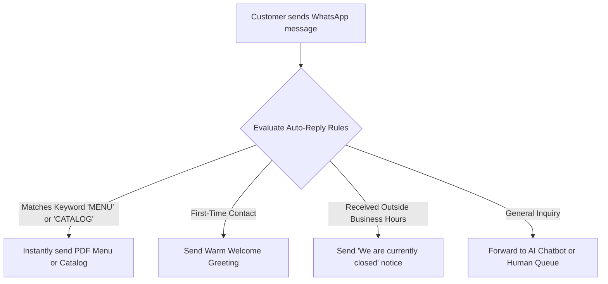

# 🔤 Configuring Keyword & After-Hours Auto-Replies

While AI chatbots are fantastic for open-ended conversational questions, certain business interactions require **strictly deterministic, instant rules**.

For example, when a customer texts `"CATALOG"`, you want to instantly send your official PDF product catalog. When a customer messages at 11:30 PM on a Sunday, you want an immediate automated notice stating when your office re-opens.

**Auto-Replies** (`/app/whatsapp/auto-replies`) provide lightning-fast, rule-based automation for these exact scenarios.

---

## 🗂️ The 4 Auto-Reply Trigger Types

| Rule Type | When It Triggers | Real-Life Business Example |
| :--- | :--- | :--- |
| **`welcome`** | When a new customer messages your WhatsApp number for the very first time. | *"Welcome to HubNest! We are delighted to connect with you. How can our team assist you today?"* |
| **`keyword`** | When an inbound message contains or matches a specific word. | Customer texts *"LOCATION"* ➔ System auto-replies with Google Maps pin and driving directions. |
| **`out_of_hours`** | When an inbound message arrives outside your scheduled operating hours. | *"Thank you for your message! Our office is currently closed (Mon–Sat 9am–8pm). We will answer you first thing tomorrow morning!"* |
| **`away`** | When your team manually toggles the support desk status to "Away". | *"Our team is currently in an all-hands meeting. We will be back online in 45 minutes!"* |

---

## 🛠️ How to Create a Keyword Rule: Step-by-Step

Navigate to **WhatsApp ➔ Auto-Replies** (`/app/whatsapp/auto-replies`) and click **+ New Auto-Reply**:

### 1. Basic Rule Settings
* **Rule Title**: (e.g., *"Keyword: Send Brochure"*).
* **Trigger Type**: Select **Keyword**.
* **Match Mode**:
  * **Exact Match**: Triggers only if the message is exactly the word (e.g., only `"BROCHURE"`).
  * **Contains Keyword**: Triggers if the word appears anywhere in their message (e.g., *"Please send me your brochure"*).

### 2. Specify Trigger Keywords
* Type your keywords separated by commas:
  * `brochure, catalog, catalogue, price list, pdf`

### 3. Choose the Reply Action
HubNotification can respond with three types of content:
* **Plain Text**: Type a friendly message with bullet points.
* **WhatsApp Approved Template**: Select a pre-approved template with interactive CTA buttons.
* **Media Attachment**: Attach a file (e.g., upload your `Company_Profile_2026.pdf`).

4. Click **Save Rule**. It activates immediately!

---

## ⏰ Setting Up After-Hours Messages (`out_of_hours`)

Never leave midnight inquiries hanging in silence:

1. Click **+ New Auto-Reply** ➔ Select **Out of Hours**.
2. Define your company's operating schedule (e.g., *Monday to Friday, 9:00 AM to 7:00 PM IST*).
3. In the message box, enter your friendly closed notification:
   * *"Hello! You have reached us outside our standard office hours (Mon–Fri 9am–7pm). We have received your inquiry and our team will get back to you promptly when we open at 9:00 AM tomorrow!"*
4. Check the box **"Send only once per customer per 24 hours"** so customers who send multiple messages late at night are not spammed with repetitive away notices.
5. Click **Save Rule**.

---

## 💡 Best Practices for Keyword Auto-Replies

> [!TIP]
> **Promote Keywords in Your Marketing:** Tell customers what to type! In your social media ads or posters, write: *"Text 'OFFER' on WhatsApp to +91-9876543210 for an instant 20% coupon!"*

> [!IMPORTANT]
> **Avoid Single-Letter Keywords:** Do not set keywords like `"A"` or `"I"` because normal sentences will accidentally trigger your rules. Use specific words with at least 3 letters.

> [!NOTE]
> **Priority Execution:** Auto-Reply rules are evaluated before the AI chatbot. If a message matches a specific keyword rule, the rule fires immediately, saving your AI token credits!
