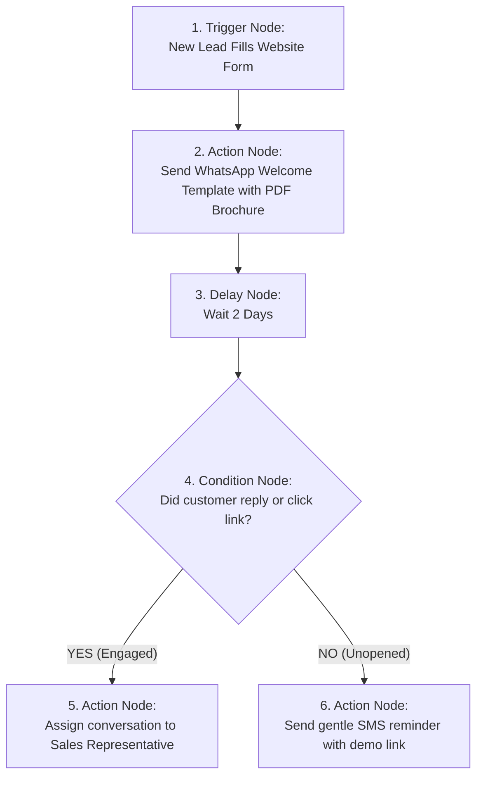
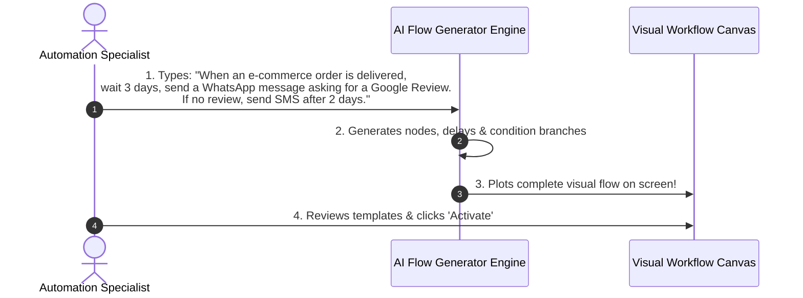

# ⚡ Building Multi-Step Automation Flows

Customer journeys rarely happen in a single moment. A customer might sign up today, require an onboarding tip tomorrow, and need a reminder about their pending invoice three days later.

The **Visual Flow Builder** (`/app/automations`) lets you create intelligent, multi-step customer journeys on an interactive canvas using simple drag-and-drop building blocks.

---

## 🧱 The 4 Building Blocks of an Automation Flow

Every flow is assembled using four types of visual nodes:

### 1. Trigger Nodes (The Starting Spark)
What causes this automation to start for a customer?
* **New Contact Created**: Fires as soon as a new contact is added via CRM, spreadsheet import, or website lead form.
* **Tag Added**: Fires when a tag is applied to a contact (e.g., `VIP-Customer`, `Webinar-Attendee`).
* **Inbound Webhook Received**: Fires when an external system (e.g., your e-commerce checkout or billing portal) triggers HubNotification's secret trigger URL (`/webhooks/automation/{trigger_token}`).
* **Inbound Message Received**: Fires when a customer sends a message on WhatsApp or Instagram.

### 2. Delay Nodes (The Natural Pause)
Prevents your company from bombarding customers with messages too quickly:
* **Wait Duration**: Pause for a set number of minutes, hours, or days (e.g., *"Wait 24 Hours"*).
* **Wait Until Time**: Pause until a specific business hour (e.g., *"Wait until 10:00 AM the following morning"*).

### 3. Action Nodes (What the System Does)
* **Send WhatsApp Template**: Dispatches an approved WhatsApp message with interactive buttons.
* **Send SMS**: Sends a text message via your connected SMS gateway.
* **Send Email**: Sends a rich HTML email via your connected SMTP server.
* **Add / Remove Tag**: Updates the customer's CRM profile tags.
* **Assign Conversation**: Automatically assigns the customer thread to a specific agent or department.

### 4. Condition Nodes (Smart Decision Branching)
Splits the path into **YES** and **NO** branches:
* *Example*: *"Did the customer open the WhatsApp message?"*
* *Example*: *"Does the customer have the tag 'Paid Customer'?"*
* *Example*: *"Did the customer click the quotation link?"*

---

## 🛠️ How to Create a New Automation Flow: Step-by-Step

1. Navigate to **Automations** (`/app/automations`).
2. Click the **+ New Automation** button in the upper right corner.
3. Enter a descriptive title (e.g., *"New Lead Nurturing Sequence"*).
4. The canvas opens showing an empty **Start Trigger** node.
5. Click the Trigger node and select **"Tag Added: New-Inquiry"**.
6. Hover over the bottom port of the Trigger node, click the plus icon (`+`), and select **Action: Send WhatsApp Template**.
7. In the side drawer, select your template (e.g., `welcome_brochure_v1`).
8. Add a **Delay Node**: Set it to **Wait 1 Day**.
9. Add a **Condition Node**: Select **"Message Replied: Yes/No"**.
10. Under the **YES** branch, add **Assign to: Sales Team**.
11. Under the **NO** branch, add **Action: Send SMS**.
12. Click **Save & Activate**. The flow is now live!

---

## 🪄 Generating Flows with Plain English AI

Don't want to drag nodes manually? Use the built-in **AI Workflow Generator**:

1. On the Automations index, click the purple **Generate with AI (✨)** button.
2. In the text box, describe your dream customer journey in simple English:
   * *Example*: *"When a customer registers on our website, send them a WhatsApp welcome message. Wait 2 days. If they haven't booked an appointment, send an SMS reminder with a booking link."*
3. Click **Build Flow**.
4. In under 5 seconds, the AI arranges the exact triggers, delays, and action nodes on your canvas!
5. Select your templates and click **Publish**.

---

## 📊 Inspecting Live Run Logs (`/app/automations/{id}/runs`)

To see real customer journeys as they happen:
* Click the **Runs** tab on any active automation flow.
* You will see a chronological log of every contact moving through your workflow:
  * 🟢 `Completed`: Contact received all steps successfully.
  * 🟡 `In Progress (Delayed)`: Contact is currently resting at a Delay node (e.g., *"Waiting for Day 2"*).
  * 🔴 `Failed`: Contact had an invalid phone number or bounced.
* Click on any customer's name to view their visual path highlighted in green on the canvas!

---

## 💡 Best Practices for Workflow Design

> [!TIP]
> **Test with Your Own Number First:** In the flow builder, click the **Test Flow** button, enter your own phone number, and simulate the execution to experience the customer journey firsthand before rolling it out publicly.

> [!IMPORTANT]
> **Always Set Exit Conditions:** If a customer purchases a product during an onboarding sequence, ensure your flow uses a condition node to stop sending reminder messages so you never ask paying customers to buy again.

> [!NOTE]
> **Webhook Secret Security:** When triggering automations from external webhooks, each automation generates a unique cryptographic secret token (`/webhooks/automation/{token}`) so unauthorized third parties cannot trigger your flows.
