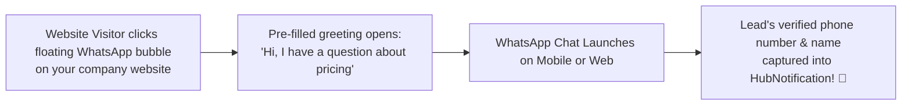
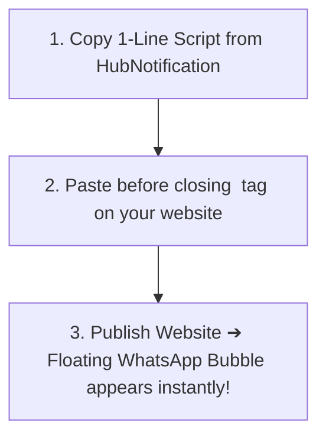

# 💬 Designing & Embedding Website Chat Widgets

Over 70% of website visitors leave without buying because they cannot find quick answers to simple questions. Traditional live-chat widgets require visitors to stay on your website with their browser open; if they close their laptop, the conversation is lost forever.

The **WhatsApp Website Chat Widget** (`/app/whatsapp/widget`) solves this problem. It places a beautiful, floating "Chat with Us" bubble in the corner of your website. When a visitor clicks it, it launches a direct WhatsApp conversation—**allowing you to continue talking to the lead even after they have left your website!**



---

## 🎨 Customizing Your Widget in HubNotification

Navigate to **WhatsApp ➔ Widget** (`/app/whatsapp/widget`) and click **+ New Widget**:

### 1. General Branding
* **Widget Title**: (e.g., *"Customer Support Desk"*).
* **Agent Name & Avatar**: Enter a friendly name (e.g., *"Priya from HubNest"*) and upload your company logo or agent photo.
* **Button Position**: Choose **Bottom Right** (industry standard) or **Bottom Left**.

### 2. Colors & Styling
* **Theme Color**: Use classic WhatsApp Green (`#25D366`) or enter your custom brand hex code.
* **Button Shape**: Rounded pill with text (*"Chat on WhatsApp"*) or a compact floating circular icon.

### 3. Greeting Message & Pre-filled Text
* **Greeting Header**: What the popup box says when clicked:
  * *"Hi there! Have a question about our services? Message us on WhatsApp!"*
* **Pre-Filled Customer Message**: The message that is automatically typed into the customer's WhatsApp composer when they click:
  * *"Hello HubNest! I am currently browsing your website and would like more information."*
* This saves the customer typing effort and tells your agents which webpage the inquiry came from!

### 4. Allowed Domains (Security Whitelist)
* Enter your official website domains (e.g., `https://yourcompany.com`, `https://shop.yourcompany.com`).
* This ensures other websites cannot steal your widget key.

---

## 💻 Embedding the Widget on Your Website

Once you click **Save & Generate Embed Code**, HubNotification generates a clean, lightweight, single-line JavaScript snippet:

```html
<!-- HubNotification WhatsApp Floating Widget -->
<script 
  src="https://hubnotification.srjhubnest.com/widgets/whatsapp/wh_live_98127401.js" 
  defer>
</script>
```



### How to Install on Common Platforms:
* **WordPress**: Go to **Appearance ➔ Theme File Editor** (or use a free plugin like *Insert Headers and Footers*) and paste the script before `</body>`.
* **Shopify**: Go to **Online Store ➔ Themes ➔ Edit Code**, open `theme.liquid`, and paste the script before the `</body>` tag.
* **HTML / Next.js / React**: Add the script tag to your main layout or document file.

---

## 📱 Mobile vs. Desktop Experience

HubNotification's widget detects the visitor's device automatically:
* **On Smartphones (iOS & Android)**: Tapping the widget opens the native **WhatsApp application** installed on the user's phone in a split second.
* **On Desktop Computers**: Tapping the widget opens **WhatsApp Web** in a new browser tab, allowing visitors to chat seamlessly from their computer keyboard.

---

## 💡 Chat Widget Best Practices

> [!TIP]
> **Use Page-Specific Pre-filled Messages:** If you have a specific high-value pricing page, create a second widget with the pre-filled text: *"Hello, I am looking at your Enterprise Plan and want a custom quotation."* This alerts your sales team to prioritize the inquiry!

> [!IMPORTANT]
> **Zero Impact on Website Speed:** The HubNotification widget script is less than 15KB and loads asynchronously (`defer`), meaning your website's Google PageSpeed and SEO scores remain 100% lightning-fast.

> [!NOTE]
> **Automatic Contact Capture:** The moment the customer sends their first WhatsApp message, HubNotification creates a new contact profile in your CRM with their phone number and WhatsApp profile name.
