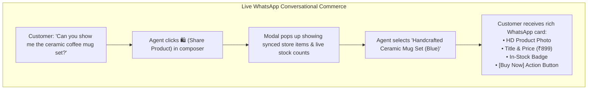

# 🛍️ Synced Product Catalog & Sharing Items in Chat

When an interested shopper reaches out on WhatsApp asking: *"Do you have running shoes in size 9?"* or *"What is your best-selling organic face serum?"*, sending a plain text reply with a raw website link looks unprofessional and loses sales.

HubNotification's **Catalog Manager** (`/app/ecommerce/products`) allows you to drop rich, interactive product cards directly into the customer's chat with a single click.

---

## 🔍 Browsing Your Synced Product Catalog (`/app/ecommerce/products`)

To audit all products currently synced from your online store:

1. Navigate to **E-Commerce ➔ Products** (`/app/ecommerce/products`).
2. The catalog directory displays:
   * **Product Thumbnail**: High-resolution image pulled from your store.
   * **Title & Description**: Official title and short summary.
   * **SKU & Variant**: Stock Keeping Unit (e.g., `TSHIRT-BLK-M`).
   * **Price**: Displayed in your store's native currency (e.g., `₹1,499` or `$29.99`).
   * **Inventory Stock Count**: Shows real-time stock (e.g., `42 in stock` or `Out of Stock`).
   * **Direct Store Link**: Click the external link icon (↗️) to open the live product page on your store.

---

## 💬 How to Share a Product Card in Live Chat: Step-by-Step

When you are chatting with a customer in the **Live Inbox** (`/app/inbox`):

1. In the bottom chat toolbar, click the **Shopping Bag Icon (🛍️ Share Product)**.
2. A search modal opens displaying your product catalog.
3. Type the product name, keyword, or SKU into the search bar:
   * *Example*: Type `"jacket"` or `"serum"`.
4. As you type, the list filters instantly.
5. Check the inventory indicator to ensure the item is in stock.
6. Click **Share in Chat**.
7. HubNotification instantly sends a formatted card to the customer's WhatsApp, Instagram, or Messenger:
   * The customer sees an attractive image card with pricing and a prominent **[View & Order]** button.
   * When they tap the button, they are redirected straight to your store checkout with the product already added to their cart!

---

## 🔄 Real-Time Inventory Protection

What happens if an item runs out of stock while an agent is chatting?

* HubNotification syncs inventory counts from your e-commerce platform in real time.
* If a product drops to zero inventory in Shopify or WooCommerce, the catalog card in HubNotification turns orange with an **Out of Stock** badge.
* The system prevents agents from accidentally sharing out-of-stock items, protecting your brand from disappointed customers and refund headaches.

---

## 💡 Conversational Selling Best Practices

> [!TIP]
> **Share Two Alternative Options:** When a customer asks for recommendations, share two product cards—one matching their exact request, and a slightly upgraded premium option. Customers love having a choice, and it frequently increases your Average Order Value (AOV)!

> [!IMPORTANT]
> **Check Variant Sizing:** If a product comes in multiple sizes or colors (e.g., Small, Medium, Large), verify which specific variant the customer wants before sharing the card so they receive the correct checkout link.

> [!NOTE]
> **Automatic Order Tracking:** When the customer completes their purchase using the shared product card, their new order appears automatically in the customer's timeline sidebar inside HubNotification.
