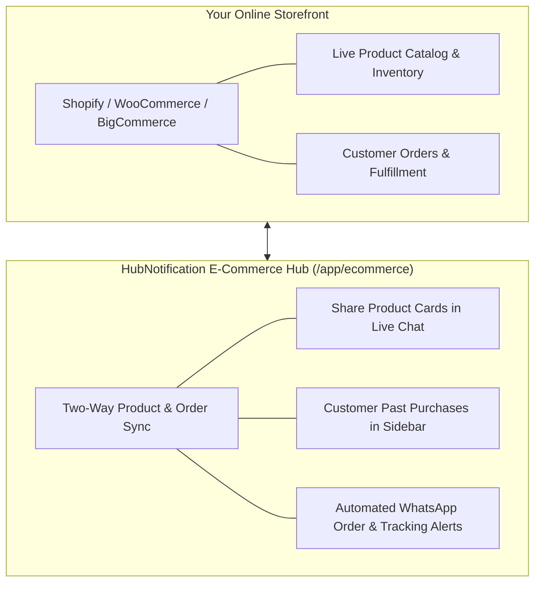

# 🛒 E-Commerce Specialist — Overview

Welcome to the **HubNotification E-Commerce Operations Specialist** user guide.

Running a successful online store requires more than just listing products on a website. Today's online shoppers expect instant updates on their smartphones: order confirmations, shipping tracking numbers with live tracking links, and fast answers when they ask questions about sizing, delivery times, or stock availability.

**HubNotification brings Conversational Commerce to your online store.** By connecting your **Shopify, WooCommerce, or BigCommerce** storefront directly to your communication engine, your team can view customer purchase histories during live chats, share interactive product cards, and dispatch automated WhatsApp and SMS delivery alerts.

---

## 🛍️ What You Can Achieve as an E-Commerce Specialist

| Goal | HubNotification Tool | What It Does for Your Business |
| :--- | :--- | :--- |
| **Store Sync** | `/app/ecommerce/stores` | Connects your Shopify, WooCommerce, or BigCommerce store via secure 1-click OAuth. |
| **Live Catalog in Chat** | `/app/ecommerce/products` | Browse synced inventory and drop rich product cards with buy links directly into WhatsApp conversations. |
| **Instant Customer Context** | Order Timeline in Live Inbox | When a customer messages, view their total spend, previous order numbers, and delivery statuses without leaving the chat. |
| **Automated Notifications** | Order Webhooks & Templates | Send automated WhatsApp confirmations the moment an order is paid, and tracking links when the parcel ships. |
| **Abandoned Cart Recovery** | Automation Flow Triggers | Re-engage shoppers who left items in their cart with an automated WhatsApp reminder and discount code. |

---

## 📦 The E-Commerce Daily Routine

### 1. Morning Order Review (09:00 AM)
* Check the **Orders Dashboard** (`/app/ecommerce/orders`) for overnight order volumes and payment states.
* Verify that automated order confirmation messages were delivered successfully to buyers' WhatsApp numbers.

### 2. Live Customer Support Throughout the Day
* When shoppers ask *"Do you have this in blue?"* or *"Can you recommend a gift under ₹1,000?"*, click the **Share Product** button in the chat composer to send an interactive product card with photos, pricing, and a direct checkout link.
* Review order status inquiries instantly using the right-hand **Customer Orders Sidebar** instead of opening a separate Shopify tab.

### 3. Dispatch & Tracking Follow-up (04:00 PM)
* When your warehouse fulfills orders and uploads courier tracking numbers (e.g., BlueDart, Delhivery, FedEx), HubNotification automatically delivers the tracking link to the customer's phone.

---

## 💡 Conversational Commerce Golden Rules

> [!TIP]
> **Share Product Cards, Not Raw Links:** When recommending items, never paste long, messy website URLs. Use HubNotification's **Share Product** tool so the customer receives an attractive card with a high-resolution photo, current price, and a prominent **[Buy Now]** button.

> [!IMPORTANT]
> **Keep Inventory Synced:** If you add new products or update prices in Shopify, click **Sync Now** in `/app/ecommerce/stores` so your support agents always quote the latest pricing.

> [!NOTE]
> **Zero Commission Fees:** HubNotification does not take any percentage or commission from your e-commerce sales. All checkout links send buyers directly to your own store's payment gateway.

---

## 📚 What You Will Master in This Section

1. [Connecting Shopify, WooCommerce & BigCommerce](store-connections.md)
2. [Catalog Management & Sharing Products in Live Chat](catalog-management.md)
3. [Viewing Customer Purchase History & Order Timeline](order-tracking.md)
4. [Automated Order Confirmations & Tracking Alerts](order-notifications.md)
