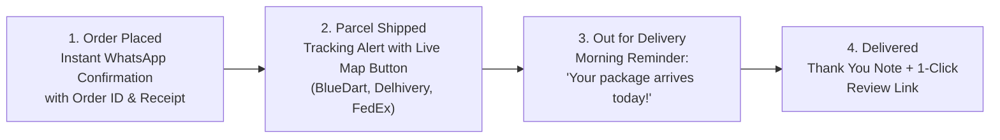
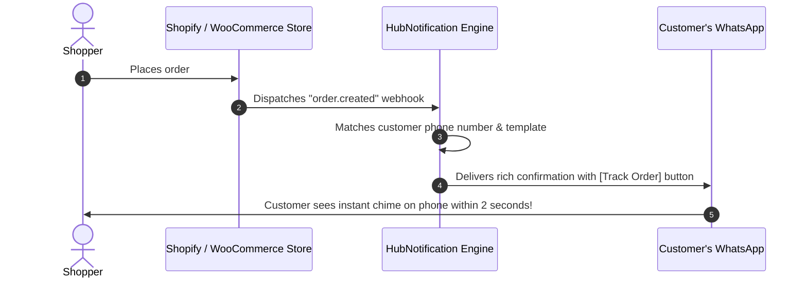

# 🔔 Automated Order Confirmations & Tracking Alerts

In e-commerce, customer anxiety peaks between the moment they pay and the moment the parcel arrives at their doorstep. If customers do not receive timely updates, they flood your support team with repetitive inquiries or cancel their cash-on-delivery orders.

By connecting your online store to **HubNotification's Automated Notification Engine**, you can send instant **WhatsApp and SMS alerts** for every stage of the fulfillment lifecycle.

---

## 📱 The 5 Standard E-Commerce WhatsApp Notifications

| Notification Event | Meta Template Category | When It Triggers | Sample WhatsApp Message Content |
| :--- | :--- | :--- | :--- |
| **1. Order Confirmed** | `Utility` | When customer completes checkout and payment succeeds. | *"Hi {{1}}! Your order #{{2}} is confirmed. We are packaging your items right now! View invoice: [Download Receipt]"* |
| **2. Parcel Dispatched** | `Utility` | When warehouse creates courier shipping label. | *"Good news, {{1}}! Your order #{{2}} has shipped via {{3}}. Track live: [Track Package ({{4}})]"* |
| **3. Out for Delivery** | `Utility` | Morning of scheduled delivery day. | *"Your delivery executive is out with your parcel today! For COD orders, please keep {{1}} ready in cash or UPI."* |
| **4. Delivered & Feedback** | `Marketing` | When courier marks package as safely delivered. | *"Your order #{{1}} has been delivered! We hope you love your new items. Tap below to share a review: [Rate Product]"* |
| **5. Abandoned Cart Recovery**| `Marketing` | 1 hour after customer abandons checkout without paying. | *"Hi {{1}}, did you leave something behind? Your cart is reserved! Use code CART5 for an extra 5% off: [Complete Order]"* |

---

## 🛠️ How to Set Up Automated Order Alerts: Step-by-Step

Setting up automated alerts requires connecting your store's webhooks to HubNotification's **Automation Studio**:

### Step 1: Prepare Your Meta Templates
1. Go to **WhatsApp ➔ Templates** (`/app/whatsapp/templates`).
2. Create templates for:
   * `order_confirmation_v1` (Category: `Utility`)
   * `order_shipped_v1` (Category: `Utility`)
3. Ensure your templates include variables for `{{1}}` (Customer Name), `{{2}}` (Order ID), and `{{3}}` (Tracking Link).
4. Wait for Meta approval (typically under 10 minutes).

### Step 2: Activate the Automation Flow
1. Navigate to **Automations** (`/app/automations`).
2. Click **+ New Automation** (or select the pre-built template *"Shopify Order Notification Sequence"*).
3. Set the Trigger to: **"E-Commerce: Order Placed"**.
4. Add Action: **Send WhatsApp Template ➔ `order_confirmation_v1`**.
5. Map template variables to order fields:
   * `{{1}}` ➔ `Order.Customer.FirstName`
   * `{{2}}` ➔ `Order.Number`
   * `{{3}}` ➔ `Order.TotalAmount`
6. Click **Activate Flow**.

---

## 🛒 Abandoned Cart Recovery Sequences

On average, 68% of online shoppers add items to their cart and abandon the website before paying. Email reminders often go unread, but **WhatsApp abandoned cart messages achieve up to a 28% recovery rate**!

### How the Abandoned Cart Sequence Works:
1. Shopper enters their phone number and adds items to the cart, but leaves the website.
2. HubNotification detects the abandoned checkout event.
3. The flow waits **60 minutes** (to avoid seeming overly aggressive).
4. The system delivers a friendly WhatsApp message with an image of the abandoned items and a single-tap **[Return to Cart]** button with their discount code pre-applied.

---

## 💡 Best Practices for Order Notifications

> [!TIP]
> **COD Verification Saves Money:** If your store offers Cash on Delivery (COD), send an instant WhatsApp message asking the customer to tap **[Confirm Order]** before dispatching the package. This eliminates up to 40% of fake orders and Return-to-Origin (RTO) shipping losses!

> [!IMPORTANT]
> **Use Utility Category for Post-Purchase Updates:** Order confirmations and shipping tracking alerts must be submitted under the `Utility` template category. Utility templates have significantly lower messaging fees than promotional marketing templates and enjoy instant Meta approval.

> [!NOTE]
> **Zero Customer Phone Entry Errors:** HubNotification automatically cleans up customer phone numbers by removing spaces, hyphens, and leading zeros, ensuring your transactional messages deliver smoothly even if the customer mistyped their number formatting.
