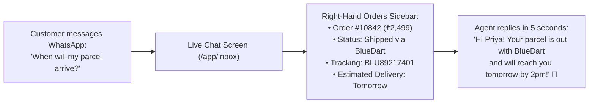
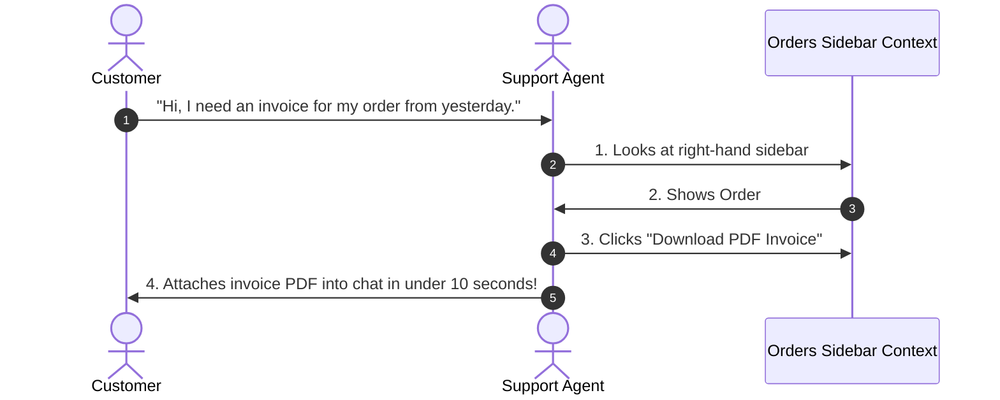

# 📦 Customer Purchase History & Order Timeline

One of the most frequent customer inquiries in any online store is: *"Where is my order?"* or *"Can you check if my payment went through?"*.

In traditional support setups, the agent must ask the customer for their order number, open Shopify in a second tab, search the database, and switch back to reply. **With HubNotification, the customer's complete purchase history and live courier tracking status appear right in the chat sidebar!**

---

## 🔍 The Live Orders Stream (`/app/ecommerce/orders`)

To monitor all incoming orders across your connected stores in real time:

1. Navigate to **E-Commerce ➔ Orders** (`/app/ecommerce/orders`).
2. The dashboard displays a clean tabular overview:
   * **Order ID**: e.g., `#10842` (with a direct link to open the order in your Shopify/WooCommerce admin).
   * **Customer Info**: Name, verified phone number, and delivery city.
   * **Items Summary**: Thumbnail of ordered items, quantities, and variants.
   * **Financial State**:
     * 🟢 `Paid`: Funds captured successfully.
     * 🟡 `Pending`: Cash-on-delivery (COD) or awaiting bank clearance.
     * 🔴 `Refunded`: Funds returned to customer.
   * **Fulfillment State**:
     * 🟡 `Unfulfilled`: Order is being packaged at your warehouse.
     * 🔵 `In Transit`: Handed over to courier with active tracking.
     * 🟢 `Delivered`: Parcel safely handed to the customer.

---

## 💬 Instant Order Context in the Live Chat Sidebar

When a customer messages your company on WhatsApp, Instagram, or Messenger, HubNotification automatically matches their phone number or email address against your e-commerce database:

### What Appears in the Chat Sidebar:
1. Open any customer conversation in the **Live Inbox** (`/app/inbox`).
2. Look at the lower half of the **Right-Hand Metadata Pane**:
   * **Recent Orders Card**: Displays the customer's last 3 purchases.
   * **Order Value & Date**: Total amount paid and order placement timestamp.
   * **Items Ordered**: Tap to expand and view item names, colors, and sizes.
   * **Courier Partner & Tracking**: Click the tracking number to open the live carrier tracking map.

---

## 🔄 Refreshing Order Status on Demand

If a customer just made a payment 30 seconds ago while on chat with you:

1. In the customer's chat sidebar, find the **Orders Card**.
2. Click the small **Refresh Icon (🔄)** in the card header.
3. HubNotification pings Shopify/WooCommerce immediately, pulls the brand-new order record, and updates the timeline on your screen without requiring a page refresh!

---

## 💡 Best Practices for Order Support

> [!TIP]
> **Proactive Order Greetings:** When a customer messages without stating their question, glance at their sidebar. If their order was marked *"Delayed by Courier"*, start with: *"Hi Rajesh, I see your order #1084 is currently in transit with Delhivery. Are you inquiring about its delivery time?"* Customers will be amazed by your proactive awareness!

> [!IMPORTANT]
> **Check Payment Before Initiating Cancellations:** If a customer asks to cancel an order, always check the **Financial State** in the sidebar. If marked `Pending (COD)`, cancel it immediately. If marked `Paid`, alert your accounts team to process the refund gateway credit.

> [!NOTE]
> **Multi-Number Linking:** If a customer contacts you from a different phone number than the one used during checkout, simply type their order number into the search bar in `/app/ecommerce/orders` to locate their record instantly.
