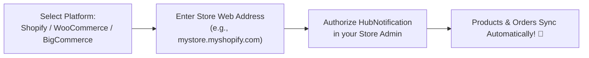
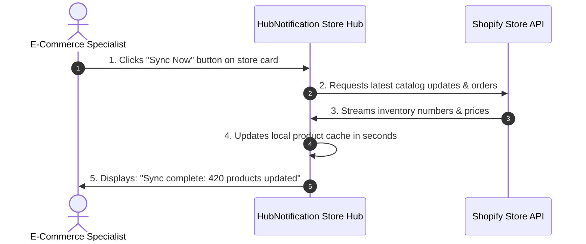

# 🏬 Connecting Shopify, WooCommerce & BigCommerce

Before you can share product cards or view customer order timelines, you need to link your online storefront to HubNotification.

Connecting an online store takes less than two minutes and requires **zero coding**. HubNotification uses secure, official OAuth protocols so you never have to share your master store passwords.

---

## 🛍️ 1. Connecting a Shopify Store

1. Navigate to **E-Commerce ➔ Connected Stores** (`/app/ecommerce/stores`).
2. Click the **+ Connect Store** button and select **Shopify**.
3. In the dialog, enter your official myshopify domain:
   * *Example*: `mybrand.myshopify.com`.
4. Click **Connect with Shopify**.
5. You will be redirected to your secure Shopify Admin panel:
   * Review the permissions (read products, read orders, read customer contact info).
   * Click **Install App**.
6. You are automatically returned to HubNotification.
7. Your store card will appear with a green **Active** badge showing the store title, currency, and total products synced!

---

## 🛒 2. Connecting a WooCommerce (WordPress) Store

For WooCommerce stores hosted on WordPress:

1. In **Connected Stores** (`/app/ecommerce/stores`), click **+ Connect Store** ➔ Select **WooCommerce**.
2. Enter your WordPress Store URL (e.g., `https://myfashionshop.in`).
3. You have two easy connection methods:
   * **Method A (1-Click OAuth)**: Click **Authorize with WooCommerce**. Log into your WordPress admin account and click **Approve**.
   * **Method B (REST API Keys)**:
     * In WordPress, go to **WooCommerce ➔ Settings ➔ Advanced ➔ REST API ➔ Add Key**.
     * Generate a key with **Read/Write** permissions.
     * Copy the **Consumer Key** (`ck_...`) and **Consumer Secret** (`cs_...`) and paste them into the HubNotification setup dialog.
4. Click **Save & Test Connection**.
5. HubNotification verifies communication with your WordPress database and begins synchronizing your products.

---

## 🏢 3. Connecting BigCommerce

1. Click **+ Connect Store** ➔ Select **BigCommerce**.
2. Enter your **Store Hash** (found in your BigCommerce control panel URL).
3. Paste your **Client ID** and **Access Token** generated from **Settings ➔ API Accounts**.
4. Click **Connect BigCommerce**.

---

## 🔄 Testing Connections & Triggering Manual Syncs

Once your store is connected, HubNotification automatically receives live updates whenever an order is created via real-time webhooks.

However, if you just bulk-imported 500 new products into Shopify and want them visible in HubNotification immediately:

1. On the store card in `/app/ecommerce/stores`, locate the three action buttons:
   * **Test Connection (⚡)**: Pings your store API to confirm that credentials and webhook listeners are active.
   * **Sync Now (🔄)**: Pulls the newest catalog items, updated prices, and recent orders on demand.
   * **Disconnect (🗑️)**: Safely unlinks the store without deleting any customer conversation history.

---

## 💡 Best Practices for Multi-Store Setups

> [!TIP]
> **Connect Regional Stores Separately:** If you operate a domestic Indian store (`store.in` in INR) and an international export store (`store.com` in USD), you can connect both stores to the same HubNotification workspace!

> [!IMPORTANT]
> **Check HTTPS Security:** WooCommerce stores must have an active SSL certificate (`https://`). Non-secure (`http://`) stores will be rejected by modern webhook gateways.

> [!NOTE]
> **Read-Only Peace of Mind:** HubNotification only requires read permissions for catalog and orders, plus order note updates. It will never modify your bank payouts or store theme designs.
