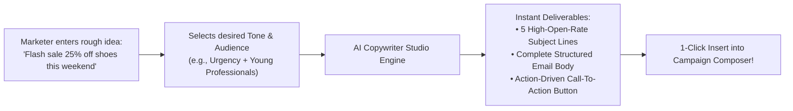
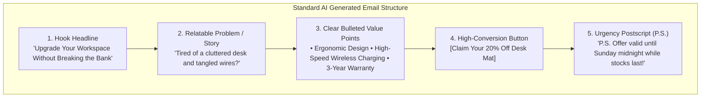

# 🤖 Generating High-Converting Copy with AI

Writing compelling marketing copy every week can be exhausting. If you have ever stared at a blank screen wondering how to phrase an email subject line or how to make an announcement sound exciting, **HubNotification's built-in AI Copywriter** (`/app/broadcasts/campaigns/generate-email`) is your 24/7 creative assistant.

---

## 🎯 The AI Subject Line Enhancer

The subject line determines whether a customer opens your email or deletes it unread. The **AI Subject Enhancer** analyzes your initial idea and generates high-converting variations tailored to specific psychological triggers:

### How to Use It:
1. In the **Email Campaign Composer** (`/app/broadcasts/campaigns/create`), locate the **Subject Line** field.
2. Type your rough concept (e.g., *"new winter jackets arrived"*).
3. Click the **Improve with AI (✨)** button next to the input field.
4. Select your preferred emotional tone:
   * **Urgency & FOMO**: *"Only 48 Hours: Winter Jackets Are Disappearing Fast!"*
   * **Curiosity**: *"The secret to staying warm this winter just dropped..."*
   * **Direct & Benefit-Driven**: *"Stay Warm in Style: Explore Our All-New Winter Collection"*
   * **Friendly & Warm**: *"Hey {{name}}, we thought you might love our newest winter layers!"*
5. Click on your favorite variation to insert it into your campaign with a single click.

---

## ✍️ Full Campaign Email Generation

Beyond subject lines, the AI Copywriter can generate complete, formatted marketing emails ready for dispatch:

### Steps to Generate a Complete Email:
1. In the campaign builder, click the purple **Generate with AI (🪄)** button above the email body editor.
2. In the AI prompt drawer, fill in four simple prompts:
   * **What are you promoting?**: (e.g., *"Organic herbal green tea pack of 3"*).
   * **What is the key offer?**: (e.g., *"Buy 2 Get 1 Free with free shipping"*).
   * **Who is your target audience?**: (e.g., *"Health-conscious working professionals"*).
   * **Tone of voice**: Select from *Friendly*, *Luxury/Premium*, *Energetic*, or *Formal*.
3. Click **Generate Draft**.
4. In under 5 seconds, the AI writes a full, beautifully formatted email including headline, body paragraphs, bullet points, and a prominent call-to-action button.
5. Review the text, make any personalized adjustments, and click **Insert into Editor**.

---

## 🎭 Tone Picker Guide: When to Use Which Tone

| Tone | When to Use It | Example Headline |
| :--- | :--- | :--- |
| **Energetic / Urgency** | Flash sales, last-day coupon expirations, event ticket deadlines. | *"⚡ Final 6 Hours: Your 30% Off Code Is Expiring!"* |
| **Friendly & Conversational** | Customer welcome emails, product tips, lifestyle blogs, customer check-ins. | *"A quick thank-you from our team (and a little surprise inside) 🎁"* |
| **Luxury & Elegant** | High-end fashion, jewelry, premium software, VIP invitations. | *"Crafted for Excellence: Discover the Private Autumn Showcase."* |
| **Direct & Informative** | System updates, shipping notifications, policy revisions, webinars. | *"Important Notice: Scheduled System Maintenance on Sunday."* |

---

## 💡 Marketer Pro Tips for AI Copywriting

> [!TIP]
> **Use Variables in AI Prompts:** Tell the AI to include dynamic placeholders like `{{name}}` or `{{company}}` so the resulting copy feels personally written for each recipient.

> [!IMPORTANT]
> **Always Proofread Brand Nuances:** While the AI produces grammatically flawless copy, always check that your specific product names, warranty years, and pricing figures match your exact company policies.

> [!NOTE]
> **Zero Token Billing Hassles:** The AI Copywriter runs seamlessly within your HubNotification plan without requiring you to manage complex third-party AI keys or token balances.
