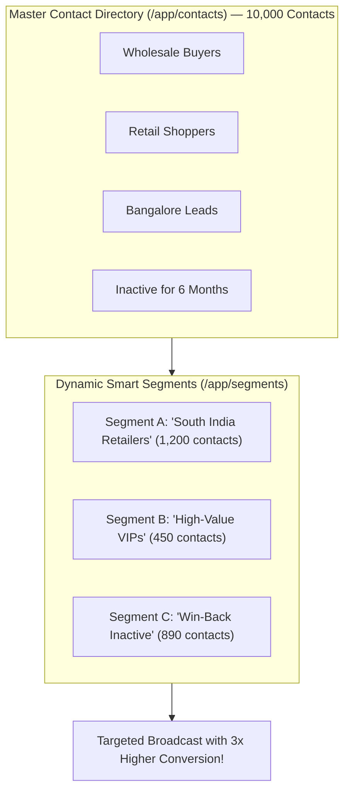
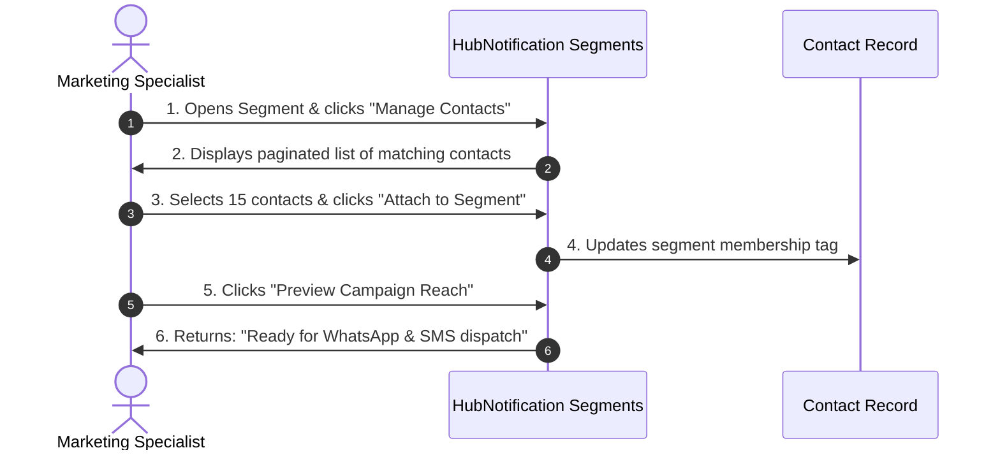

# 🎯 Creating Audience Segments & Previewing Reach

Sending every message to every contact in your database is a quick way to get your WhatsApp number blocked or your marketing emails marked as spam.

**Audience Segmentation** (`/app/segments`) allows you to group contacts based on shared characteristics—such as their geographic city, past purchase behavior, or company size. When customers receive messages tailored specifically to their needs, your conversion rates skyrocket.

---

## ⚖️ Static Lists vs. Dynamic Smart Segments

HubNotification supports two distinct types of segments:

| Feature | Static Segment (Manual List) | Dynamic Smart Segment (Automated Filter) |
| :--- | :--- | :--- |
| **How It Works** | A fixed snapshot of contacts you manually upload or tag. | An intelligent filter query that updates itself automatically. |
| **Membership** | Fixed. If a new customer signs up tomorrow, they are **not** added unless you add them manually. | Fluid. As soon as a customer matches your filter (e.g., their city becomes *Delhi*), they enter the segment automatically. |
| **Best Used For** | Specific one-time events, such as *"Attendees of TechExpo 2026"* or *"Holiday Hamper Recipients"*. | Ongoing campaigns, such as *"Customers who haven't ordered in 60 days"* or *"VIPs who spent over ₹50,000"*. |

---

## 🛠️ How to Build a Dynamic Smart Segment: Step-by-Step

1. Navigate to **Contacts ➔ Segments** (`/app/segments`).
2. Click the **+ New Segment** button in the upper right.
3. Fill in the Basic Info:
   * **Segment Name**: Give it a descriptive name (e.g., *"Mumbai Retailers — Active"*).
   * **Description**: Brief reminder of who belongs here (e.g., *"Wholesale accounts in Maharashtra with verified phone numbers"*).
4. Set Up Your **Filter Rules**:
   * Click **+ Add Rule** to specify your matching conditions:
     * **Condition 1**: `City` ➔ `Equals` ➔ `Mumbai`
     * **Condition 2**: `Tag` ➔ `Contains` ➔ `Wholesale`
     * **Condition 3**: `WhatsApp Status` ➔ `Equals` ➔ `Valid`
5. Choose Rule Logic:
   * **Match ALL Rules (AND)**: Contact must satisfy every single condition to be included.
   * **Match ANY Rule (OR)**: Contact enters the segment if they satisfy at least one condition.
6. Click **Calculate Reach**. HubNotification displays the exact number of matching contacts in real time!
7. Click **Save Segment**.

---

## 👥 Managing Contacts Inside a Segment

To inspect or manually adjust contacts inside any segment:

1. In the Segments list, click on the **Segment Name** or click the **Manage Contacts (👥)** icon.
2. You will see a dedicated table displaying all contacts currently qualifying for this segment.
3. **Manual Attach**: Click **+ Add Contacts** to search and manually link specific contacts.
4. **Manual Detach**: If a particular contact should be excluded from future promotions for this group, click the small trash icon next to their name to detach them.

---

## 📊 Previewing Campaign Reach Before Launching

Before scheduling an expensive bulk broadcast, always verify your segment's deliverability:

1. When selecting your segment in the **Campaign Creator** (`/app/broadcasts/campaigns/create`):
2. Click the **Audience Reach Breakdown** button.
3. A modal appears showing:
   * **Total Contacts in Segment**: e.g., `5,000`
   * **Reachable on WhatsApp**: e.g., `4,850` (97%)
   * **Reachable via SMS**: e.g., `4,980` (99.6%)
   * **Reachable via Email**: e.g., `4,200` (84%)
   * **Opted-out or Blocked**: e.g., `20` (Excluded automatically for your safety)
4. This ensures you never pay for undeliverable numbers or waste budget on inactive profiles.

---

## 💡 Segmentation Best Practices

> [!TIP]
> **Combine RFM (Recency, Frequency, Monetary):** Create a segment for *"Lapsed VIPs"* (Customers who spent over ₹25,000 in the past but have not ordered in the last 90 days). Send them a special WhatsApp message with a generous comeback offer to recover lost revenue!

> [!IMPORTANT]
> **Check Country Codes:** When targeting regional phone numbers for WhatsApp or SMS broadcasts, ensure your contacts have valid international dialing prefixes (e.g., `+91` for India, `+1` for USA).

> [!NOTE]
> **Continuous Background Updating:** Dynamic segments evaluate new contacts as soon as they are added or edited in the CRM. You never need to rebuild dynamic segments before sending a campaign.
