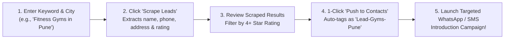
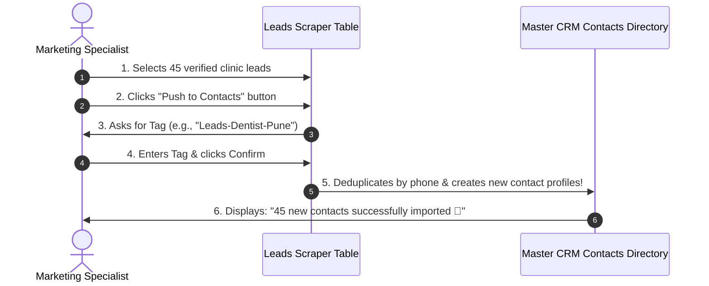

# 🎯 Discovering B2B Leads with Google Maps Scraper

If your business sells products or services to other businesses (B2B)—such as wholesale goods, software solutions, maintenance services, or consulting—finding verified contact details for local companies is usually slow and expensive.

The **Leads Scraper** (`/app/leads`) connects directly to Google Places and Google Maps business listings, allowing you to search any city in the world, extract verified company phone numbers and addresses, and import them into your CRM with a single click!

---

## 🛠️ How to Scrape Local Business Leads: Step-by-Step

Navigate to **Leads** (`/app/leads`) from the main sidebar:

### Step 1: Set Your Search Parameters
In the search card at the top of the page:
1. **Business Category / Keyword**: Enter the type of business you want to target:
   * *Examples*: `"Dental Clinics"`, `"Interior Designers"`, `"Boutique Hotels"`, `"Car Repair Workshops"`.
2. **City / Location**: Enter the geographic target:
   * *Examples*: `"Ahmedabad, Gujarat"`, `"South Delhi"`, `"Bangalore Central"`.
3. **Maximum Leads**: Choose how many leads you wish to extract in this batch (e.g., 20, 50, or 100 leads).
4. Click the blue button labeled **Start Scraping Leads (🔍)**.

---

### Step 2: Reviewing the Extracted Business Data

In less than 30 seconds, HubNotification returns a structured directory of local businesses matching your search:

| Extracted Field | What It Shows | How It Helps Your Outreach |
| :--- | :--- | :--- |
| **Business Name** | Official registered company title. | Personalize your outreach (*"Hi Dr. Roy, we saw your clinic..."*). |
| **Phone Number** | Official office or mobile telephone number. | Ready for direct WhatsApp or SMS introduction broadcasts. |
| **Physical Address** | Street, locality, and postal pincode. | Verify regional proximity for local service deliveries. |
| **Star Rating & Reviews** | Google Maps rating (e.g., `4.7 ⭐ (142 reviews)`). | Target established, high-reputation businesses first. |
| **Website & Map Link** | Company website URL and Google Maps pin. | Review their current website before making a pitch. |

---

## 🚀 Pushing Scraped Leads into Your CRM Directory

You do not need to download CSV files and re-upload them:

1. Review the scraped leads table.
2. Select the checkboxes next to the businesses you wish to target (or click the master checkbox to select all).
3. Click the green button labeled **Push to Contacts (📥)** in the table header.
4. In the dialog, attach an outreach tag:
   * *Example*: `Leads-Gyms-Pune-Oct2026`.
5. Click **Import Now**.
6. HubNotification automatically checks for duplicates against your existing contact directory, adds new records, and creates a ready-to-use segment for immediate outreach!

---

## 📣 Next Step: Launching a Friendly Introduction Broadcast

Now that your prospects are in your contacts directory:
1. Navigate to **Broadcasts ➔ Campaigns** (`/app/broadcasts/campaigns/create`).
2. Select your new tag (`Leads-Gyms-Pune-Oct2026`).
3. Send a polite, non-spammy WhatsApp introductory template or email introducing your company's services.
4. Interested prospects will reply directly into your **Live Inbox** (`/app/inbox`), where your support and sales team can close deals!

---

## 💡 Lead Generation Best Practices

> [!TIP]
> **Target High-Rating Businesses First:** Businesses with 4.0+ stars on Google Maps are usually actively operating and have budget to spend on new tools, products, and services.

> [!IMPORTANT]
> **Respect Anti-Spam Guidelines:** When reaching out to new B2B leads for the first time, introduce your business politely and always provide an easy opt-out mechanism (e.g., *"If you prefer not to receive updates, reply STOP"*).

> [!NOTE]
> **DLT Compliance for India SMS:** If you plan to send introductory SMS messages to Indian business numbers, ensure you use a DLT-approved transactional or promotional header and template.
