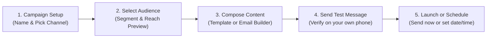
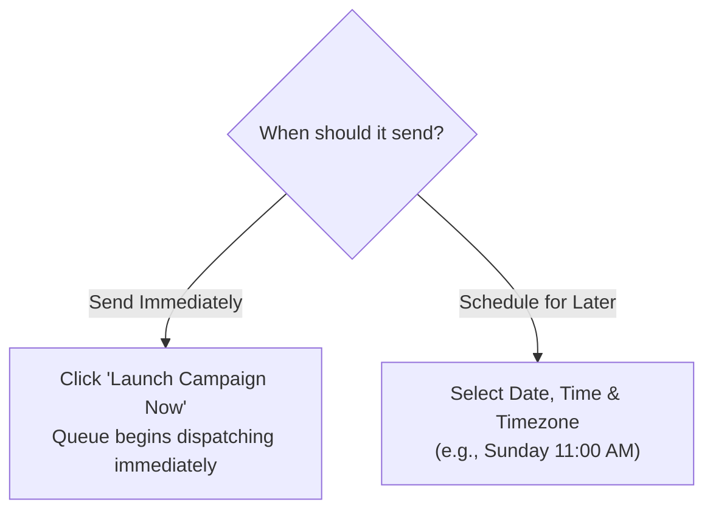

# 📣 Creating Multi-Channel Broadcasts

When you need to announce a new product, distribute a holiday discount code, or invite customers to a webinar, the **Campaigns Studio** (`/app/broadcasts/campaigns`) lets you reach thousands of recipients in just a few clicks.

---

## 🛠️ Step-by-Step Campaign Creation Wizard

Navigate to **Broadcasts ➔ Campaigns** (`/app/broadcasts/campaigns`) and click the **+ New Campaign** button in the upper right corner.

### Step 1: Basic Campaign Details
1. **Campaign Name**: Give your campaign an internal name that is easy to recognize later (e.g., *"Diwali 30% Off Blast — October 2026"*).
2. **Select Delivery Channel**:
   * 🟢 **WhatsApp**: Best for highest open rates (98%), rich media banners, and interactive buttons.
   * 📱 **SMS**: Best for urgent alerts, OTPs, or reaching clients with feature phones and low internet connectivity.
   * 📧 **Email**: Best for detailed newsletters, product catalogs, and formal corporate invitations.
3. Click **Next: Audience**.

---

### Step 2: Selecting Your Target Audience
Never blast messages blindly. HubNotification helps you calculate your exact reach:

1. **Target Group**: Choose between:
   * **All Contacts**: Sends to your entire customer directory (use sparingly).
   * **Saved Segment**: Select a focused audience (e.g., *"Repeat Buyers"*, *"Mumbai Leads"*, or *"Inactive 90 Days"*).
2. **Reachable Contacts Preview**:
   * Click **Calculate Audience**.
   * HubNotification checks your database and displays the number of recipients who have valid phone numbers (or email addresses) and have not opted out.
   * *Example*: *"Found 4,250 contacts in 'VIP Customers'. 4,218 have valid WhatsApp numbers."*
3. Click **Next: Content**.

---

### Step 3: Composing Your Message Content

Depending on the channel you selected in Step 1:

#### For WhatsApp Campaigns:
* You cannot send raw, unapproved text to bulk audiences (per Meta anti-spam regulations).
* Select an **Approved WhatsApp Template** from your template dropdown (e.g., `festive_offer_v2`).
* If your template contains variables (e.g., *"Hello {{1}}, here is your discount code: {{2}}"*), map the variables to your contact fields:
  * Variable `{{1}}` ➔ `Contact First Name`
  * Variable `{{2}}` ➔ `Custom Field: Promo Code`
* If the template has an image header, upload your campaign banner or select one from your **Media Library**.

#### For Email Campaigns:
* **Subject Line**: Enter your email title. Use the built-in **AI Subject Enhancer** button to generate catchy variations.
* **Email Body**: Use the visual drag-and-drop designer or rich text editor to insert images, call-to-action buttons, and social links.
* **From Name & From Email**: Verified automatically from your connected corporate SMTP server.

#### For SMS Campaigns:
* Enter your text message.
* If sending within India, select your **DLT Registered Template ID** and approved **Sender ID**.
* Observe the character counter (160 characters per standard SMS segment).

---

### Step 4: The Mandatory Test Send

> [!IMPORTANT]
> **Always Test Before Launching:** Never send a message to thousands of customers without testing it on your own phone first!

1. In the **Test Send** box, enter your personal mobile number or email address.
2. Click **Send Test Message**.
3. Check your phone within 10 seconds:
   * Do the personalized variables (name, company) appear correctly?
   * Does the banner image load clearly?
   * Do the buttons and website links open the correct landing page?
4. If everything looks perfect, click **Next: Launch Options**.

---

### Step 5: Scheduling & Launching

Choose when your customers should receive the message:

* **Send Now**: The campaign enters the background queue immediately.
* **Schedule for Later**: Pick a date and time. For example, schedule for Sunday at 11:00 AM when customer engagement is at its peak.
* **Delivery Speed (Throttling)**: For massive lists (50,000+ contacts), you can set a delivery rate (e.g., 200 messages per minute) so your website server does not get overloaded with sudden traffic spikes!
* Click **Confirm & Launch**.

---

## ⏸️ Monitoring, Pausing & Resuming Active Campaigns

While a campaign is sending:
* Navigate to **Campaigns Directory** (`/app/broadcasts/campaigns`).
* A live progress bar shows: **Queued ➔ Processing ➔ Delivered ➔ Failed**.
* If you discover a mistake on your website (e.g., discount code not working), click the yellow **Pause Queue (⏸️)** button immediately to halt remaining dispatches.
* Once the website issue is fixed, click **Resume Queue (▶️)** to continue sending to the remaining recipients without sending duplicates!

---

## 💡 Best Practices for High Open Rates

> [!TIP]
> **The Golden Delivery Hours:** Based on customer messaging benchmarks, the highest engagement times for WhatsApp and SMS broadcasts are **10:30 AM – 1:00 PM** and **6:30 PM – 8:30 PM**. Avoid sending after 9:00 PM to respect customer privacy.

> [!NOTE]
> **Automatic Unsubscribe Handling:** If a customer replies with *"STOP"* to an SMS or WhatsApp broadcast, HubNotification automatically flags their contact record so they will never receive future marketing broadcasts, keeping your account 100% compliant.
