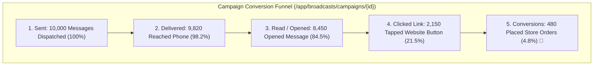
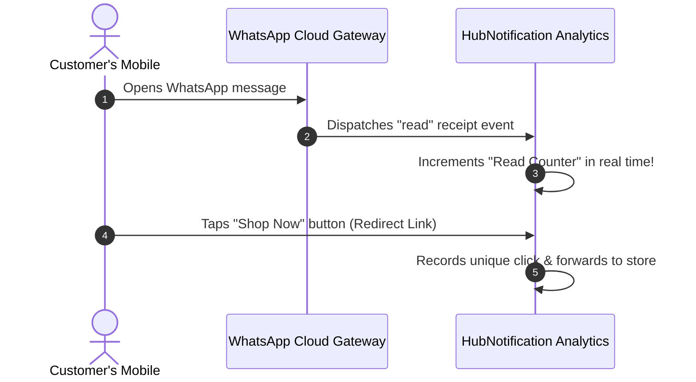

# 📊 Tracking Open Rates, Link Clicks & Campaign Analytics

A marketing campaign does not finish when you press "Send". To maximize return on marketing investment (ROMI), you must measure how many customers actually received, opened, and clicked your messages.

HubNotification provides real-time **Campaign Analytics** (`/app/broadcasts/campaigns/{id}`) with visual delivery funnels, link click counters, and granular delivery logs.

---

## 📈 Key Marketing Metrics Explained

When you open any completed or active campaign, the top dashboard displays five core metric tiles:

| Metric | What It Measures | Target Benchmark |
| :--- | :--- | :---: |
| **Delivery Rate** | Percentage of sent messages that successfully reached the customer's phone or email server. | **95% – 99%** |
| **Read / Open Rate** | Percentage of recipients who actually viewed your message. | **WhatsApp: 80%–95%** Email: 25%–40% |
| **Click-Through Rate (CTR)** | Percentage of readers who tapped an interactive button or tracking link. | **15% – 35%** |
| **Failure Rate** | Messages that bounced due to switched-off phones, invalid numbers, or full mailboxes. | **Under 3%** |
| **Opt-Out / Unsubscribe** | Recipients who replied "STOP" or clicked the email unsubscribe link. | **Under 0.5%** |

---

## 🔍 Understanding the Interactive Funnel Chart

The centerpiece of the analytics screen is the **Visual Funnel Chart**:
* **Step 1 (Sent)**: Total contacts queued from your target segment.
* **Step 2 (Delivered)**: Messages that received positive delivery receipts from WhatsApp or telecom towers.
* **Step 3 (Read)**: Customers who opened the message (tracked via WhatsApp blue double checkmarks or email tracking pixels).
* **Step 4 (Clicked)**: Customers who tapped your **[Visit Website]** CTA button or promo link.

---

## ⚠️ Diagnosing Failed Deliveries

If a campaign shows a failure count, click on the **Delivery Failures Tab** to review the exact reason:

| Error Notice | What It Means in Plain Language | Action to Take |
| :--- | :--- | :--- |
| `invalid_phone_number` | The phone number has too few or too many digits, or is missing a country code. | Verify contact profile and add international prefix (`+91`, `+1`). |
| `user_not_on_whatsapp` | The phone number is active for regular voice calls, but is not registered on WhatsApp. | Switch delivery channel to regular SMS for this contact. |
| `recipient_blocked` | The customer previously blocked your WhatsApp Business Account. | Exclude this contact from future broadcasts. |
| `message_undeliverable` | Customer's phone was switched off or out of network coverage for more than 48 hours. | Retry dispatch during daytime business hours. |

---

## 📥 Exporting Campaign Reports for Management

Need to share campaign results with your executive team or clients?

1. On the campaign analytics page, click the **Export Report (📥)** button in the top right corner.
2. Choose your preferred format:
   * **Summary CSV / Excel**: High-level totals for Sent, Delivered, Read, Clicked, and Cost.
   * **Full Recipient Log**: Detailed table showing every customer's name, phone number, exact delivery timestamp, and read status.
3. The spreadsheet downloads instantly to your computer, ready for executive presentations!

---

## 💡 Pro Tips for Continuous Improvement

> [!TIP]
> **Retarget Customers Who Read but Didn't Click:** In the analytics tab, click **Create Segment from Readers**. You can then launch a gentle follow-up broadcast 2 days later (e.g., *"Did you forget something? Here is an extra 5% off!"*) to capture hesitant buyers!

> [!IMPORTANT]
> **Prune Inactive Contacts:** Regularly remove contacts who have failed delivery across 3 consecutive campaigns to keep your database healthy and reduce messaging costs.

> [!NOTE]
> **Real-Time Click Tracking:** All links inside WhatsApp template buttons and email campaigns are automatically routed through HubNotification's secure link-tracking proxy, recording unique vs. total clicks without slowing down page load times.
