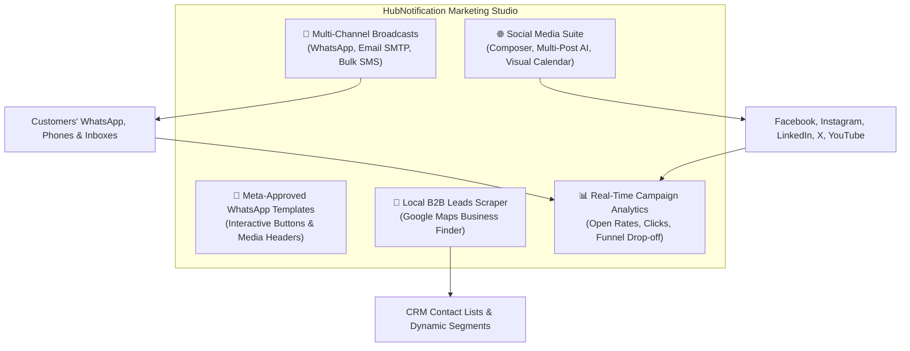

# 📢 Marketing Specialist — Overview & Growth Strategies

Welcome to the **HubNotification Marketing & Campaign Specialist** user guide.

In modern business, sending generic bulk emails is no longer enough. Customers rarely check spam-heavy inboxes, but they open **WhatsApp messages in under 3 minutes with a 98% open rate**. At the same time, brands must maintain an active presence across LinkedIn, Instagram, Facebook, and X (Twitter) without spending hours manually logging into each website.

**HubNotification unites all your outbound marketing channels into one high-powered growth studio.**

---

## 🎯 The Marketer's Mission in HubNotification

As a Marketing Specialist, you use HubNotification to drive customer acquisition, retain existing buyers, and announce company updates:

| Responsibility | Tools Used | Business Outcome |
| :--- | :--- | :--- |
| **Outbound Broadcasts** | `/app/broadcasts/campaigns` | Announce flash sales, holiday discounts, and product launches across thousands of customers simultaneously. |
| **Meta WhatsApp Templates** | `/app/whatsapp/templates` | Create high-converting messages with clickable **[Buy Now]** and **[Visit Website]** interactive buttons. |
| **AI Content Creation** | AI Copywriter & Subject Enhancer | Draft captivating email bodies and high-converting social captions in seconds with zero writer's block. |
| **Social Content Calendar** | `/app/social/composer` & `/calendar` | Schedule a full month of social media posts across Facebook, LinkedIn, X, and Instagram in a single afternoon. |
| **Audience Segmentation** | `/app/segments` | Segment customers by purchase history, location, or tags so you never send irrelevant promotions. |
| **B2B Lead Generation** | `/app/leads` | Discover verified local businesses on Google Maps and import them directly into your outreach database. |

---

## 📅 The Marketer's Weekly Rhythm

### Monday: Planning & Campaign Strategy
* Review performance metrics from last week's broadcasts in **Campaign Analytics**.
* Review the **Social Media Calendar** (`/app/social/calendar`) for the upcoming week and schedule missing posts.
* Check Meta WhatsApp template approval statuses in `/app/whatsapp/templates`.

### Wednesday: Launching Targeted Broadcasts
* Build your audience segment (e.g., *"Customers who bought last month"* or *"Inquiries from Bangalore"*).
* Run a **Test Send** to your personal phone/email to verify formatting, links, and image clarity.
* Schedule the broadcast for optimal customer engagement times (typically 11:00 AM or 7:00 PM).

### Friday: Lead Generation & Audience Growth
* Use the **B2B Leads Scraper** (`/app/leads`) to locate new prospective clients in target cities.
* Push qualified prospects to your **Contacts Directory** with appropriate tags.
* Organize your digital media library (`/app/media`) with new banners and promotional assets.

---

## 💡 Golden Rules for High-Conversion Marketing

> [!TIP]
> **Segment Before You Send:** Never blast your entire customer base with the same message. Sending a men's shoe discount to women buyers causes unsubscribes. Use **Dynamic Segments** to target the exact audience interested in your specific offer.

> [!IMPORTANT]
> **Maintain WhatsApp Quality Rating:** Meta continuously monitors how many recipients block or report your WhatsApp messages. To maintain a **Green Quality Rating**, always include an opt-out option (e.g., *"Reply STOP to unsubscribe"*) and only message customers who have given prior consent.

> [!NOTE]
> **Rate Limit Safety:** HubNotification automatically staggers bulk broadcast dispatches into throttled batches so your WhatsApp numbers and email servers never get flagged for sudden spikes.

---

## 📚 What You Will Master in This Section

1. [Creating WhatsApp, SMS & Email Broadcasts](broadcast-campaigns.md)
2. [Designing Meta-Approved WhatsApp Templates](whatsapp-templates.md)
3. [Generating High-Converting Copy with AI](ai-copywriter.md)
4. [Creating Audience Segments & Previewing Reach](audience-segmentation.md)
5. [Multi-Network Social Media Posting](social-composer.md)
6. [Visual Social Content Calendar & Scheduling](social-calendar.md)
7. [Discovering B2B Leads with Google Maps Scraper](b2b-leads-scraper.md)
8. [Tracking Open Rates, Link Clicks & Campaign Analytics](campaign-analytics.md)
