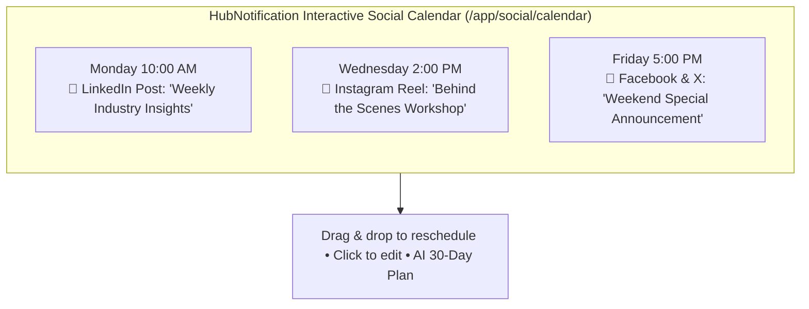
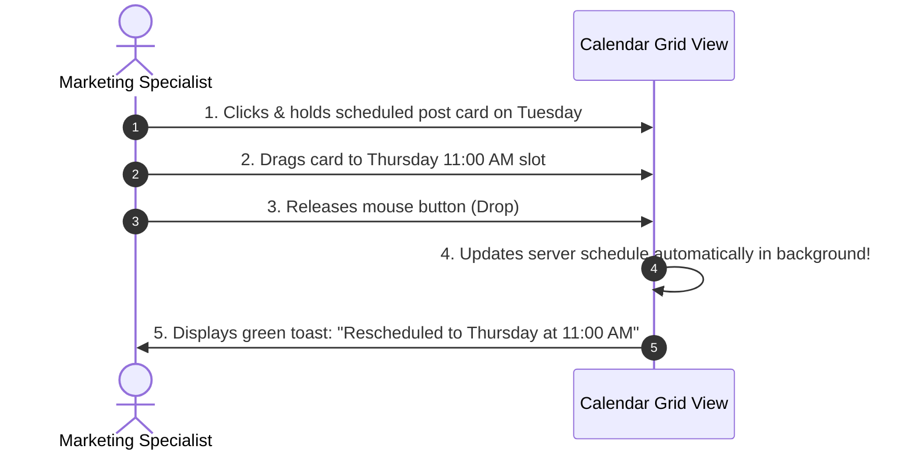

# 📅 Visual Social Content Calendar & Scheduling

Consistency is the secret to social media growth. Posting sporadically every few weeks hurts your reach with social algorithms, while maintaining a steady 3-times-a-week schedule compounds your audience growth over time.

The **Social Calendar** (`/app/social/calendar`) gives you a bird's-eye view of your entire social media strategy across all connected platforms in one beautiful, interactive calendar.

---

## 🧭 Exploring the Interactive Calendar

Navigate to **Social ➔ Calendar** (`/app/social/calendar`):

* **Monthly & Weekly Views**: Toggle between a high-level monthly grid and a detailed hourly weekly planner.
* **Network Filter Checkboxes**: Filter the calendar to display only specific accounts (e.g., view only your *LinkedIn Company Page* or only your *Instagram Feed*).
* **Color-Coded Network Badges**:
  * 📘 **Facebook**: Blue badge.
  * 🟣 **Instagram**: Purple/Magenta badge.
  * 🔷 **LinkedIn**: Navy blue badge.
  * ⚫ **X (Twitter)**: Sleek black badge.
* **Post Status Indicators**:
  * 🟢 **Published**: The post was successfully sent to the network at the scheduled time.
  * 🟡 **Scheduled**: Queued and waiting for its future dispatch date and time.
  * 🔴 **Failed**: Network rejected the post (e.g., expired account token or unreadable video format). Click to view the error and retry.

---

## 🖱️ Drag-and-Drop Rescheduling

Need to change your publishing schedule? You do not need to open complex edit dialogs:

1. Find the scheduled post card on the calendar.
2. Click and hold the card with your mouse.
3. Drag it across the grid to a new date (e.g., move from Tuesday to Friday).
4. Release the mouse. HubNotification updates the background schedule automatically!

---

## 🤖 The AI 30-Day Content Planner (`/app/social/ai-plan`)

If you are unsure what to post throughout the upcoming month, let artificial intelligence plan your calendar for you:

1. In the top bar of the Calendar page, click the purple button labeled **AI Content Planner (🪄)**.
2. Provide your brand context:
   * **Company Industry**: (e.g., *"Real Estate Agency specializing in luxury apartments"*).
   * **Target Goal**: (e.g., *"Build trust with homebuyers and showcase new properties"*).
   * **Posting Frequency**: (e.g., *"3 times a week (Monday, Wednesday, Friday)"*).
3. Click **Generate 30-Day Content Strategy**.
4. The AI builds a balanced calendar strategy:
   * *Mondays*: Educational tips & market trends.
   * *Wednesdays*: Customer success stories & property spotlights.
   * *Fridays*: Interactive polls, team culture, and weekend open-house invites.
5. Review the plan. Click **Populate Calendar** to automatically create scheduled draft slots ready for you to add final photos and approve!

---

## 📋 Managing All Posts in List View (`/app/social/posts`)

If you prefer a clean tabular view to audit, edit, or delete past content:
* Navigate to **Social ➔ Posts** (`/app/social/posts`).
* The table displays:
  * **Thumbnail & Caption Preview**
  * **Target Network(s)**
  * **Scheduled Date & Time**
  * **Published Status**
  * **Actions**: Edit, Publish Immediately, Cancel Schedule, or Delete.

---

## 💡 Best Practices for Social Scheduling

> [!TIP]
> **Maintain an 80/20 Balance:** Follow the golden 80/20 social media rule. 80% of your posts should provide helpful tips, entertainment, or industry insights, and only 20% should be hard sales pitches. Audiences unfollow accounts that constantly scream *"BUY NOW"*.

> [!IMPORTANT]
> **Review Scheduled Posts During Crises:** If major local news or an emergency occurs, review your calendar and pause scheduled humorous or promotional posts so your brand does not appear insensitive.

> [!NOTE]
> **Timezone Precision:** Scheduled posts always fire according to the timezone set in your organization settings (`/app/settings`). Verify that your workspace timezone matches your regional audience.
