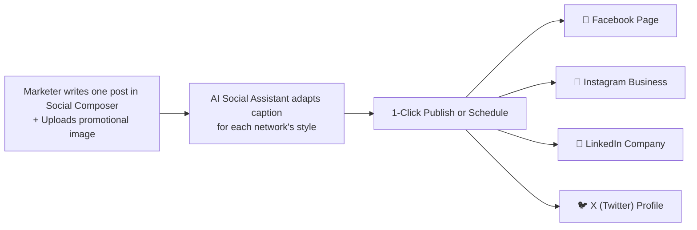

# 🌐 Multi-Network Social Media Posting

Managing company social media channels usually requires logging in and out of four or five different websites every day.

With **HubNotification's Social Suite** (`/app/social`), you can connect your official brand profiles on **Facebook, Instagram, LinkedIn, X (Twitter), YouTube, and TikTok**, compose one post, adapt it for each platform's unique character limits, and publish or schedule it across all networks at once!

---

## 🔗 Connecting Your Brand Accounts

Before posting for the first time, connect your social profiles:

1. Navigate to **Social ➔ Connected Accounts** (`/app/social/accounts`).
2. You will see cards for supported networks:
   * **Facebook & Instagram**: Click **Connect Facebook** ➔ Log into your Facebook account ➔ Select the Facebook Pages and linked Instagram Business accounts you wish to manage.
   * **LinkedIn**: Click **Connect LinkedIn** ➔ Authorize access for your personal profile or company organization page.
   * **Twitter / X**: Click **Connect X** ➔ Authorize the official HubNotification OAuth connection.
   * **YouTube & TikTok**: Connect your official brand channels for video distribution.
3. Once connected, your account cards will display a green **Active** badge showing your profile picture, follower count, and connected status.

---

## ✍️ Composing a Multi-Network Post: Step-by-Step

Navigate to **Social ➔ Composer** (`/app/social/composer`):

### 1. Select Target Accounts
At the top of the composer, click on the profile avatars you want to post to (e.g., select both your **LinkedIn Company Page** and **Instagram Business Account**).

### 2. Write Your Core Caption
* In the central text box, type your announcement or update.
* **Hashtag Suggestions**: Click the hashtag icon (`#`) to see trending industry hashtags.
* **Emoji Picker**: Click 😊 to add visual flair to your text.

### 3. Generate or Enhance with AI
Click the purple **AI Caption Generator (✨)** button:
* Select your objective: *Drive Website Traffic*, *Boost Engagement*, *Announce Product*, or *Hiring/Recruitment*.
* The AI will format your caption with attention-grabbing hooks, clean bullet spacing, and relevant hashtags.

### 4. Upload Visual Media
* Drag and drop photos (`.jpg`, `.png`, `.webp`) or short video clips (`.mp4`).
* HubNotification automatically checks network aspect ratios (e.g., square 1:1 for Instagram feeds, horizontal 16:9 for LinkedIn).

### 5. Fine-Tune Per Network (Tabbed Customization)
Different networks have different rules:
* Click the **X (Twitter)** tab: HubNotification shows a character countdown (280 characters limit). If your text is too long, the AI can automatically condense it to fit the tweet limit without losing key information!
* Click the **LinkedIn** tab: Add professional commentary or tag partner company pages.
* Click the **Instagram** tab: Add up to 30 hashtags and verify your image is properly cropped.

---

## 🚀 Publishing Immediately vs. Scheduling

At the bottom of the composer, choose your dispatch action:

| Button | What Happens |
| :--- | :--- |
| **Publish Now** | HubNotification dispatches the post to all selected networks within seconds. A success banner displays direct links to view the live posts on Facebook, LinkedIn, etc. |
| **Schedule Post** | Pick a specific date and time (e.g., *Thursday at 4:30 PM*). The post is placed in your automated publishing calendar. |
| **Save as Draft** | Saves your work so a team manager or marketing director can review and approve it before going live. |

---

## 💡 Social Posting Pro Tips

> [!TIP]
> **Post When Your Audience is Active:** According to social media data, the best times to post for B2B brands on LinkedIn are **Tuesday through Thursday between 9:00 AM and 11:00 AM**. For consumer retail on Instagram and Facebook, **evening hours (7:00 PM – 9:00 PM)** generate the highest engagement.

> [!IMPORTANT]
> **Instagram Requires a Media Attachment:** Instagram does not support text-only updates. Always include at least one photo or video when scheduling to an Instagram account.

> [!NOTE]
> **Token Expiry Alerts:** Social networks (especially Facebook and LinkedIn) periodically expire authorization tokens for security. If an account shows an orange *"Reconnect"* badge, simply click it to refresh permissions without losing any scheduled posts.
